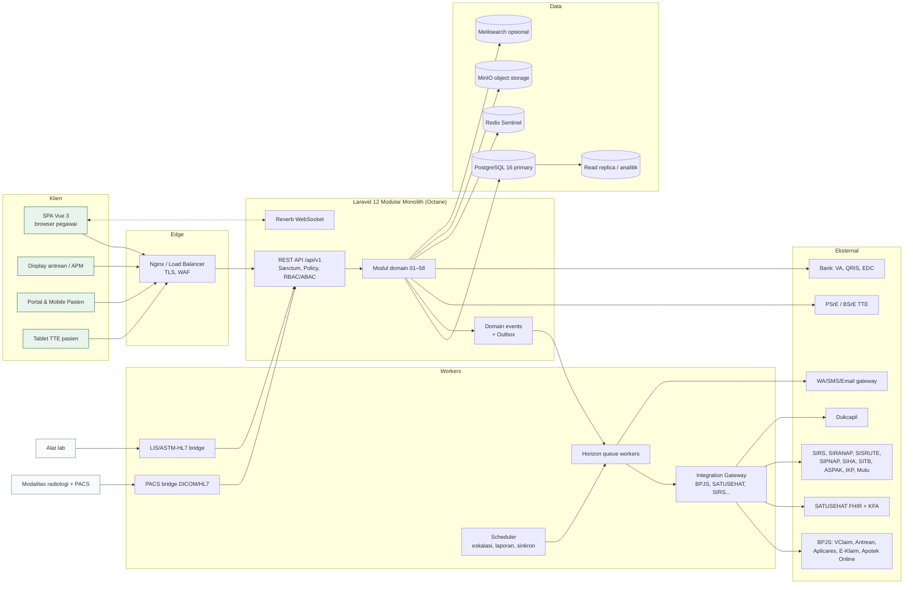
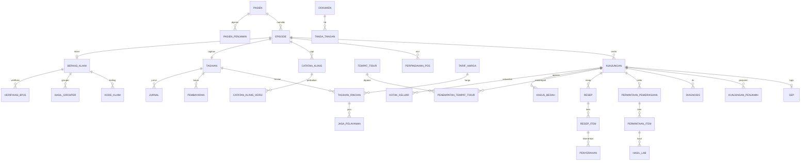
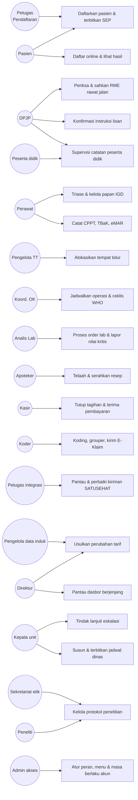

# PRD — Karsitara SIMRS untuk RS Umum Tipe B Pendidikan

*Profil contoh konfigurasi: RS Pendidikan Prof. dr. Chairuddin P. Lubis USU*

**Product Requirements Document · Sistem Informasi Manajemen Rumah Sakit (SIMRS) Paperless**

| Atribut | Nilai |
|---|---|
| Versi dokumen | 0.10.12 |
| Tanggal | 11 Oktober 2026 |
| Penyusun | Eza (Karyasistemnusantara) · disusun bersama Claude |
| Sumber konteks | Lampiran 1 *Visual Layar SIMRS* (15 layar), Lampiran 2 *Visual Dasbor Berjenjang* (7 dasbor + contoh kewenangan), HTML *Dasbor Berjenjang Karsitara*, *Pedoman Identitas USU* (2021) dan folder Logo |
| Tech stack | Laravel 12 (PHP 8.3+) · Vue 3 + TypeScript · PostgreSQL 16 · Valkey (kompatibel Redis) · Laravel Reverb |
| Status | **Produk generik** (3.4). Fase 0 mode produk selesai dengan satu gerbang tertunda: uji SUS (16.1). Keputusan yang biasanya diambil RS dicatat sebagai keputusan produk di 17.2 dan dikonfirmasi tiap RS saat implementasi |
| Riwayat | v0.1 analisis konteks · v0.2 audit regulasi · v0.3 model episode, CPPT lintas pos, rawat jalan multi-poli · v0.4 hak akses sampai tingkat bagian halaman dan per akun (9.2), keamanan rinci (14.2) · v0.5 panduan serah terima ke tim pengembang (Lampiran D), prototipe diselaraskan · v0.6 identitas visual dari Pedoman Identitas USU (5.3) · v0.7 anjungan, perjalanan antrean, menu Rekam Medis · v0.8 token lengkap dan triase, aset logo, role basis data · v0.9 konvensi API (10.3.1), rincian role `simrs_analitik`/`simrs_baca` (11.1) · v0.10 mode produk generik (3.4), Fase 0 tanpa RS (16.1), log keputusan (17.2), aturan UX dari tinjauan heuristik (5.1 butir 9–17), wizard penyiapan dan paket referensi (FR-54-08…10), Lampiran E · v0.10.1 hasil tiket autentikasi: pengecualian skema untuk `simrs_analitik` (11.1), CSRF 403 (10.3.1), penguncian nama fiktif dan sesi (14.2) · v0.10.2 kontrak autentikasi dan MFA (10.3.2) · v0.10.3 header Retry-After (10.3.2) · v0.10.4 nama modul bahasa Indonesia (10.3, 10.4, D.3), menu *Segera hadir* (10.4), alur kerja per halaman (D.5) · v0.10.5 keputusan basis data dan Valkey (10.1), pendaftaran MFA hanya dari jaringan RS (10.3.2), superadmin pertama lewat konsol (FR-54-08) · v0.10.6 responsif dan perangkat (5.5), DoD uji kelas layar (D.7) · v0.10.7 ketahanan beban (14.1.1), DoD endpoint daftar (D.7) · v0.10.8 siapa wajib MFA dan batas kewenangan admin (10.3.2); kontrak API pertama di `docs/api/openapi.yaml` · v0.10.9 penyelarasan dengan implementasi hak akses tiket 1.2a: format kode menu dan izin (9.1), letak Akun & Peran di Pengaturan Sistem (9.1), aturan layar peran dan akun (9.3), kolom tabel `akses` (11.2) · v0.10.10 order penunjang dari semua pos dan pengembalian hasil ke perawat pasien saat ini (7.00.5, 7.19, 7.20), lokasi fisik bertingkat dan pengelolaan kamar/TT (7.08, 7.54, 11.2) · v0.10.11 istilah umum: glosarium 10.3.3, format `error`, `challenge_id`, kolom `email`, *rate limit*, *queue* (tiket 1.0g) · **v0.10.12** kriteria keluar Fase 1 tanpa RS: simulator dan uji kontrak menggantikan sandbox nyata; sandbox nyata menjadi syarat masuk pilot Fase 2 (16, 16.1) |

> **Konvensi penandaan sumber**
> - **[K]** = fitur/aturan tertulis eksplisit di dokumen konteks (Lampiran 1/2/HTML).
> - **[I]** = inferensi/rekomendasi penyusun untuk melengkapi kebutuhan RS Tipe B Pendidikan; **tidak** ada di konteks dan perlu dikonfirmasi pengguna.
> - **[R]** = diturunkan langsung dari teks regulasi yang sudah dibaca dari JDIH BPK (daftar di [15.1](#151-sumber-regulasi-yang-sudah-dibaca)).
> - **[High/Medium/Low confidence]** dipakai untuk klaim regulasi. Semua rujukan regulasi **perlu verifikasi hukum terakhir** sebelum dijadikan dasar kontrak.

---

## Daftar Isi

0. [Temuan Kritis dari Analisis Konteks](#0-temuan-kritis-dari-analisis-konteks)
1. [Ringkasan Produk](#1-ringkasan-produk)
2. [Tujuan, Sasaran, dan Ukuran Keberhasilan](#2-tujuan-sasaran-dan-ukuran-keberhasilan)
3. [Lingkup dan Batasan](#3-lingkup-dan-batasan)
4. [Persona dan Peran Pengguna](#4-persona-dan-peran-pengguna)
5. [Prinsip Produk dan Desain UI (paket identitas; contoh RS USU)](#5-prinsip-produk-dan-desain-ui)
6. [Katalog Modul (01–58)](#6-katalog-modul)
7. [Spesifikasi Fitur per Modul](#7-spesifikasi-fitur-per-modul)
8. [Dasbor Berjenjang (Dasbor 1–7)](#8-dasbor-berjenjang)
9. [Struktur Menu dan Pengaturan Menu per Akun](#9-struktur-menu-dan-pengaturan-menu-per-akun)
10. [Arsitektur Sistem](#10-arsitektur-sistem)
11. [Desain Database](#11-desain-database)
12. [Integrasi Eksternal](#12-integrasi-eksternal)
13. [Use Case](#13-use-case)
14. [Kebutuhan Non-Fungsional](#14-kebutuhan-non-fungsional)
15. [Matriks Kepatuhan Regulasi](#15-matriks-kepatuhan-regulasi)
16. [Rencana Rilis dan Fase](#16-rencana-rilis-dan-fase)
17. [Risiko, Asumsi, dan Pertanyaan Terbuka](#17-risiko-asumsi-dan-pertanyaan-terbuka)
18. [Glosarium](#18-glosarium)

Lampiran: [A. Katalog Formulir RM](#lampiran-a-katalog-formulir-rekam-medis-elektronik) · [B. Alur Tambahan](#lampiran-b-alur-tambahan--perlu-atau-tidak) · [C. Peta Paperless](#lampiran-c-peta-paperless) · [D. Panduan Serah Terima ke Tim Pengembang](#lampiran-d-panduan-serah-terima-ke-tim-pengembang) · [E. Hasil Fase 0](#lampiran-e-hasil-fase-0-mode-produk)

---

## 0. Temuan Kritis dari Analisis Konteks

Bagian ini sengaja diletakkan paling awal. Beberapa hal di konteks **tidak konsisten atau belum lengkap** dan harus diputuskan sebelum desain detail dimulai.

| # | Temuan | Dampak | Rekomendasi |
|---|---|---|---|
| T-1 | **Klasifikasi RS tidak konsisten.** Proyek disebut "Tipe B", tetapi seluruh lampiran menyatakan data disusun menurut profil **"rumah sakit umum kelas C pendidikan dengan 150 tempat tidur"**. Menurut Permenkes 3/2020, RS umum kelas B mensyaratkan minimal ±200 TT dan kelas C minimal ±100 TT [Medium confidence — angka minimal TT dan rezim klasifikasi telah diubah oleh UU 17/2023 & PP 28/2024 yang beralih ke klasifikasi berbasis kemampuan pelayanan; **perlu verifikasi**]. | Volume data, sizing server, jumlah ruang/KSM, kewajiban layanan (mis. bank darah, ICU, PONEK) dan target indikator bisa berbeda. | Konfirmasi klasifikasi resmi RS USU dan jumlah TT riil. PRD ini menyiapkan konfigurasi **tanpa angka tetap**: ruang, TT, poliklinik, KSM semuanya data induk. |
| T-2 | **Nomor modul tidak lengkap.** Konteks merujuk modul 01–54, tetapi nomor 13, 17, 18, 21, 23, 24, 25, 36, 41, 44, 48 tidak pernah disebut namanya. | Risiko modul "hilang" saat penawaran/kontrak. | PRD ini mengisi celah tersebut dengan modul yang lazim wajib di RS Tipe B (ditandai **[I]**) dan menambah 55–58. Harus dicocokkan dengan daftar modul di surat penawaran 001/KSN/SPH/2026. |
| T-3 | **"Permenkes 6/2026 Pasal 33–34"** dikutip sebagai dasar penelitian di RS (Lampiran 2, Dasbor 7). | Saya tidak dapat memverifikasi regulasi ini. **This needs verification.** | Tim legal mengonfirmasi nomor dan isi; bila salah, ganti dengan dasar yang benar (mis. PP 28/2024 dan pedoman KEPPKN). |
| T-4 | **Kelas rawat (I/II/III/VIP)** dipakai di tarif dan tagihan, sementara program **KRIS** (Perpres 59/2024) mengubah standar kelas rawat inap JKN [Medium confidence — jadwal implementasi KRIS telah beberapa kali disesuaikan; **perlu verifikasi live**]. | Struktur tarif, plafon kamar, dan selisih biaya (naik kelas) bisa berubah. | Model data kelas rawat dibuat **dapat dikonfigurasi** (kelas lama + KRIS) dan aturan selisih biaya per penjamin disimpan sebagai aturan, bukan kode. |
| T-5 | **INA-CBG vs iDRG.** Konteks memakai INA-CBG & ICD-10/ICD-9-CM. Kemenkes/BPJS menyiapkan transisi ke **iDRG** dengan ICD-10/ICD-9-CM versi Indonesia (IM) [Medium confidence; **perlu verifikasi live** status per Oktober 2026]. | Modul koding/grouper bisa usang saat go-live. | Grouper dibungkus sebagai adapter (*strategy pattern*) — INA-CBG dan iDRG dapat aktif paralel dengan tanggal berlaku. |
| T-6 | **Pelaporan INM ke "SIMAR".** Konteks menyebut pengiriman INM ke SIMAR. Setahu saya INM dilaporkan melalui aplikasi **Mutu Fasyankes** Kemenkes [Low–Medium confidence]. | Salah target integrasi. | Konfirmasi nama dan endpoint sistem tujuan ke Kemenkes/Komite Mutu. |
| T-7 | **"Full paperless"** berbenturan dengan beberapa dokumen yang secara praktik/regulasi masih butuh bentuk tertentu: resep narkotika/psikotropika, surat kematian, dokumen ke pihak luar yang belum menerima TTE, rekam medis untuk keperluan hukum (visum). | Klaim paperless 100% berisiko tidak patuh. | Target realistis: **paperless untuk alur internal**, dengan **cetak terkendali** (bertanda QR verifikasi TTE) untuk dokumen keluar. Status hukum e-resep narkotika **perlu verifikasi** — Permenkes 5/2023 tidak memuat ketentuan resep elektronik (sudah dicek; lihat 7.57). |
| T-8 | **Konteks berbentuk materi penawaran visual**, bukan spesifikasi. Banyak layar hanya menampilkan kondisi "jalur bahagia". | Alur pengecualian (pasien tanpa identitas, bayi baru lahir, pasien jiwa, korban massal, pasien meninggal, pembatalan SEP, retur obat, refund) tidak tergambar. | Alur pengecualian dirinci di [Lampiran B](#lampiran-b-alur-tambahan--perlu-atau-tidak); perpindahan antar-pos di 7.00. |
| T-9 | Angka di konteks (BOR 82,9%, pendapatan Rp119 M, dll.) adalah **data ilustrasi**. | Tidak boleh dijadikan target/baseline. | Baseline diambil dari data RS riil saat fase discovery. |
| T-10 | **Perbaikan catatan klinis diatur regulasi.** Permenkes 24/2022 Ps. 30 ayat 6–7: perbaikan oleh pemberi pelayanan atau petugas administrasi paling lama **2 × 24 jam** sejak diinput; sesudahnya perbaikan data administratif dengan persetujuan PMIK/pimpinan [High]. | Desain "sah langsung terkunci, hanya adendum" tidak sesuai. | FR-26-06, tabel `klinis.catatan_klinis_versi`, alur B-14. |
| T-11 | **Rujukan Permenkes 3/2015 sudah dicabut** oleh Permenkes 5/2023; Permenkes 5/2023 **tidak mengatur resep elektronik** [High]. | Dasar SIPNAP dan e-resep narkotika keliru. | Matriks 15 diperbarui; konfirmasi tertulis dinkes/BPOM untuk e-resep narkotika (7.57). |
| T-12 | **Resume wajib diberikan ke pasien rawat inap dan rawat darurat saat pulang**, boleh elektronik (Permenkes 24/2022 Ps. 26 ayat 8 dan 11) [High]. | Fitur pengiriman ke pasien belum ada. | FR-05-08, alur B-15. |
| T-13 | **Episode klaim diatur Pedoman INA-CBG** (Permenkes 26/2021): beberapa poli di hari yang sama = 1 episode rawat jalan; rawat inap lanjutan dari poli/IGD di hari yang sama = 1 episode rawat inap; episode rawat inap mencakup ruang intensif dan ruang operasi [High]. | Kunjungan, CPPT, tagihan, dan klaim harus berbasis episode, bukan per unit. | Bagian 7.00, 7.07.1, 7.26.1, tabel `kunjungan.episode`. |
| T-14 | **TTE di RME bersifat "dapat"** (Permenkes 24/2022 Ps. 31) dan TTE tidak tersertifikasi sah bila memenuhi PP 71/2019 Ps. 59 ayat 3 [High]. | Memakai TTE tersertifikasi untuk semua catatan mahal dan rapuh. | TTE tiga tingkat (7.57). |
| T-15 | **UU PDP**: data kesehatan = data spesifik; penilaian dampak dan pejabat PDP wajib; pemberitahuan kebocoran ≤ 3 × 24 jam (UU 27/2022 Ps. 4, 34, 46, 53) [High]. | Belum ada alur kebocoran data. | Alur B-21, tabel `mutu.insiden_data_pribadi`. |

---

> **Keputusan produk untuk T-1–T-9** (Fase 0 tanpa RS) ada di [17.2](#172-log-keputusan-fase-0-dan-konfirmasi-rs). Kolom *Rekomendasi* di atas tetap menjadi pertanyaan konfirmasi ke setiap RS pengguna.

## 1. Ringkasan Produk

**Karsitara SIMRS** adalah produk generik untuk RS umum Tipe B pendidikan. RS Pendidikan USU dipakai sebagai profil contoh konfigurasi (identitas, struktur unit, contoh layar), bukan sebagai satu-satunya pengguna. Produk mencakup **alur pasien (front-office s.d. pulang), penunjang, pendapatan & klaim, keuangan BLU, SDM & kredensial, logistik & aset, mutu & keselamatan, pendidikan klinis, penelitian & uji klinik, integrasi nasional, dan dasbor berjenjang**, dalam satu basis data transaksi.

### 1.1 Prinsip yang diturunkan dari konteks [K]

1. **Satu sumber data.** Pelayanan, tagihan, klaim, akuntansi, mutu, dan laporan membaca transaksi yang sama — "unit yang berbeda membawa angka yang sama ke ruang rapat".
2. **Tanpa entri ulang.** VClaim, Antrean Online, SATUSEHAT, SIRANAP/Aplicares, E-Klaim dijalankan dari layar kerja; hasil alat lab masuk via antarmuka alat; tagihan terbentuk dari pencatatan unit.
3. **Indikator terbentuk dari pekerjaan.** Waktu tanggap, lama di IGD, pelaporan nilai kritis, penundaan operasi, kepatuhan formularium dihitung dari stempel waktu transaksi, bukan formulir terpisah.
4. **Pekerjaan tertinggal dikejar sistem.** Tugas berjenjang: pengingat → teguran kepala unit → eskalasi kepala bidang → dasbor Direktur.
5. **Pengesahan elektronik berlapis.** Draf (perawat/peserta didik) → supervisi → pengesahan DPJP dengan PIN (TTE T1, 7.57) → masa perbaikan dan penguncian sesuai FR-26-06.
6. **Data induk berpemilik.** Setiap data induk punya pemilik, pemverifikasi, versi, tanggal berlaku, dan jejak perubahan; tarif berubah hanya lewat usulan berjenjang.
7. **Kewenangan per peran, bukan per orang.** Angka (mis. rupiah) dibuka/ditutup menurut matriks kewenangan; permintaan akses tercatat.
8. **RS Pendidikan.** Akun peserta didik berbatas waktu rotasi, catatan peserta didik masuk antrean supervisi, penelitian berjalan dalam alur etik dan izin Direktur, data riset keluar dalam bentuk agregat / de-identifikasi / berkode.

---

## 2. Tujuan, Sasaran, dan Ukuran Keberhasilan

| Kode | Tujuan | Ukuran keberhasilan (target awal, disesuaikan baseline) |
|---|---|---|
| G-1 | Paperless alur klinis internal | ≥ 95% dokumen rekam medis tersusun & ditandatangani elektronik dalam 6 bulan go-live |
| G-2 | Kepatuhan integrasi nasional | Kiriman SATUSEHAT berhasil ≥ 99% per hari; SEP terbit dari SIMRS ≥ 99%; task ID antrean 1–7 lengkap ≥ 98% [K: angka contoh 99,2–99,7%] |
| G-3 | Pendapatan & klaim | Berkas klaim lengkap sebelum tenggat ≥ 98%; pending+dispute turun; kecocokan tagihan–laporan penjamin terpantau bulanan |
| G-4 | Mutu | 13 INM terhitung otomatis; RM lengkap ≤ 24 jam ≥ 95% |
| G-5 | Efisiensi kerja | Pendaftaran pasien lama ≤ 2 menit; resep nonracikan ≤ 30 menit, racikan ≤ 60 menit [K] |
| G-6 | Tata kelola | 100% perubahan data induk melalui usulan & jejak audit; 100% akses rekam medis tercatat |
| G-7 | Pendidikan & penelitian | 100% akun peserta didik berbatas rotasi; 100% protokol penelitian melalui alur etik dalam sistem |
| G-8 | Kemudahan | SUS (System Usability Scale) ≥ 75 pada uji pengguna; ≤ 3 klik untuk 80% tugas harian |

---

## 3. Lingkup dan Batasan

### 3.1 Dalam lingkup
Seluruh modul pada [Bagian 6](#6-katalog-modul) (01–58), dasbor berjenjang, pengaturan menu & kewenangan per akun, integrasi pada [Bagian 12](#12-integrasi-eksternal), migrasi data, pelatihan, dan dukungan pasca go-live.

### 3.2 Di luar lingkup (kecuali disepakati)
- Perangkat keras medis dan driver alat (hanya antarmuka/bridge).
- PACS penuh (SIMRS terhubung ke PACS; penyediaan PACS [I] bisa memakai Orthanc/vendor terpisah).
- Sistem akademik fakultas mitra (contoh: FK USU); SIMRS hanya bertukar data rotasi & penilaian.
- ERP penggajian penuh (SIMRS menyediakan data jasa pelayanan & kehadiran ke sistem gaji) — **perlu keputusan**.

### 3.3 Asumsi
- RS berstatus **BLU** (konteks memakai SAP-BLU, RBA, PER-36/PB/2016) [K].
- RS punya akses resmi BPJS (cons-id, secret, user key) dan SATUSEHAT (organization ID, client id/secret).
- Pengesahan harian memakai TTE tidak tersertifikasi berbasis PIN (T1); TTE tersertifikasi lewat PSrE (mis. Privy, Peruri, VIDA, BSrE) hanya untuk dokumen keluar RS dan bernilai hukum tinggi (T2) — lihat 7.57 [I].

### 3.4 Mode produk generik [I]

| Aturan | Isi |
|---|---|
| **Satu instalasi = satu RS** | Tidak multi-tenant dalam satu database. Setiap RS punya database, kunci enkripsi, cadangan, dan log audit sendiri. Alasan: pemisahan data rekam medis dan tanggung jawab pengendali data per RS (UU PDP) lebih sederhana dibuktikan. |
| **Instalasi kosong** | Instalasi baru tidak berisi data RS apa pun. Isi pertama datang dari wizard penyiapan (FR-54-08) dan paket data referensi nasional (FR-54-09). |
| **Beda antar-RS = konfigurasi** | Struktur unit, TT, kelas rawat, tarif, alur persetujuan, batas waktu tugas, dokumen T1/T2, modul aktif, dan indikator adalah data induk atau aturan. **Dilarang** cabang kode per RS (`if rs == ...`) dan fork per pelanggan. |
| **Modul aktif per instalasi** | Modul 01–58 dinyalakan per instalasi dan per unit (feature flag, tabel `inti.modul_aktif`). Modul inti fase 1–2 tidak bisa dimatikan. |
| **Identitas RS** | Nama, logo, kop, dan warna `--brand-*`/`--accent` diisi dari paket identitas per instalasi (`inti.profil_rs`). Token lain (status, triase, netral) tetap milik produk agar keselamatan visual sama di semua RS. Paket bawaan = Karsitara; paket RS USU adalah contoh. Logo RS USU **tidak boleh** dipakai di demo publik atau materi pemasaran tanpa izin tertulis USU. |
| **Data demo** | Hanya sintetis, dari seeder terpisah yang ditolak berjalan bila `APP_ENV=production` (FR-54-10). |
| **Validasi lapangan** | Keputusan di 17.2 diambil tanpa RS; setiap RS pertama (*design partner*) wajib meninjaunya sebelum pilot fase 2 (16.1). |

---

## 4. Persona dan Peran Pengguna

Daftar peran berikut menjadi **template peran** di modul Kendali Akses (54). Setiap akun dapat memiliki ≥ 1 peran, dengan cakupan data (unit/KSM/ruang) dan masa berlaku.

### 4.1 Pelayanan klinis
| Kode peran | Peran | Sumber |
|---|---|---|
| R-PDF | Petugas pendaftaran & admisi | [K] |
| R-DJG | Dokter jaga IGD | [K] |
| R-PIG | Perawat IGD / triase | [K] |
| R-KIG | Kepala IGD | [K] |
| R-DPJ | Dokter spesialis / DPJP | [K] |
| R-DGI | Dokter gigi | [I] |
| R-PPL | Perawat poliklinik | [K] |
| R-PRI | Perawat ruang rawat inap (pelaksana, ketua tim) | [K] |
| R-KRU | Kepala ruang / kepala unit rawat inap | [K] |
| R-BDN | Bidan | [I] |
| R-MPP | Manajer Pelayanan Pasien (case manager) | [K] |
| R-PTT | Pengelola tempat tidur (bed manager) | [K] |
| R-KOK | Koordinator kamar operasi | [K] |
| R-OPR | Operator bedah | [K] |
| R-ANS | Dokter anestesi & penata anestesi | [K] |
| R-APK | Apoteker klinis | [K] |
| R-APT | Apoteker depo | [K] |
| R-TTK | Tenaga teknis kefarmasian | [K] |
| R-GZI | Ahli gizi / dietisien | [K] |
| R-ANL | Analis / ATLM laboratorium | [K] |
| R-DPK | Dokter patologi klinik | [K] |
| R-RDG | Radiografer | [K] |
| R-DRD | Dokter radiologi | [K] |
| R-FIS | Fisioterapis / terapis rehab medik | [I] |
| R-HDN | Perawat hemodialisa | [I] |
| R-PPD | Peserta didik: PPDS, dokter muda/koas, mahasiswa keperawatan, farmasi, dll. | [K] |
| R-SUP | Supervisor klinis / dosen pembimbing | [K] |

### 4.2 Pendapatan & keuangan
| Kode | Peran | Sumber |
|---|---|---|
| R-KSR | Kasir | [K] |
| R-TGH | Petugas penagihan (piutang) | [K] |
| R-KDR | Koder (PMIK/RMIK) | [K] |
| R-VRF | Verifikator internal / tim casemix | [K] |
| R-AKT | Bagian Akuntansi | [K] |
| R-ANG | Bagian Anggaran | [I] |
| R-KBK | Kepala Bidang Keuangan | [K] |
| R-REM | Pengelola remunerasi / jasa pelayanan | [K] |

### 4.3 Tata kelola & penunjang manajemen
| Kode | Peran | Sumber |
|---|---|---|
| R-DIR | Direktur Utama / Direktur | [K] |
| R-WDR | Wakil Direktur / Kepala Bidang (Yanmed, Keperawatan, Penunjang, Umum) | [K] |
| R-DWS | Dewan Pengawas | [K] |
| R-KMD | Komite Medik (subkomite kredensial, mutu profesi, etik) | [K] |
| R-KKP | Komite Keperawatan | [K] |
| R-KTK | Komite Tenaga Kesehatan Lain | [I] |
| R-KMT | Komite Mutu / PMKP | [K] |
| R-PPI | Komite PPI / IPCN | [K] |
| R-PRA | Komite/Tim PPRA | [K] |
| R-HMS | Humas & pengaduan | [K] |
| R-SDM | Bagian SDM / kepegawaian | [K] |
| R-LOG | Logistik / gudang umum | [K] |
| R-PGD | Unit Pengadaan / ULP | [K] |
| R-IPS | IPSRS / teknisi elektromedis | [K] |
| R-RMK | Kepala/petugas Rekam Medis | [K] |
| R-INT | Petugas integrasi / TI | [K] |
| R-MDI | Pengelola data induk | [K] |
| R-KEP | Sekretariat Komite Etik Penelitian | [K] |
| R-PNL | Peneliti (dosen, PPDS, mahasiswa, eksternal, sponsor) | [K] |
| R-PDP | Petugas Pelindungan Data Pribadi (DPO) | [K] |
| R-PPN | Pengelola data riset | [K] |
| R-TBH | Tim program TB / HIV | [K] |
| R-SKD | Sekretariat Direksi | [K] |
| R-AUD | Satuan Pemeriksa Internal (SPI) / auditor | [I] |
| R-ADM | Superadmin sistem (Instalasi SIMRS): mengelola menu, peran, dan akun atas dasar kebijakan pimpinan; tanpa akses data klinis/rupiah bawaan (9.2.4) | [I] |
| R-PSN | Pasien / keluarga (portal) | [I] |

---

## 5. Prinsip Produk dan Desain UI

### 5.1 Prinsip UX
1. **Satu kolom pencarian global** di header: menerima nama + tanggal lahir, No. RM, NIK, No. kartu BPJS [K]. Shortcut `/` atau `Ctrl+K`.
2. **Kerja dari daftar kerja (worklist), bukan dari menu.** Setiap modul membuka antrean/papan tugas yang relevan dengan peran.
3. **Pilih, jangan ketik.** "Diagnosa Rutin" dan "Obat Rutin" per dokter, template SOAP, paket order [K].
4. **Status selalu terlihat** dengan label teks + warna (bukan warna saja — aksesibilitas).
5. **Angka bernomor (callout)** hanya di materi pelatihan; di produksi diganti tooltip *"Kenapa ini muncul?"*.
6. **Tidak ada dialog berlapis.** Panel samping (drawer) untuk detail; modal hanya untuk konfirmasi tindakan berisiko (pengesahan, pembatalan, pembayaran).
7. **Keamanan klinis di depan:** banner alergi, risiko jatuh, subjek uji klinik, DNR, isolasi tampil konsisten di header pasien [K].
8. **Keyboard-first** untuk pendaftaran, kasir, koding, farmasi.

Butir 9–17 ditambahkan dari tinjauan heuristik Fase 0 (Lampiran E). Semuanya syarat terima komponen bersama, bukan saran.

9. **Dua penanda identitas di semua titik pasien.** Setiap daftar, pemilih (dropdown), papan, ceklis, dan modal yang menyangkut satu pasien menampilkan **nama lengkap + No. RM + tanggal lahir**. Inisial hanya untuk layar publik (antrean, display). Pasien berinisial atau bernama mirip dalam satu daftar diberi penanda *nama mirip*.
10. **Modal TTE menyebut apa dan siapa.** Modal `TtdModal` memuat pasien (butir 9), jenis dokumen, ringkasan isi, dan nama penanda tangan **sama dengan akun yang login**. Menandatangani atas nama orang lain tidak mungkin; yang ada hanya *minta tanda tangan* ke kotak kerja orang tersebut.
11. **Aksi tak terbalikkan dikonfirmasi dengan objeknya.** Disposisi meninggal/pulang/APS, kirim klaim, rilis data, finalisasi koding, tetapkan HAIs, penyerahan obat: konfirmasi menyebut pasien atau jumlah berkas, alasan bila relevan, dan dokumen wajib (misal formulir APS) sebelum aktif.
12. **Aksi massal tidak menelan peringatan.** "Centang semua", "setujui semua", dan sejenisnya tidak pernah mencakup butir berstatus peringatan atau perlu perhatian; butir itu diputuskan satu per satu dengan alasan.
13. **Validasi di field, bukan hanya toast.** Format identitas (NIK 16 digit, kartu BPJS 13 digit), rentang fisiologis dan angka stok divalidasi di klien dan server. Batas rentang berasal dari data induk, bukan kode. Field yang salah ditandai dan diberi pesan di dekatnya.
14. **Data yang sudah mengunci tidak bisa berubah diam-diam.** Setelah SEP terbit, resep disahkan, atau hasil divalidasi, mengubah data pengunci (poli, dokter, penjamin, item) hanya lewat aksi eksplisit (*ubah/batal SEP*, *adendum*) dengan peringatan dampaknya.
15. **"Tidak ada" berbeda dengan "belum dikaji".** Contoh alergi: *Tidak ada alergi diketahui* tampil netral dan eksplisit; *Belum dikaji* tampil sebagai peringatan; alergi nyata tampil merah dengan ikon. Teks status tidak boleh dipotong menjadi label yang bermakna lain.
16. **Persetujuan hanya untuk penyetuju yang dituju.** Tombol setujui/berikan/rilis hanya dirender untuk akun yang menjadi penyetuju sah (lapis aksi 9.2). Memulihkan akses yang dicabut adalah perubahan akses biasa: beralasan, tercatat, dan mengikuti 9.2.4.
17. **Aksesibilitas modal dan tabel.** Fokus pindah ke modal saat dibuka dan kembali saat ditutup, `Esc` menutup modal (kecuali saat memproses), ada tautan *lewati ke konten*, dan baris tabel yang bisa dipilih dapat dijangkau keyboard. Panel pengembang tidak pernah menutupi tombol aksi.

### 5.2 Tata letak (diturunkan dari Lampiran 1) [K]
```
┌─────────────────────────────────────────────────────────────────────┐
│ Karsitara│ Judul layar     [ Cari pasien: nama, RM, NIK, BPJS ]  👤  │  ← Header 60px
├──────────┬──────────────────────────────────────────────────────────┤
│ PELAYANAN│ Breadcrumb: Rawat Jalan / Poliklinik Penyakit Dalam       │
│ Beranda  │ ┌─ Header pasien (nama, umur, RM, penjamin, alergi) ────┐ │
│ Pendaftar│ │ chip: Risiko jatuh · Alergi · Prolanis · Uji klinik    │ │
│ IGD      │ └───────────────────────────────────────────────────────┘ │
│ R. Jalan │  KPI strip (3–5 kartu angka)                              │
│ R. Inap  │  ┌────────── Konten utama ─────────┐ ┌─ Panel kanan ─────┐│
│ K.Operasi│  │ tabel / form / linimasa         │ │ ringkasan/aksi    ││
│ Penunjang│  └─────────────────────────────────┘ └───────────────────┘│
│ Farmasi  │                                                          │
│PENDAPATAN│                                                          │
│ Kasir    │                                                          │
│ Casemix  │                                                          │
│TATA KELOL│                                                          │
│ Mutu ... │  Footer: tanggal-jam server · unit aktif · versi          │
└──────────┴──────────────────────────────────────────────────────────┘
```
Sidebar 248px (collapsible ke 64px ikon), hanya menampilkan menu yang diizinkan untuk akun. Bagian atas sidebar memuat logo Karsitara; di bawahnya kartu RS berisi logo RS USU dan nama resmi rumah sakit (5.3.1).

### 5.3 Identitas visual dan design token

> **Paket identitas RS USU (contoh).** Seluruh 5.3.1–5.3.2 di bawah adalah isi paket identitas untuk instalasi RS USU (3.4). Untuk RS lain, logo dan warna `--brand-*`/`--accent` diganti dari wizard penyiapan; aturan kontras, token status, triase, dan netral tetap berlaku untuk semua paket.

**Sumber:** *Pedoman Identitas Universitas Sumatera Utara* (2021, 44 halaman) dan file logo resmi di folder `Logo` (Karsitara, Karya Sistem Nusantara, RS USU). Pedoman itu ditulis untuk komunikasi universitas (logo, cetak, presentasi), **bukan untuk antarmuka aplikasi**. Jadi warna dan huruf diturunkan dari pedoman, sedangkan aturan aplikasi (kontras, status, triase) ditambahkan di sini [I].

#### 5.3.1 Logo

| Logo | Dipakai di | Aturan |
|---|---|---|
| **Karsitara** (`Artboard 4.png`; versi putih `Karsitara_Putih.png`) | Sidebar atas, halaman masuk | Logo produk. Tidak diubah warna atau rasionya; versi putih hanya di latar gelap |
| **RS USU** (`RS USU.png`) | Kartu RS di sidebar, halaman masuk, kop dokumen keluar | Logo pemilik layanan, selalu bersama nama resmi RS |
| **Karya Sistem Nusantara** (`KSN_Logo.png`) | Kaki halaman masuk ("Dikembangkan oleh") | Tidak tampil di layar kerja |
| **Lambang USU** | **Tidak dipakai di aplikasi** | Pedoman 1.2: lambang hanya untuk keperluan legal dan seremonial (ijazah, sertifikat, SK) |

- Jarak aman minimal ¼ tinggi lambang di sekeliling logo dan jarak ≥ 10 mm dari tepi pada dokumen cetak (pedoman 1.10–1.11).
- Ukuran minimal logo pada dokumen cetak: 10–20 mm sesuai variasi (pedoman 1.9).
- **Dilarang** mengubah rasio, warna, rotasi, memotong, memberi bayangan atau emboss (pedoman 1.12).
- **File asli** disimpan di repo `docs/brand/` dan tidak dimuat aplikasi. Aplikasi memakai **versi web**: SVG bila tersedia, atau PNG tinggi 64 px (dua kali ukuran tampil) di bawah 20 KB per file di `frontend/public/logo/`. File asli PNG 10.000 px (± 300 KB) tidak boleh dimuat di layar kerja (anggaran kinerja 14.1).
- **Perlu dari klien:** logo RS USU dalam format vektor (SVG/AI). File yang ada hanya PNG 512 px, cukup untuk layar tetapi kurang tajam untuk kop dan cetak.

#### 5.3.2 Warna

Warna formal dan kasual pedoman (hal. 30–31). Nilai HEX diambil dari tampilan pedoman; **dua HEX tercetak tidak cocok dengan RGB-nya**: Pantone 349 C tertulis `#006973` padahal RGB 0/105/55 = `#006937` (yang tampil di pedoman), dan beberapa HEX formal berbeda tipis dari RGB-nya. Sistem memakai warna yang tampil di pedoman [Medium confidence — perlu konfirmasi bagian Humas/Promosi USU].

| Token | Nilai | Asal | Pemakaian | Kontras |
|---|---|---|---|---|
| `--brand-600` | `#006937` | Pantone 349 C (kasual) | Tombol utama, menu aktif, tautan | putih di atasnya 6,8:1 |
| `--brand-800` / `--brand-900` | `#004A27` / `#0B3A22` | turunan 349 C | Teks di latar hijau muda, panel gelap | — |
| `--brand-50` / `--brand-25` | `#E8F4EC` / `#F4FAF6` | turunan | Latar item aktif, baris terpilih | teks `--brand-600` 6,0:1 |
| `--usu-gelap` | `#135851` | latar halaman pembatas pedoman | Panel merek (halaman masuk) | putih 8,3:1 |
| `--usu-hijau` | `#487629` | Pantone 364 C (formal) | Kop dokumen dan cetak | — |
| `--accent` (`--usu-emas`) | `#F3C300` | Pantone 7406 C (formal) | **Isian saja**: garis penanda, badge notifikasi, aksen kartu RS | teks hitam di atasnya 10,1:1 |
| `--accent-ink` | `#7A5A00` | turunan emas | Teks bernuansa emas | 6,4:1 |
| `--usu-kuning` | `#FAE345` | Pantone 106 C | Teks penekanan di latar gelap | 6,3:1 pada `#135851` |
| `--text` | `#1D1D1B` | Pantone Black | Teks utama | — |
| `--muted` / `--subtle` | `#565C63` / `#686E75` | netral | Label, metadata | ≥ 4,5:1 |
| `--danger` | `#C21E15` | turunan Pantone 485 C (`#E1251B`) | Kritis, gagal | 6,0:1 (`#E1251B` hanya 4,7:1 dan gagal di latar merah muda) |
| `--warn` / `--warn-bg` | `#8A5A00` / `#FFF4D6` | turunan Pantone 137 C | Mendekati batas | 5,4:1 |
| `--success` / `--success-bg` | `#187A3E` / `#E7F5EC` | hijau fungsional | Selesai, normal | 4,8:1 |
| `--info` / `--info-bg` | `#2457C5` / `#EAF1FF` | **tidak ada di pedoman** [I] | Informasi | 5,7:1 |
| `--brand-700` / `--brand-500` / `--brand-100` | `#005A2F` / `#1F8A4C` / `#CDE7D6` | turunan 349 C | Hover tombol utama; tepi fokus; garis tipis bernuansa hijau | `--brand-500` di putih 4,4:1, **jangan untuk teks kecil** |
| `--danger-bg` | `#FDECEA` | turunan | Latar pesan/badge kritis | teks `--danger` 5,3:1 |
| `--accent-bg` | `#FEF6D6` | turunan emas | Latar penanda bernuansa emas | teks `--accent-ink` 5,9:1 |
| `--usu-merah` / `--usu-hitam` | `#E1251B` / `#1D1D1B` | Pantone 485 C / Black | Dokumen cetak dan kop; bukan untuk status di layar | — |

**Permukaan, garis, dan fokus** [I — diturunkan untuk antarmuka, tidak ada di pedoman]:

| Token | Nilai | Pemakaian | Catatan kontras |
|---|---|---|---|
| `--bg` | `#F6F7F6` | Latar halaman | teks `--muted` 6,3:1 |
| `--surface` | `#FFFFFF` | Kartu, tabel, panel | — |
| `--border` | `#E4E7E5` | Garis pemisah kartu/tabel (dekoratif) | tidak dipakai sebagai satu-satunya penanda batas kontrol |
| `--border-strong` | `#C9CFCB` | Garis pemisah tegas, kotak centang nonaktif | 1,6:1, **tidak cukup untuk tepi input** |
| `--border-input` | `#858B91` | **Tepi input, select, dan tombol sekunder** | 3,4:1 di putih, 3,2:1 di `--bg` (WCAG 2.1 SC 1.4.11 minimal 3:1) |
| `--ring` | `0 0 0 3px rgba(0,105,55,.25)` + tepi `--brand-600` | Fokus keyboard | tepi `--brand-600` 6,8:1 |

**Triase** [I — nilai diusulkan, standar kategori dari [K]]; hanya dipakai di papan IGD, triase, dan penanda kategori triase:

| Token | Nilai | Teks di atasnya | Kontras |
|---|---|---|---|
| `--triase-merah` | `#C21E15` | putih | 6,0:1 |
| `--triase-kuning` | `#FACC15` | `#1D1D1B` | 11,0:1 |
| `--triase-hijau` | `#187A3E` | putih | 5,4:1 |
| `--triase-hitam` | `#1D1D1B` | putih | 16,9:1 |

Kuning triase dan emas USU hampir tidak bisa dibedakan (1,1:1), karena itu aturan butir 3 di bawah wajib.

**Risiko dan aturan pakai:**
1. **Hijau merek dan hijau "berhasil" berdekatan.** Status tidak boleh bergantung pada warna saja: selalu ada teks dan ikon (5.1 butir 4). Tombol utama hijau solid; status berhasil berupa badge hijau muda dengan ikon centang.
2. **Emas USU tidak lolos kontras sebagai teks** (1,7:1 di latar putih). Emas hanya untuk isian dan garis; teks memakai `--accent-ink`.
3. **Emas dan kuning triase mudah tertukar.** Di layar IGD dan papan triase, emas merek tidak dipakai sama sekali.
4. Motif grafis pedoman (Pengabdian, Ulos, Melayu, dan lain-lain; file `PATTERN DESIGN USU.ai`) hanya dipakai di halaman masuk, layar tunggu antrean, dan cetak. **Tidak dipakai di layar kerja klinis**, agar tetap tenang dan mudah dibaca.

#### 5.3.3 Huruf, ukuran, dan lain-lain

| Token | Nilai |
|---|---|
| Huruf UI | **Public Sans** (pedoman 2.1), berat 400/500/600/700; cadangan `system-ui` |
| Huruf kode | JetBrains Mono untuk No. RM, kode ICD, nomor SEP (pedoman tidak mengatur huruf monospace) [I] |
| Ukuran | dasar 14px; tabel 13px; judul halaman 22px |
| Radius | 12px kartu, 8px input dan tombol |
| Spasi | skala 4px (4, 8, 12, 16, 24, 32) |
| Bayangan | sangat tipis (`0 1px 2px rgb(0 0 0 / .05)`) |
| Mode gelap | **Ditunda** setelah go-live pertama (fase 2). Dibutuhkan untuk ruang gelap (radiologi, ICU malam) [I]; nilainya dirancang dan diuji kontras tersendiri, bukan inversi otomatis |

Kontras teks minimum WCAG 2.1 AA (4.5:1). Angka memakai `font-variant-numeric: tabular-nums`. Format Indonesia: `Rp 1.950.000`, `36,7 °C`, tanggal `2 Oktober 2026`, jam `10.30 WIB` [K].

Prototipe HTML sudah memakai token ini. Di kode produksi, token disimpan di satu file `design-system/tokens.css` (10.4) dan tidak boleh ada warna HEX langsung di komponen.

### 5.4 Komponen UI inti (Vue)
`AppShell`, `SidebarMenu` (dinamis dari API menu), `GlobalPatientSearch`, `PatientHeader` (+ `SafetyChips`), `KpiCard`, `DataTable` (virtual scroll, filter, kolom tersimpan per user), `StatusBadge`, `Timeline` (CPPT), `BedMapGrid`, `TriageBoard`, `GanttSchedule` (OK), `ChecklistStepper` (WHO surgical safety, telaah resep), `TtdModal` (T1 PIN / T2 PSrE), `ApprovalFlow` (usulan berjenjang), `TaskInbox`, `EscalationBadge`, `IcdPicker`, `DrugPicker` (Fornas/KFA, generik vs paten + harga), `ChartPanel` (ECharts), `AuditTrailDrawer`, `EmptyState`, `PermissionGate` (komponen/directive `v-can`).

---

### 5.5 Responsif, tablet, dan perangkat

Satu kode SPA untuk semua ukuran layar; tata letak menyesuaikan lebar, bukan aplikasi terpisah per perangkat.

| Kelas layar | Lebar | Perangkat umum | Tata letak |
|---|---|---|---|
| Desktop | ≥ 1280 px | Komputer loket, kasir, casemix, manajemen | Sidebar 248 px + konten + panel kanan (5.2) |
| Tablet mendatar | 1024–1279 px | Tablet 10–13" di ruang rawat, IGD, kamar operasi | Sidebar ringkas 64 px (ikon + tooltip); panel kanan menjadi laci (*drawer*) |
| Tablet tegak | 768–1023 px | Tablet di samping tempat tidur, TTE pasien | Sidebar menjadi menu laci; satu kolom; header pasien tetap terlihat (sticky) |
| Ponsel | < 768 px | Ponsel pribadi pegawai | **Terbatas**: masuk, MFA, kotak kerja ringkas, notifikasi, konfirmasi instruksi lisan (TBaK), persetujuan. Form klinis panjang tidak dioptimalkan untuk ponsel dan menampilkan saran memakai tablet/komputer |

**Matriks layar ↔ perangkat utama** (layar yang wajib diuji di kelas tersebut):

| Kelas utama | Layar |
|---|---|
| Tablet (mendatar dan tegak) | eMAR dan pemberian obat di samping tempat tidur, CPPT bangsal, triase dan papan IGD, ceklis keselamatan operasi, tanda tangan pasien/wali (7.57), asesmen keperawatan |
| Desktop dan tablet mendatar | Rawat jalan, pendaftaran, rekam medis, farmasi, penunjang, peta tempat tidur, data induk |
| Desktop | Casemix/koding, kasir, keuangan, SDM, logistik, dasbor |
| Layar khusus | Anjungan (kios layar sentuh, KioskLayout), display antrean (TV, tanpa interaksi) |

Aturan:
1. Target sentuh minimal **44 × 44 px** di semua layar kelas tablet dan kios; jarak antar-target ≥ 8 px.
2. Tidak ada fungsi yang hanya bisa lewat *hover* atau klik kanan; pintasan keyboard (5.1 butir 8) adalah tambahan, bukan satu-satunya jalan.
3. Tabel lebar di tablet tegak: kolom prioritas tetap, kolom lain lewat gulir horizontal di dalam tabel atau tampilan kartu; halaman sendiri tidak boleh bergulir horizontal.
4. Input memakai tipe yang tepat (`inputmode="numeric"`, `type="date"`) agar papan ketik layar sesuai.
5. Orientasi tegak dan mendatar sama-sama didukung; berpindah orientasi tidak menghapus isian.
6. **Dinamis**: menu, bagian halaman, dan tombol dibentuk dari API sesuai hak akses (9.2) dan modul aktif (3.4); teks unit, identitas RS, dan batas waktu dari data induk/konfigurasi, bukan kode.

## 6. Katalog Modul

Kelompok mengikuti sidebar konteks: **PELAYANAN · PENDAPATAN · TATA KELOLA** [K], ditambah kelompok Pendidikan & Penelitian, Data & Kepatuhan, dan Platform.

| No | Modul | Kelompok | Sumber | Layar/dasbor konteks |
|---|---|---|---|---|
| 01 | Admisi & Pendaftaran | Pelayanan | [K] | Layar 1, Dasbor 4.1 |
| 02 | Antrean (loket, poli, farmasi, Antrean Online BPJS) | Pelayanan | [K] | Layar 1, Dasbor 6.5 |
| 03 | IGD & Triase | Pelayanan | [K] | Layar 2, Dasbor 4.4 |
| 04 | Rujukan (masuk/keluar, SISRUTE, rujuk balik) | Pelayanan | [K] | Layar 2, Dasbor 6.4 |
| 05 | Pemulangan (discharge planning, resume, surat kontrol) | Pelayanan | [K] | Layar 4 |
| 06 | Telemedicine / Telekonsultasi | Pelayanan | [K] | Layar 1, Dasbor 4.1 |
| 07 | Rawat Jalan / Poliklinik | Pelayanan | [K] | Layar 3, Dasbor 4.1 |
| 08 | Rawat Inap & Manajemen Tempat Tidur | Pelayanan | [K] | Layar 4, 5 |
| 09 | Rawat Intensif (ICU, ICCU, HCU, NICU, PICU) | Pelayanan | [K] | Dasbor 4.3 |
| 10 | Kamar Bedah / Instalasi Bedah Sentral | Pelayanan | [K] | Layar 6, Dasbor 4.5 |
| 11 | Anestesi & Sedasi | Pelayanan | [K] | Layar 6 |
| 12 | Kebidanan, Persalinan & Perinatologi (PONEK) | Pelayanan | [K] | Layar 6 (SC) |
| 13 | Rehabilitasi Medik | Pelayanan | [I] (lini layanan disebut di Dasbor 2.2) | — |
| 14 | Hemodialisa | Pelayanan | [K] | Dasbor 4.6 |
| 15 | Medical Check Up (MCU) | Pelayanan | [K] | Layar 1, 7, Dasbor 3.3 |
| 16 | Penunjang Langsung (pasien datang langsung ke lab/radiologi) | Pelayanan | [K] | Layar 1, Dasbor 4.1 |
| 17 | Bank Darah Rumah Sakit (BDRS) | Penunjang | [I] | — |
| 18 | Patologi Anatomi | Penunjang | [I] | — |
| 19 | Laboratorium Patologi Klinik (LIS) | Penunjang | [K] | Layar 7 |
| 20 | Radiologi (RIS + PACS) | Penunjang | [K] | Layar 7 |
| 21 | Gizi Klinik & Instalasi Gizi | Penunjang | [I] (ahli gizi, ADIME, diet disebut di Layar 5) | Layar 5 |
| 22 | Farmasi & Depo | Penunjang | [K] | Layar 8, Dasbor 2.8 |
| 23 | CSSD / Sterilisasi | Penunjang | [I] | — |
| 24 | Laundry & Linen | Penunjang | [I] | — |
| 25 | Pemulasaraan Jenazah & Kedokteran Forensik | Penunjang | [I] | — |
| 26 | Rekam Medis Elektronik (RME) | Klinis inti | [K] | Layar 3, 5, Dasbor 5.5 |
| 27 | Koding & Casemix | Pendapatan | [K] | Layar 10 |
| 28 | Kasir, Billing & Tarif | Pendapatan | [K] | Layar 9, 12 |
| 29 | Siklus Pendapatan (piutang, penagihan, rekonsiliasi) | Pendapatan | [K] | Dasbor 2.6, 3 |
| 30 | Remunerasi & Jasa Pelayanan | Pendapatan | [K] | Layar 9, Dasbor 2.2 |
| 31 | Akuntansi & Anggaran BLU | Keuangan | [K] | Dasbor 2 |
| 32 | Mutu (INM, IMP-RS, IMP-Unit) | Tata kelola | [K] | Dasbor 5.2 |
| 33 | Insiden Keselamatan Pasien & Manajemen Risiko | Tata kelola | [K] | Dasbor 5.3 |
| 34 | PPI (Pencegahan & Pengendalian Infeksi) | Tata kelola | [K] | Dasbor 5.4 |
| 35 | PPRA (Pengendalian Resistansi Antimikroba) | Tata kelola | [K] | Layar 5, Dasbor 6.2 |
| 36 | K3RS & Manajemen Fasilitas/Keamanan | Tata kelola | [I] | — |
| 37 | Keluhan, Kepuasan & Humas | Tata kelola | [K] | Dasbor 5.5 |
| 38 | Program Nasional (TB, HIV-PDP, imunisasi, dll.) | Tata kelola | [K] (Tim TB/HIV) | Dasbor 6.4 |
| 39 | Kepegawaian & Jadwal Dinas | SDM | [K] | Layar 14 |
| 40 | Kredensial, SPK & RKK (medis, keperawatan, nakes lain) | SDM | [K] | Layar 14 |
| 41 | Diklat & Pengembangan Kompetensi (CPD/SKP) | SDM | [I] | — |
| 42 | Logistik, Pengadaan & Aset | Logistik | [K] | Dasbor 2.3, 2.5, 2.8 |
| 43 | IPSRS, Pemeliharaan & Kalibrasi Alat (ASPAK) | Logistik | [K] | Layar 13, Dasbor 6.4 |
| 44 | Kesehatan Lingkungan & Limbah B3 | Logistik | [I] | — |
| 45 | Kerja Sama (penjamin, perusahaan, institusi pendidikan, sponsor) | Pendapatan | [K] | Layar 9, Dasbor 3.3 |
| 46 | Pendidikan Klinis (peserta didik, rotasi, supervisi, logbook) | Pendidikan | [K] | Layar 3, 14 |
| 47 | Penelitian, Komite Etik & Uji Klinik | Penelitian | [K] | Layar 15, Dasbor 7 |
| 48 | Portal Pasien & Aplikasi Mobile | Platform | [I] | — |
| 49 | SATUSEHAT & Interoperabilitas (FHIR, KFA) | Integrasi | [K] | Layar 11 |
| 50 | Bridging BPJS Kesehatan (VClaim, Antrean, Aplicares, E-Klaim, Apotek Online, i-Care) | Integrasi | [K] | Layar 1, 4, 10 |
| 51 | Pelaporan Wajib (SIRS RL, SIRANAP, SISRUTE, SIPNAP, SIHA, SITB, ASPAK, IKP, INM) | Integrasi | [K] | Dasbor 6 |
| 52 | Dasbor Berjenjang & Analitik | Platform | [K] | Lampiran 2 |
| 53 | Notifikasi, Tugas & Eskalasi | Platform | [K] | Layar 13 |
| 54 | Master Data & Kendali Akses (RBAC, menu, audit) | Platform | [K] | Layar 12, 14, Dasbor 8 |
| 55 | Ambulans & Transportasi Pasien | Pelayanan | [I] tambahan | — |
| 56 | Manajemen Dokumen & Regulasi Internal (kebijakan, SPO, dokumen akreditasi) | Tata kelola | [I] tambahan | — |
| 57 | Persetujuan & Tanda Tangan Elektronik (e-consent, TTE) | Platform | [I] tambahan — fitur tersebar di konteks, dijadikan layanan bersama | Layar 1, 3, 6 |
| 58 | Helpdesk TI & Manajemen Perubahan Sistem | Platform | [I] tambahan | — |

---

## 7. Spesifikasi Fitur per Modul

Format ID kebutuhan: `FR-<modul>-<nomor>`. Prioritas: **M** = Must (go-live), **S** = Should, **C** = Could.

### 7.00 Model Episode, Kunjungan, dan Alur Antar-Pos

Bagian ini mengatur bagaimana pasien berpindah antar-pos pelayanan (pendaftaran, IGD, poliklinik, penunjang, kamar operasi, ICU, rawat inap, farmasi, kasir) dan bagaimana rekam medis, tagihan, serta klaim mengikutinya. Semua modul klinis di bagian 7 tunduk pada aturan ini.

#### 7.00.1 Dasar regulasi

| Sumber | Ketentuan yang dipakai | Keyakinan |
|---|---|---|
| Permenkes 26/2021 Pedoman INA-CBG, Bagian D.1 | Episode rawat jalan adalah "satu rangkaian pertemuan konsultasi antara pasien dan dokter dan/atau pemeriksaan penunjang … pada hari pelayanan yang sama". Pelayanan **di satu atau lebih klinik spesialis pada hari yang sama dihitung 1 episode** (D.1.d). Hasil penunjang yang belum selesai di hari yang sama dan perlu konsultasi lanjutan merupakan **episode baru** (D.1.b). Konsultasi persiapan operasi dihitung 1 episode dengan surat konsultasi (D.1.e). IGD **kurang dari 6 jam** tanpa rawat inap = 1 episode rawat jalan (D.1.f) | [High] — teks dibaca dari JDIH BPK |
| Permenkes 26/2021, Bagian D.2 | Rawat inap yang **melanjutkan rawat jalan atau IGD pada hari yang sama = 1 episode rawat inap** (D.2.a); bila tanggalnya berbeda, diklaim terpisah. Episode rawat inap mencakup **ruang rawat, ruang intensif, dan ruang operasi**. IGD **lebih dari 6 jam** = 1 episode yang diklaim sebagai rawat inap kelas 3 (D.2.b). Rawat inap kurang dari 6 jam dengan pasien meninggal = 1 episode rawat inap (D.2.c) | [High] |
| Permenkes 26/2021, Bagian E.1 | **Readmisi**: rawat inap berulang di FKRTL yang sama dengan diagnosis utama sama dalam ≤ 30 hari, dengan pengecualian kegawatdaruratan, penyakit kronis, dan tindakan terjadwal yang tidak dapat dilakukan dalam satu episode | [High] — bagian lanjutan teks terpotong saat dibaca |
| Permenkes 3/2023 Standar Tarif JKN, Ps. 26 | Tarif INA-CBG mencakup pemeriksaan, pengobatan, konsultasi spesialistik, tindakan medis bedah maupun non-bedah, perawatan non-intensif dan intensif | [High] |
| Permenkes 3/2023, Ps. 48 ayat 3 | Selisih biaya dihitung per **episode rawat jalan eksekutif atau rawat inap** | [High] |
| Permenkes 24/2022, Ps. 13 | Tahapan RME: registrasi, distribusi data, pengisian informasi klinis, pengolahan, input klaim, penyimpanan, penjaminan mutu, transfer isi | [High] |
| Permenkes 24/2022, Ps. 24 ayat 2 | Transfer isi RM untuk rujukan lewat platform yang dikelola Kemenkes | [High] |
| Standar akreditasi bab AKP (akses dan kontinuitas pelayanan) | Proses penerimaan, transfer internal dan eksternal, serah terima, perencanaan pulang dalam satu kesinambungan asuhan | [Medium] — dokumen KMK belum dibaca |

Dua catatan: aturan episode di atas adalah **aturan klaim JKN**. Untuk penjamin lain, pengelompokan tagihan mengikuti kontrak penjamin (`tagihan.aturan_penjamin`). Aturan teknis VClaim tentang jumlah SEP saat pasien berobat ke beberapa poli pada hari yang sama (SEP terpisah per poli atau rujukan internal) **perlu dicocokkan dengan katalog VClaim terbaru** [Low confidence].

#### 7.00.2 Tiga lapis: episode perawatan, kunjungan, aktivitas

```
Pasien
 └─ Episode perawatan  (satu rangkaian asuhan; dasar CPPT terintegrasi, tagihan, dan klaim)
     ├─ Kunjungan per pos  (poli A dr. X, poli B dr. Y, IGD, OK, ICU, bangsal) — punya antrean, DPJP, unit, waktu
     │   └─ Aktivitas  (catatan, order, resep, tindakan, observasi)
     └─ Penjaminan  (SEP/jaminan per episode atau per kunjungan sesuai aturan penjamin)
```

| Jenis episode | Terbentuk saat | Berisi | Selesai saat |
|---|---|---|---|
| **Rawat jalan harian** | Kunjungan poli/penunjang pertama pasien pada hari itu | Semua kunjungan poli, penunjang langsung, dan IGD < 6 jam pada hari yang sama (D.1.d, D.1.f) | Pasien selesai di semua pos hari itu, atau episode berubah menjadi rawat inap |
| **Rawat inap** | Keputusan rawat (SPRI) dari poli, IGD, atau elektif | Kunjungan IGD/poli di hari yang sama yang mendahului, bangsal, ICU, kamar operasi, pindah ruang (D.2.a, D.2) | Pasien pulang, dirujuk, atau meninggal |
| **IGD > 6 jam tanpa rawat inap** | Lama di IGD melewati 6 jam | Kunjungan IGD | Disposisi IGD |
| **Rawat jalan berulang terjadwal** (HD, kemoterapi, rehabilitasi) | Setiap sesi | Satu sesi | Sesi selesai |

Sistem membentuk dan menggabung episode **otomatis** dari waktu dan jenis kunjungan. Petugas casemix dapat mengoreksi dengan alasan (misalnya rawat inap esok hari yang berasal dari poli kemarin = episode terpisah).

#### 7.00.3 Apakah semua pos bisa memicu semua alur?

**Tidak.** Ada dua jenis pemicu yang diperlakukan berbeda:

1. **Perintah** (keputusan yang mengubah perjalanan pasien: rawat inap, operasi, rujuk, pulang, pindah ruang, batal) **dibatasi kewenangan**. Hanya peran tertentu di pos tertentu yang boleh mengeluarkannya, dan perintah klinis harus berasal dari dokter (DPJP atau dokter jaga) atau tenaga yang berwenang.
2. **Kejadian** (fakta yang sudah terjadi: hasil kritis keluar, obat diserahkan, pembayaran masuk, pasien tiba di bangsal) **disiarkan ke semua modul yang berlangganan**. Setiap modul bebas bereaksi sesuai perannya, misalnya hasil kritis memicu tugas di DPJP dan entri di CPPT; obat diserahkan memicu tagihan dan kiriman SATUSEHAT.

Jadi arah "sebaliknya" selalu terjadi lewat kejadian. Kasir tidak bisa memulangkan pasien, tetapi status "tagihan lunas" ikut menentukan apakah daftar periksa pulang lengkap.

**Matriks perpindahan antar-pos** (baris = asal, kolom = tujuan):

| Asal ↓ / Tujuan → | Poli lain | Penunjang | IGD | Kamar operasi | ICU/HCU | Rawat inap | Rujuk keluar | Pulang | Meninggal |
|---|---|---|---|---|---|---|---|---|---|
| **Pendaftaran** | — | ✔ penunjang langsung (pasien datang dengan rujukan/permintaan dokter luar) | ✔ bila gawat | — | — | ✔ admisi elektif dengan SPRI | — | — | — |
| **Poliklinik** | ✔ rujukan internal/konsul oleh dokter poli (episode sama bila hari sama) | ✔ order dokter | ✔ bila memburuk di poli | ✔ ODC/operasi elektif terjadwal (konsul pra-operasi = 1 episode) | ✔ via IGD/tim reaksi cepat | ✔ SPRI dokter poli | ✔ dokter poli | ✔ | ✔ (alur B-05) |
| **IGD** | ✔ konsul spesialis | ✔ order | — | ✔ operasi cito | ✔ | ✔ (episode rawat inap sejak IGD) | ✔ | ✔ (< 6 jam = episode RJ; > 6 jam = aturan D.2.b) | ✔ |
| **Penunjang** | — (hasil kembali ke pemesan) | — | ✔ bila pasien memburuk | — | — | — | — | ✔ penunjang langsung selesai | ✔ |
| **Kamar operasi** | — | ✔ spesimen PA, lab cito | — | — | ✔ pasca-operasi | ✔ kembali ke bangsal / rawat inap baru dari ODC | ✔ | ✔ ODC memenuhi kriteria pulang | ✔ |
| **ICU/HCU** | — | ✔ | — | ✔ | — | ✔ pindah ke bangsal | ✔ | ✔ jarang, atas keputusan DPJP | ✔ |
| **Rawat inap** | ✔ konsul/rawat bersama | ✔ | — (kegawatan ditangani tim reaksi cepat di tempat) | ✔ | ✔ | ✔ pindah ruang/kelas | ✔ | ✔ | ✔ |
| **Farmasi** | — | — | — | — | — | — | — | — | — (farmasi tidak memindahkan pasien; mengirim kejadian "obat siap/diserahkan") |
| **Kasir** | — | — | — | — | — | — | — | — (kasir tidak memulangkan; mengirim kejadian "tagihan lunas/jaminan sah") | — |

Setiap ✔ adalah **perintah** yang wajib membawa: siapa yang memutuskan, alasan, pos asal dan tujuan, serah terima (formulir transfer RM-15 untuk perpindahan antar-ruang), dan status episode. Perpindahan yang tidak ada di matriks ditolak sistem. Isi matriks adalah **data induk** sehingga RS dapat menyesuaikan tanpa ubah kode.

**Pemicu yang boleh dikeluarkan dari pos mana pun** karena menyangkut keselamatan atau mutu: panggilan darurat (*code blue*/tim reaksi cepat), laporan insiden, laporan kerusakan alat, permintaan akses darurat, dan keluhan.

#### 7.00.4 Kebutuhan

| ID | Kebutuhan | Prio | Sumber |
|---|---|---|---|
| FR-00-01 | Episode perawatan terbentuk dan tergabung otomatis sesuai aturan 7.00.2; koreksi oleh casemix dengan alasan | M | [R] Permenkes 26/2021 D.1–D.2 |
| FR-00-02 | Matriks perpindahan antar-pos sebagai data induk; perintah di luar matriks ditolak | M | [I] |
| FR-00-03 | Setiap perpindahan pos menyertakan serah terima terstruktur (RM-15) dan tercatat di linimasa pasien | M | [I] / AKP [Medium] |
| FR-00-04 | Kejadian lintas modul disiarkan lewat bus kejadian internal; modul berlangganan sesuai kebutuhan | M | [I] |
| FR-00-05 | Penanda readmisi ≤ 30 hari dengan diagnosis utama sama, lengkap dengan pengecualiannya, tampil ke DPJP dan casemix | M | [R] Permenkes 26/2021 E.1 |
| FR-00-06 | Penanda IGD mendekati 6 jam (aturan D.1.f/D.2.b) di papan IGD | M | [R] |
| FR-00-07 | Satu tagihan per episode untuk penjamin JKN; pengelompokan penjamin lain mengikuti kontrak | M | [R] / [I] |
| FR-00-08 | Komponen order penunjang bersama dipakai semua pos di matriks 7.00.3; order terikat kunjungan dan episode saat dipesan (7.00.5) | M | [I] |
| FR-00-09 | Hasil penunjang dirutekan ke pemesan **dan** DPJP/ruang tempat pasien berada saat hasil keluar; perpindahan pasien di antara order dan hasil tidak menghilangkan tindak lanjut | M | [I] |


#### 7.00.5 Order penunjang dari pos mana pun

Order laboratorium, radiologi, patologi anatomi, bank darah, dan gizi **tidak terikat ke rawat jalan**. Setiap pos yang diberi ✔ "Penunjang" di matriks 7.00.3 (poliklinik, IGD, rawat inap, ICU/HCU, kamar operasi, hemodialisa, MCU, dan pendaftaran untuk penunjang langsung) memesan lewat **satu komponen order bersama** dengan aturan yang sama:

1. **Order terikat ke kunjungan dan episode tempat pasien berada saat dipesan** (bukan ke modul pemesan), sehingga hasil, BMHP/kontras, dan tagihan masuk episode yang benar (7.00.2) dan ServiceRequest SATUSEHAT merujuk Encounter yang benar.
2. **Hasil mengikuti pasien, bukan alamat pemesan.** Hasil dikirim ke pemesan **dan** ke DPJP serta ruang tempat pasien dirawat saat hasil keluar. Contoh: foto toraks dipesan dokter IGD, hasil keluar setelah pasien pindah ke bangsal → muncul di kotak kerja dokter IGD (sebagai informasi) dan DPJP bangsal (sebagai tindak lanjut). Hasil kritis memakai jalur lapor-baca ulang ke penanggung jawab saat itu (FR-19-07, FR-20-10).
3. **Semua tahap tercatat di rekam medis episode itu**: order beserta indikasi klinis, persiapan dan skrining keamanan, pelaksanaan (waktu, petugas, lokasi, alat), hasil/ekspertise yang disahkan, adendum, dan pelaporan hasil kritis. Tampil di linimasa pasien dan dapat dibuka dari semua pos yang sedang merawat pasien sesuai hak akses (9.2). Hasil yang sudah disahkan tidak diubah; koreksi lewat adendum bertanda (FR-26-06).
4. **Lokasi pelaksanaan** dicatat: di instalasi penunjang, di samping tempat tidur (portabel), atau di kamar operasi. Pasien rawat inap/ICU yang dibawa ke instalasi penunjang memiliki status *sedang di penunjang* di peta TT dan serah terima pendamping.

Dasar: Permenkes 24/2022 memasukkan hasil pemeriksaan penunjang ke isi rekam medis dan mewajibkan pencatatan oleh pemberi pelayanan [High confidence untuk prinsipnya; nomor pasal per isian perlu dicocokkan ulang]. Pola "hasil mengikuti pasien" adalah praktik keselamatan pasien (komunikasi hasil kritis, sasaran keselamatan pasien) [Medium confidence — standar akreditasi KMK belum dibaca langsung].

### 7.01 Admisi & Pendaftaran
**Pengguna:** petugas pendaftaran & admisi. **Tujuan:** pasien terdaftar sekali dengan satu No. RM seumur hidup; SEP terbit tanpa pindah aplikasi.

| ID | Kebutuhan | Prio | Sumber |
|---|---|---|---|
| FR-01-01 | Pencarian satu kolom: NIK, No. RM, No. kartu BPJS, atau nama + tanggal lahir; hasil menampilkan jumlah kunjungan & sejak tahun | M | [K] |
| FR-01-02 | Master Patient Index (MPI) dengan deteksi duplikat (fuzzy nama, tgl lahir, NIK, nama ibu) dan alur **merge** RM berjenjang (diajukan → diverifikasi RM) | M | [K]/[I] |
| FR-01-03 | Validasi NIK ke Dukcapil (bila RS punya akses) dan ke data kepesertaan VClaim | M | [K] |
| FR-01-04 | Pasien baru: identitas lengkap sesuai RME (nama, NIK, tgl lahir, JK, alamat wilayah Kemendagri, agama, pendidikan, pekerjaan, status kawin, kontak darurat, bahasa, kebutuhan khusus) | M | [I] |
| FR-01-05 | Pasien tanpa identitas (Mr. X / Ny. X), bayi baru lahir (RM bayi terhubung ibu), WNA (paspor), pasien titipan/tahanan | M | [I] |
| FR-01-06 | **Jenis kunjungan dipilih di awal**: poliklinik, IGD, rawat inap elektif, penunjang langsung, MCU, hemodialisa/terjadwal rutin, telekonsultasi, kemoterapi pelayanan sehari | M | [K] |
| FR-01-07 | Kartu kepesertaan BPJS: status, jenis peserta, kelas, FKTP, Prolanis/PRB dibaca dari VClaim | M | [K] |
| FR-01-08 | Rujukan FKTP/antar-RS dibaca dari VClaim; **rujukan habis masa berlaku ≤ 7 hari ditandai** sebelum SEP; daftar pasien terjadwal dengan rujukan hampir habis | M | [K] |
| FR-01-09 | Verifikasi biometrik peserta (sidik jari/wajah sesuai ketentuan BPJS) dicatat jam & hasilnya | M | [K] |
| FR-01-10 | Pembuatan, ubah, hapus SEP; SEP melekat ke kunjungan, RM, dan tagihan; cetak hanya bila diminta (PDF ber-QR) | M | [K] |
| FR-01-11 | Surat kontrol / SPRI (surat perintah rawat inap) via VClaim | M | [I] |
| FR-01-12 | Penjamin lain: umum, asuransi rekanan (cek GL/surat jaminan, plafon), perusahaan, Jasa Raharja/KLL, Jamkesda, sponsor uji klinik; penjamin ganda (COB) | M | [K]/[I] |
| FR-01-13 | Persetujuan umum (*general consent*) elektronik — tanda tangan pasien di tablet + status sudah/belum; sekali per periode yang ditetapkan | M | [K] |
| FR-01-14 | Persetujuan keterlibatan peserta didik dalam pelayanan (RS pendidikan) | M | [I] |
| FR-01-15 | Pilih poliklinik & dokter dengan kuota/jadwal praktik terkini (terisi/kuota), ruang & lantai | M | [K] |
| FR-01-16 | Admisi rawat inap: dari IGD, OK, poliklinik (SPRI), elektif; pilih kelas/TT dari peta TT; naik kelas & selisih biaya; deposit | M | [K]/[I] |
| FR-01-17 | Cetak gelang identitas (2 identitas: nama + tgl lahir/RM, barcode) dan label | M | [I] |
| FR-01-18 | Riwayat kunjungan terakhir & diagnosis awal tampil di panel kanan | S | [K] |
| FR-01-19 | Tagihan tertunda pasien terlihat saat pendaftaran | S | [K] |
| FR-01-20 | Pendaftaran mandiri via anjungan (APM) dan Mobile JKN check-in — rincian di 7.01.1 | S | [K]/[I] |
| FR-01-21 | Pembatalan kunjungan dengan alasan; pembatalan otomatis jika tidak dilayani sampai jam tutup | M | [I] |
| FR-01-22 | KPI layar: kunjungan hari ini, rata-rata tunggu, sumber antrean (Loket vs Mobile JKN) | S | [K] |

**Aturan bisnis:** No. RM tidak pernah dibuat ulang untuk pasien lama [K]; NIK unik per pasien (kecuali bayi sebelum punya NIK); SEP tidak bisa terbit bila rujukan kedaluwarsa kecuali IGD.

#### 7.01.1 Anjungan pendaftaran mandiri (APM)

Anjungan adalah **perangkat**, bukan akun orang. Setiap mesin terdaftar di data induk `kunjungan.anjungan` dengan lokasi, mode, dan token perangkat. Mesin yang sama bisa dipakai di beberapa lokasi dengan mode berbeda:

| Mode | Lokasi | Yang bisa dilakukan pasien |
|---|---|---|
| **Pendaftaran** | Lobi rawat jalan | Check-in reservasi; daftar mandiri pasien lama BPJS; ambil nomor loket; cek jadwal dokter |
| **Farmasi** | Depo farmasi rawat jalan | Konfirmasi hadir, cek status obat, cetak ulang nomor farmasi (lihat 7.02.1) |

**Alur daftar mandiri pasien lama BPJS** (pasien baru, umum, dan asuransi selalu ke loket):

| Langkah | Pasien | Sistem | Integrasi |
|---|---|---|---|
| 1 | Pindai kartu/KTP/QR Mobile JKN atau ketik NIK/no. kartu | Cari di MPI; tampilkan **nama tersamar** (contoh "Sri W••••••") lalu minta tanggal lahir sebagai konfirmasi | — |
| 2 | — | Cek kepesertaan dan rujukan/surat kontrol yang berlaku | VClaim peserta, rujukan, surat kontrol |
| 3 | Pilih poli dan dokter | Hanya poli tujuan rujukan/kontrol; dokter dengan jadwal hari ini dan kuota JKN tersisa | Antrean Online: jadwal dokter |
| 4 | Verifikasi sidik jari atau wajah | Dicatat jam dan hasilnya (FR-01-09) | Sesuai ketentuan BPJS — **perlu verifikasi** perangkat dan SDK yang disyaratkan [Low confidence] |
| 5 | Periksa ringkasan, tekan "Daftar" | Buat episode dan kunjungan, terbitkan SEP, buat nomor poli, kirim tambah antrean | VClaim insert SEP; Antrean tambah antrean, task 1–3 |
| 6 | Ambil struk | Struk berisi nomor poli, ruang, estimasi, **QR kunjungan**, nomor SEP | — |

**Pengecualian: mesin tidak boleh membuntu.** Bila salah satu kondisi di bawah terjadi, mesin mencetak **nomor loket prioritas** dan meneruskan data yang sudah terisi ke loket, supaya pasien tidak ditanya ulang.

| Kondisi | Pesan di layar | Lanjut |
|---|---|---|
| Rujukan habis atau poli tidak sesuai | "Rujukan Anda berakhir 3 Oktober. Silakan ke loket A." | Loket, alasan terisi |
| Peserta tidak aktif | "Status kepesertaan perlu dicek petugas." (tidak menyebut tunggakan di layar umum) | Loket |
| Kuota dokter penuh | Tawarkan dokter lain di poli yang sama atau jadwal lain | Pasien memilih |
| Biometrik gagal 3 kali | "Verifikasi tidak berhasil." | Loket, alur pengecualian BPJS |
| VClaim/Antrean tidak terjangkau | "Sistem BPJS sedang lambat." | Nomor loket; kunjungan tersimpan berstatus *menunggu SEP* |
| Data tidak ditemukan | "Data belum terdaftar." | Loket pasien baru |

**Keamanan dan privasi:** mesin tidak memakai akun petugas; API anjungan memakai token perangkat dengan cakupan sempit, rate limit per perangkat, dan jejak audit per sesi. Sesi dihapus otomatis setelah 60 detik tanpa sentuhan [I — nilai awal di data induk]. Layar tidak pernah menampilkan diagnosis, alamat, atau riwayat.

**Ketersediaan dan aksesibilitas:** printer habis → QR tampil di layar dan dikirim ke nomor ponsel terdaftar; tombol ≥ 64 px, teks ≥ 20 px, kontras AA, suara panduan, satu unit setinggi pengguna kursi roda; petugas pendamping di jam sibuk [I].

| ID | Kebutuhan | Prio | Sumber |
|---|---|---|---|
| FR-01-23 | Data induk perangkat anjungan: lokasi, mode (pendaftaran/farmasi), printer, token perangkat, status | M | [I] |
| FR-01-24 | Check-in reservasi Mobile JKN/web RS dengan kode booking atau QR; langsung masuk antrean poli | M | [K] |
| FR-01-25 | Daftar mandiri pasien lama BPJS: identifikasi + konfirmasi tanggal lahir, cek rujukan/kontrol, pilih dokter sesuai kuota, biometrik, SEP, nomor poli | S | [K]/[I] |
| FR-01-26 | Pengecualian di anjungan menghasilkan nomor loket prioritas dan meneruskan data terisi ke loket | M | [I] |
| FR-01-27 | Struk anjungan memuat QR kunjungan yang berlaku di semua titik antrean hari itu | M | [I] |
| FR-01-28 | Sesi anjungan tanpa akun petugas, hapus otomatis saat tidak aktif, nama tersamar, tanpa data klinis | M | [I]; UU PDP Ps. 4 |
| FR-01-29 | Mode cadangan: VClaim/Antrean tidak terjangkau → kunjungan *menunggu SEP*, nomor loket, sinkron ulang otomatis | M | [I] |
| FR-01-30 | Pemantauan perangkat: status online, kertas printer, jumlah sesi dan tingkat pengalihan ke loket per jam | S | [I] |

### 7.02 Antrean
| ID | Kebutuhan | Prio | Sumber |
|---|---|---|---|
| FR-02-01 | Nomor antrean per jenis (loket A, poli PD-xxx, farmasi, kasir, penunjang) dengan prefix per poli | M | [K] |
| FR-02-02 | Sinkron Antrean Online BPJS: tambah antrean, check-in, **task ID 1–7 terkirim otomatis** dari event sistem (task 4 saat dokter membuka RM, dst.) | M | [K] |
| FR-02-03 | Status antrean: belum check-in, menunggu, dipanggil, dilayani, dilewati, batal | M | [K] |
| FR-02-04 | Display TV & suara panggilan (TTS bahasa Indonesia) per area | M | [I] |
| FR-02-05 | Estimasi waktu tunggu & pemberitahuan ke pasien (WA/portal) | S | [I] |
| FR-02-06 | Pemantauan kelengkapan task ID per kunjungan (Dasbor 6.5) | M | [K] |
| FR-02-07 | Antrean prioritas (lansia, disabilitas, ibu hamil) | S | [I] |

#### 7.02.1 Perjalanan antrean rawat jalan

**Satu kunjungan, satu QR, nomor per titik.** QR kunjungan (dari loket, anjungan, atau Mobile JKN) dipakai di semua titik hari itu. Nomor yang tampil di display berbeda per area agar mudah dibaca, tetapi semuanya tertaut ke kunjungan yang sama. Pasien yang berobat ke dua poli di hari yang sama memegang satu QR dengan dua nomor poli (7.07.1).

| Titik | Nomor | Dibuat saat | Dipanggil oleh | Task ID BPJS |
|---|---|---|---|---|
| Loket admisi | `A-012` (prioritas `P-004`) | Ambil nomor di anjungan atau mesin tiket | Petugas loket | 1 saat ambil nomor; 2 saat dipanggil; 3 saat selesai (SEP terbit) |
| Poli: perawat | `PD-023` (kode poli + urut per hari) | Selesai admisi / check-in reservasi | Perawat poli (asesmen awal) | — |
| Poli: dokter | sama, `PD-023` | Asesmen perawat selesai | Dokter (per ruang) | 4 saat dokter membuka RM; 5 saat selesai |
| Penunjang | `L-031` lab, `R-008` radiologi | Order dokter disahkan | Petugas sampling/radiografer | — |
| Kembali ke dokter | tetap `PD-023`, status *kembali membawa hasil* | Hasil divalidasi | Dokter | — |
| Farmasi | `F-045` (racikan diberi tanda) | **Resep disahkan dokter** (bukan saat pasien tiba) | Apoteker | 5 = mulai tunggu farmasi; 6 mulai dibuat; 7 selesai |
| Kasir | `K-017` | Tagihan ditutup, hanya untuk pasien umum/asuransi tertentu dan selisih biaya | Kasir | — |

Pemetaan task ID di atas mengikuti pemahaman umum atas katalog Antrean RS BPJS dan **wajib dicocokkan dengan katalog versi terbaru** sebelum dibangun [Medium confidence].

**Aturan antrean** (semua angka adalah nilai awal di data induk, ditetapkan kebijakan RS) [I]:

1. **Panggilan:** maksimal 3 kali dengan jeda 1 menit. Tidak hadir → status *dilewati*. Bila datang kembali sebelum sesi berakhir, nomor disisipkan setelah 2 nomor berikutnya. Sampai sesi berakhir tidak hadir → *batal* (task 99) setelah dikonfirmasi petugas.
2. **Prioritas:** lansia, penyandang disabilitas, ibu hamil, dan anak dengan kondisi khusus disisipkan di depan (FR-02-07). Pasien yang memburuk di ruang tunggu tidak diurus lewat antrean: panggil tim reaksi cepat atau bawa ke IGD (7.00.3).
3. **Kembali dari penunjang** disisipkan setelah pasien yang sedang dilayani, maksimal 1 sisipan per 3 pasien baru agar antrean awal tidak tertahan.
4. **Reservasi yang datang terlambat** (check-in lewat dari estimasi + toleransi 30 menit) diurutkan menurut jam check-in, bukan nomor booking. Kebijakan ini perlu dicocokkan dengan aturan Mobile JKN [Low confidence].
5. **Satu antrean farmasi per pasien per hari** walaupun resep berasal dari beberapa poli (FR-07-26). Pasien umum: obat boleh disiapkan lebih dulu, tetapi **penyerahan terkunci** sampai tagihan lunas atau jaminan sah; kasir mengirim kejadian, bukan perintah (7.00.3). Obat kronis JKN 7 + 23 hari mengikuti FR-22-08.
6. **Notifikasi:** WhatsApp/portal saat 3 nomor lagi dan saat obat siap (FR-02-05).

**Privasi di display dan suara:**
- Layar menampilkan **nomor dan inisial** saja (contoh `PD-023 · S.W.`). Pasien privasi tinggi (B-18) memakai nomor saja.
- Suara hanya menyebut nomor dan ruang, **tidak menyebut nama**.
- Poli yang bisa membuka diagnosis (jiwa, VCT/HIV, kebidanan tertentu) tampil dengan nama netral, misalnya "Klinik 7", diatur di data induk.

**Ukuran waktu tunggu:**
- **Waktu tunggu rawat jalan** adalah indikator nasional mutu rumah sakit (Permenkes 30/2022 Ps. 4 ayat 4 huruf e) [High confidence]. Definisi titik awal–akhir dan targetnya ada di lampiran peraturan yang belum terbaca; yang lazim dipakai adalah ≤ 60 menit dari pasien terdaftar sampai dilayani dokter, dengan target ≥ 80% pasien [Medium confidence — **perlu verifikasi** ke lampiran].
- Sistem menyimpan semua jam di setiap titik sehingga definisi apa pun yang ditetapkan bisa dihitung tanpa ubah kode.
- Waktu tunggu obat nonracikan ≤ 30 menit dan racikan ≤ 60 menit (G-5) [K].

| ID | Kebutuhan | Prio | Sumber |
|---|---|---|---|
| FR-02-08 | QR kunjungan berlaku di semua titik antrean hari itu; nomor per titik tertaut ke kunjungan | M | [I] |
| FR-02-09 | Antrean poli per dokter per ruang dengan status perawat → dokter → penunjang → kembali → selesai | M | [K] / [I] |
| FR-02-10 | Antrean farmasi dibuat otomatis saat resep disahkan; satu antrean per pasien per hari; tanda racikan | M | [K] / [I] |
| FR-02-11 | Aturan panggil ulang, dilewati, sisip kembali, dan batal (task 99) dengan nilai di data induk | M | [I] |
| FR-02-12 | Sisipan pasien kembali dari penunjang dengan batas rasio terhadap pasien baru | S | [I] |
| FR-02-13 | Reservasi terlambat diurutkan menurut jam check-in | S | [I] |
| FR-02-14 | Penyerahan obat pasien umum terkunci sampai tagihan lunas atau jaminan sah | M | [I] |
| FR-02-15 | Display per area: nomor + inisial, nama poli netral untuk poli sensitif, suara tanpa nama | M | [I]; UU PDP Ps. 4 |
| FR-02-16 | Jam di setiap titik tersimpan untuk perhitungan waktu tunggu rawat jalan (INM) dan waktu tunggu obat | M | [R] Permenkes 30/2022 Ps. 4 |
| FR-02-17 | Data induk display: lokasi, area yang ditampilkan, suara, teks berjalan | S | [I] |

### 7.03 IGD & Triase
| ID | Kebutuhan | Prio | Sumber |
|---|---|---|---|
| FR-03-01 | Registrasi cepat IGD (≤ 30 detik) — identitas bisa dilengkapi kemudian | M | [I] |
| FR-03-02 | Triase 4 kategori warna (Merah/Kuning/Hijau/Hitam) dengan instrumen terkonfigurasi (mis. ATS/ESI) dan ulang triase | M | [K] |
| FR-03-03 | **Papan pasien IGD**: area (Resusitasi, Observasi, Hijau), pasien & keluhan, triase, jam tiba, tanggap dokter, lama di IGD, status & rencana; urut triase lalu jam tiba | M | [K] |
| FR-03-04 | Waktu tanggap = jam tiba → dokter mengisi asesmen awal; baris berubah warna mendekati batas (≤ 5 menit) | M | [K] |
| FR-03-05 | Lama di IGD ≤ 6 jam dipantau; KPI: pasien di IGD, menunggu kamar, waktu tanggap ≤ 5 mnt %, lama di IGD ≤ 6 jam % | M | [K] |
| FR-03-06 | **Pesan tempat tidur** dari papan IGD, ketersediaan dari sumber sama dengan peta TT | M | [K] |
| FR-03-07 | Eskalasi otomatis pasien menunggu kamar melewati batas RS ke Kepala IGD (jam eskalasi tercatat) | M | [K] |
| FR-03-08 | Asesmen awal medis & keperawatan IGD, order cito lab/radiologi, resep IGD, tindakan, konsul spesialis | M | [K] |
| FR-03-09 | Disposisi: pulang, rawat inap, OK, rujuk, APS (pulang atas permintaan sendiri), meninggal, DOA | M | [K] |
| FR-03-10 | Mode korban massal (bencana): registrasi massal tag triase, nomor sementara | S | [I] |
| FR-03-11 | Pasien PONEK/obstetri diarahkan ke ruang bersalin (integrasi modul 12) | M | [K] |
| FR-03-12 | Visum et repertum & kasus medikolegal (penanda, rantai bukti) | S | [I] |
| FR-03-13 | Integrasi ambulans (55) & SISRUTE (04) untuk rujukan masuk | S | [I] |

### 7.04 Rujukan
| ID | Kebutuhan | Prio | Sumber |
|---|---|---|---|
| FR-04-01 | Rujukan masuk via SISRUTE: terima/tolak dengan alasan, notifikasi ke IGD/poli | M | [K] |
| FR-04-02 | Rujukan keluar via SISRUTE & VClaim (rujukan antar-RS), resume rujukan otomatis | M | [K] |
| FR-04-03 | Rujuk balik (PRB) ke FKTP dengan obat PRB | M | [I] |
| FR-04-04 | Rujukan internal antar-poli (konsul) | M | [K] |
| FR-04-05 | Indikator kiriman SISRUTE berhasil (Dasbor 6.4) | M | [K] |

### 7.05 Pemulangan
| ID | Kebutuhan | Prio | Sumber |
|---|---|---|---|
| FR-05-01 | Perencanaan pulang sejak admisi; **rencana pulang hari ini ditandai sejak pagi** | M | [K] |
| FR-05-02 | Resume medis disusun otomatis dari CPPT/diagnosis/tindakan/obat; DPJP mengesahkan dengan TTE | M | [K] |
| FR-05-03 | Ceklis pulang: obat pulang & edukasi, surat kontrol, rujuk balik, tagihan lunas/jaminan, lepas infus/gelang | M | [I] |
| FR-05-04 | Resume belum ditandatangani > 2×24 jam memicu tugas & eskalasi | M | [K] |
| FR-05-05 | Status TT berubah otomatis ke "dibersihkan" setelah pasien keluar | M | [K] |
| FR-05-06 | Surat keterangan (sakit, rawat, kematian) elektronik ber-QR | M | [I] |
| FR-05-07 | Pulang APS, melarikan diri, dan meninggal mengikuti alur B-05/B-06 | M | [I] |
| FR-05-08 | **Resume/ringkasan pulang dikirim ke pasien rawat inap dan rawat darurat saat pulang** (portal, tautan aman WhatsApp, atau cetak terkendali) dan tercatat waktunya — Permenkes 24/2022 Ps. 26 ayat 8 dan 11 [High confidence] | M | [R] |

### 7.06 Telemedicine
| ID | Kebutuhan | Prio | Sumber |
|---|---|---|---|
| FR-06-01 | Penjadwalan telekonsultasi, tautan video (WebRTC/vendor), persetujuan pasien | S | [K] |
| FR-06-02 | Catatan RME telekonsultasi, e-resep dengan pengantaran/ambil | S | [I] |
| FR-06-03 | Telekonsultasi antar-fasyankes (pengampuan) | C | [I] |

### 7.07 Rawat Jalan / Poliklinik
| ID | Kebutuhan | Prio | Sumber |
|---|---|---|---|
| FR-07-01 | Worklist dokter & perawat per poli: antrean, lama tunggu, status | M | [K] |
| FR-07-02 | **Draf perawat**: anamnesis, tanda vital (TD, nadi, napas, suhu, SpO2, BB, TB, IMT otomatis), skrining (nyeri, jatuh, gizi), resep draf — belum berlaku sampai disahkan | M | [K] |
| FR-07-03 | Ringkasan klinis: diagnosis aktif, obat rutin saat ini, hasil terakhir (HbA1c, kreatinin/eGFR), kunjungan terakhir, risiko jatuh, alergi, program (Prolanis) | M | [K] |
| FR-07-04 | SOAP terstruktur + teks bebas; template per poli | M | [K] |
| FR-07-05 | **Diagnosa Rutin** (n diagnosis tersering per dokter) dan pencarian ICD-10; diagnosis utama/sekunder | M | [K] |
| FR-07-06 | **Obat Rutin** (obat tersering dokter), jumlah dihitung otomatis untuk n hari | M | [K] |
| FR-07-07 | **Pemeriksaan resep otomatis**: alergi, interaksi, kesesuaian Fornas/formularium RS/penjamin, dosis vs fungsi ginjal (eGFR), duplikasi | M | [K] |
| FR-07-08 | Penyakit kronis JKN: pemisahan **7 hari paket + 23 hari obat kronis** otomatis | M | [K] |
| FR-07-09 | Order penunjang (lab, radiologi, PA, rehab, gizi) + paket order; "penunjang sebelum kontrol" | M | [K] |
| FR-07-10 | Tindakan poliklinik (kode ICD-9-CM + tarif) | M | [K] |
| FR-07-11 | Edukasi pasien terdokumentasi | M | [K] |
| FR-07-12 | Rujuk internal/eksternal, surat kontrol (tanggal kontrol), SPRI | M | [K] |
| FR-07-13 | **Pengesahan DPJP dengan PIN/TTE** → catatan terkunci; perubahan = adendum | M | [K] |
| FR-07-14 | **Catatan peserta didik** masuk antrean supervisi DPJP; belum berlaku sebelum disupervisi | M | [K] |
| FR-07-15 | Poli gigi (odontogram), poli mata (visus), poli jiwa (formulir khusus), poli anak (kurva pertumbuhan) | S | [I] |
| FR-07-16 | Jadwal praktik dokter, cuti, kuota; sesi sore | M | [K] |
| FR-07-17 | Banner subjek uji klinik (nomor studi, obat uji, kontak peneliti) | M | [K] |
| FR-07-18 | Median waktu tunggu per poli (terdaftar → dipanggil dokter) | M | [K] |
| FR-07-19 | **CPPT rawat jalan**: catatan SOAP setiap PPA per kunjungan disimpan di `klinis.catatan_klinis` dengan `tatanan = 'rj'` dan tampil berurutan lintas kunjungan | M | [I] |
| FR-07-20 | **Ringkasan rawat jalan (PRMRJ)** diperbarui otomatis dari diagnosis, tindakan, obat, dan alergi untuk pasien dengan kunjungan berulang/diagnosis kompleks | M | [I] [Medium confidence soal kewajiban akreditasi] |
| FR-07-21 | Asesmen awal medis dan keperawatan rawat jalan (RM-23, RM-24) pada kunjungan pertama; asesmen ulang sesuai kebijakan RS | M | [I] |

#### 7.07.1 Banyak poliklinik dan banyak dokter

Rawat jalan RS pendidikan berarti banyak poli, banyak dokter per poli, dokter yang praktik di lebih dari satu poli, PPDS yang memeriksa di bawah supervisi, dan pasien yang berobat ke beberapa poli pada hari yang sama.

| Situasi | Aturan sistem | Dasar |
|---|---|---|
| **Satu poli, banyak dokter** | Jadwal, kuota JKN/non-JKN, dan antrean **per dokter per sesi**. Pasien memilih dokter saat daftar atau diberi dokter yang kuotanya tersedia. DPJP kunjungan = dokter pemeriksa. Daftar kerja dokter hanya menampilkan pasiennya; daftar kerja perawat poli menampilkan seluruh antrean poli | [I]; Antrean Online per dokter [K] |
| **Satu dokter, beberapa poli/sesi** | Jadwal per poli; sistem menolak jadwal yang bertabrakan dan jadwal dokter yang SIP-nya tidak berlaku untuk RS ini | FR-40-03 [K] |
| **PPDS memeriksa pasien** | Kunjungan punya `dpjp_id` (supervisor) dan `pemeriksa_id` (PPDS). Catatan PPDS berstatus menunggu supervisi; resep dan order baru berlaku setelah disahkan DPJP sesuai kewenangan | PP 93/2015 [Medium]; FR-07-14 [K] |
| **Pasien ke beberapa poli di hari yang sama** (sudah terdaftar sejak awal, misal Penyakit Dalam lalu Mata) | Satu **episode rawat jalan harian** berisi beberapa kunjungan poli; masing-masing punya antrean, Task ID, DPJP, dan CPPT sendiri, tetapi tampil dalam satu linimasa | Permenkes 26/2021 D.1.d [High] |
| **Rujukan internal / konsul antar-poli** (dokter poli A meminta pendapat poli B) | Order "konsul" dari dokter poli A → kunjungan poli B dibuat otomatis dengan prioritas dan alasan konsul; jawaban konsul masuk CPPT dan kembali ke daftar kerja dokter A | Permenkes 26/2021 D.1.d [High]; teknis SEP/VClaim **perlu verifikasi** |
| **Hasil penunjang belum selesai hari itu** | Kontrol berikutnya untuk membaca hasil dibuat sebagai **episode baru** dengan surat kontrol | Permenkes 26/2021 D.1.b [High] |
| **Konsul persiapan operasi** (anestesi, penyakit dalam, jantung) | Dihitung satu episode dengan surat konsultasi dari operator | Permenkes 26/2021 D.1.e [High] |
| **Obat dari beberapa dokter pada hari yang sama** | Telaah farmasi memeriksa interaksi dan duplikasi **lintas resep dari semua poli** hari itu dan obat aktif; pasien mengambil semua obat sekali di depo (satu antrean, resep tetap terpisah per dokter) | Permenkes 72/2016 [High]; [I] |
| **Order penunjang ganda** | Sistem memperingatkan bila pemeriksaan yang sama sudah diminta dokter lain hari itu atau hasilnya masih berlaku | [I] |
| **Tagihan** | Satu tagihan per episode harian; rincian per poli/dokter tetap terlihat untuk jasa pelayanan; pasien membayar sekali | Permenkes 26/2021 D.1.d (JKN) [High]; [I] untuk penjamin lain |
| **Poli eksekutif / sore** | Kunjungan bertanda eksekutif; selisih biaya dihitung per episode rawat jalan eksekutif | Permenkes 3/2023 Ps. 48 ayat 3 [High] |
| **Rawat bersama di rawat jalan** (pasien kronis ditangani beberapa DPJP) | Ringkasan rawat jalan (PRMRJ) menggabungkan diagnosis dan obat dari semua DPJP; tiap DPJP bertanggung jawab atas masalah yang ia tangani | [I] |

| ID | Kebutuhan | Prio | Sumber |
|---|---|---|---|
| FR-07-23 | Jadwal, kuota, dan antrean per dokter per sesi per poli | M | [K] |
| FR-07-24 | Episode rawat jalan harian menggabungkan kunjungan beberapa poli di hari yang sama | M | [R] |
| FR-07-25 | Konsul antar-poli membuat kunjungan tujuan otomatis dengan prioritas dan mengembalikan jawaban ke dokter peminta | M | [R] / [I] |
| FR-07-26 | Telaah obat lintas resep dari semua poli di hari yang sama; satu antrean pengambilan obat per pasien | M | [I] |
| FR-07-27 | Peringatan order penunjang ganda lintas dokter | S | [I] |
| FR-07-28 | Kunjungan dengan pemeriksa PPDS menyimpan DPJP supervisor dan pemeriksa terpisah | M | [K] |


### 7.08 Rawat Inap & Manajemen Tempat Tidur
| ID | Kebutuhan | Prio | Sumber |
|---|---|---|---|
| FR-08-01 | **Peta tempat tidur** seluruh RS dalam satu layar per ruang; status: terisi (angka = hari rawat), kosong siap, dibersihkan, dipesan, tidak dipakai, rencana pulang, melewati rencana lama rawat | M | [K] |
| FR-08-02 | KPI: terisi, kosong siap, dibersihkan, dipesan, rencana pulang, BOR, hunian per ruang | M | [K] |
| FR-08-03 | **Satu antrean permintaan kamar** dari IGD, OK, admisi elektif beserta lama menunggu; pelayanan sehari (kemoterapi) | M | [K] |
| FR-08-04 | Status TT berubah dari pekerjaan unit (pulang, pindah, selesai dibersihkan) — integrasi housekeeping | M | [K] |
| FR-08-05 | **Sinkron SIRANAP & Aplicares otomatis setiap perubahan status** | M | [K] |
| FR-08-06 | Pindah ruang/kelas, titip kelas, rawat gabung ibu-bayi | M | [I] |
| FR-08-07 | Asesmen awal rawat inap (medis, keperawatan, gizi, risiko jatuh Morse/Humpty Dumpty, Braden, nyeri) & reasesmen per shift | M | [K] |
| FR-08-08 | Asuhan keperawatan (SDKI/SLKI/SIKI terkonfigurasi), serah terima shift (SBAR) | M | [K]/[I] |
| FR-08-09 | Pemberian obat (eMAR): jadwal, diberikan/ditunda, **cek ganda obat kewaspadaan tinggi**, barcode pasien-obat | M | [K] |
| FR-08-10 | Grafik tanda vital & EWS (early warning score) dengan pemicu tim reaksi cepat | M | [I] |
| FR-08-11 | Visite DPJP (jam visite untuk INM kepatuhan waktu visite) | M | [K] |
| FR-08-12 | Telaah lama rawat oleh MPP untuk pasien melewati rencana | M | [K] |
| FR-08-13 | Clinical pathway per diagnosis dan varians (INM kepatuhan CP) | M | [K] |
| FR-08-14 | Order diet ke gizi, permintaan linen, permintaan BMHP ke depo | M | [I] |
| FR-08-15 | Ruang isolasi & kewaspadaan transmisi | M | [K] |
| FR-08-16 | **Pengelolaan ruang dan TT dari layar** (Master Data → Organisasi, Unit, Ruang & Tempat Tidur): tambah, ubah, tutup sementara, dan tutup permanen ruang/kamar/TT lewat **usulan berjenjang dengan tanggal berlaku** (FR-54-02). Kode TT yang pernah dipakai **tidak pernah dihapus atau dipakai ulang** untuk TT lain, karena dirujuk riwayat penempatan pasien | M | [K] (prototipe Master Data: contoh usulan ICU 12 → 16 TT) |
| FR-08-17 | **Aturan pengurangan TT**: TT yang terisi atau dipesan pada tanggal berlaku tidak bisa ditutup; sistem menandainya *akan ditutup setelah kosong* dan menolak penempatan baru. Penambahan dan pengurangan berlaku otomatis pada tanggalnya, memperbarui peta TT, SIRANAP, dan Aplicares | M | [I] |
| FR-08-18 | **Kapasitas TT per tanggal** (riwayat jumlah TT tersedia per ruang dan kelas) menjadi penyebut BOR, BTO, dan TOI; perubahan TT di tengah bulan tidak mengubah angka bulan sebelumnya. TT tambahan saat lonjakan (*TT ekstra*) ditandai terpisah; dihitung atau tidak dalam kapasitas resmi adalah konfigurasi | M | [I] — aturan perhitungan resmi perlu dicocokkan dengan juknis SIRS |
| FR-08-19 | **Atribut kamar untuk standar ruang rawat** (KRIS dan standar kelas lama): kapasitas maksimum TT per kamar, kamar mandi dalam, outlet oksigen per TT, tirai/partisi, bel perawat, dan atribut lain sebagai **daftar periksa data induk** yang bisa diubah tanpa rilis. Sistem memperingatkan bila jumlah TT melebihi kapasitas maksimum kamar | S | [R] KRIS (T-4); isi kriteria dan jadwalnya **perlu verifikasi live**, tidak dikodekan keras |
| FR-08-20 | Peta TT dapat difilter dan dikelompokkan per gedung, lantai, dan bangsal (7.54 lokasi fisik), dengan pencarian kode TT | M | [I] |

### 7.09 Rawat Intensif
| ID | Kebutuhan | Prio | Sumber |
|---|---|---|---|
| FR-09-01 | Kriteria masuk/keluar ICU, skor APACHE II/SOFA/PELOD/SNAPPE | S | [I] |
| FR-09-02 | Flowsheet intensif per jam (hemodinamik, ventilator, balans cairan) | M | [I] |
| FR-09-03 | Hari pemakaian ventilator, CVC, kateter untuk PPI (VAP, CLABSI, CAUTI) | M | [K] |
| FR-09-04 | Daftar tunggu ICU & eskalasi bila penuh | M | [K] |

### 7.10 Kamar Bedah
| ID | Kebutuhan | Prio | Sumber |
|---|---|---|---|
| FR-10-01 | Pengajuan jadwal operasi elektif (operator, prosedur, anestesi, alat, darah) | M | [K] |
| FR-10-02 | **Jadwal Gantt per kamar** dengan status: persiapan, berlangsung, selesai, ditunda, cito | M | [K] |
| FR-10-03 | Operasi cito tampil dengan waktu sejak keputusan; **SC emergensi ≤ 30 menit keputusan→insisi** dipantau | M | [K] |
| FR-10-04 | **Ceklis keselamatan operasi WHO** (Sign In, Time Out, Sign Out); tahap berikut terkunci sebelum tahap sebelumnya lengkap | M | [K] |
| FR-10-05 | Penandaan lokasi operasi, antibiotik profilaksis ≤ 60 menit sebelum insisi | M | [K] |
| FR-10-06 | **Penundaan elektif dengan alasan wajib** → indikator penundaan operasi | M | [K] |
| FR-10-07 | Rata-rata pergantian kamar (turnover), utilisasi kamar, operasi pertama tepat waktu (≤ 15 mnt) | M | [K] |
| FR-10-08 | Laporan operasi (TTE operator), hitung instrumen/kasa/jarum, label spesimen ke PA | M | [K] |
| FR-10-09 | Pemakaian BMHP & implan per operasi (lot/serial) → tagihan & stok depo OK | M | [I] |
| FR-10-10 | Persetujuan tindakan bedah & anestesi lengkap sebelum jadwal dikunci | M | [K] |
| FR-10-11 | Infeksi daerah operasi (follow-up 30/90 hari) | M | [K] |
| FR-10-12 | **Catatan keperawatan perioperatif** pra, intra, pasca (RM-48) | M | [I] |
| FR-10-13 | **Catatan singkat operasi** wajib sebelum pasien keluar ruang pulih bila laporan operasi lengkap belum selesai; otomatis masuk CPPT episode | M | [I] [Medium confidence] |
| FR-10-15 | Asesmen pra-bedah (RM-45) lengkap sebelum jadwal dikunci | M | [I] |

### 7.11 Anestesi
| ID | Kebutuhan | Prio | Sumber |
|---|---|---|---|
| FR-11-01 | Asesmen pra-anestesi & pra-induksi, ASA, risiko jalan napas | M | [K] |
| FR-11-02 | Rekam anestesi intraoperatif (obat, cairan, tanda vital per 5 mnt; integrasi monitor opsional) | M | [I] |
| FR-11-03 | Pemantauan PACU (Aldrete/Bromage), kriteria keluar | M | [I] |
| FR-11-04 | Sedasi di luar OK (endoskopi, radiologi) | S | [I] |
| FR-11-05 | Asesmen pra-induksi sesaat sebelum induksi, terpisah dari asesmen pra-anestesi | M | [I] |
| FR-11-06 | Kriteria keluar ruang pulih terdokumentasi dan ditandatangani dokter anestesi sebelum pasien dipindah | M | [I] |

### 7.12 Kebidanan & Perinatologi
| ID | Kebutuhan | Prio | Sumber |
|---|---|---|---|
| FR-12-01 | ANC risiko tinggi, partograf elektronik, persalinan normal & SC | M | [K]/[I] |
| FR-12-02 | Pendaftaran bayi baru lahir (RM bayi tertaut ibu), APGAR, IMD, vitamin K, HB0 (Immunization ke SATUSEHAT) | M | [I] |
| FR-12-03 | Perinatologi/NICU, BBLR, SHK (skrining hipotiroid kongenital) | S | [I] |
| FR-12-04 | Registri kehamilan risiko tinggi (47) | S | [K] |
| FR-12-05 | MgSO4/protokol preeklampsia sebagai order set | S | [K] |

### 7.13 Rehabilitasi Medik [I]
| ID | Kebutuhan | Prio |
|---|---|---|
| FR-13-01 | Asesmen Sp.KFR, program terapi (fisio, okupasi, wicara, ortotik-prostetik) | M |
| FR-13-02 | Jadwal sesi terapi berulang & kehadiran; batas sesi per penjamin | M |
| FR-13-03 | Dokumentasi per sesi dan evaluasi | M |

### 7.14 Hemodialisa
| ID | Kebutuhan | Prio | Sumber |
|---|---|---|---|
| FR-14-01 | Jadwal pasien rutin per mesin & sesi (mis. 20 mesin × 3 sesi), utilisasi | M | [K] |
| FR-14-02 | Pendaftaran terjadwal rutin (tidak dicatat sebagai kunjungan poli) | M | [K] |
| FR-14-03 | Lab pra-HD (ureum/kreatinin) batch | M | [K] |
| FR-14-04 | Monitoring intradialisis, QB, UF, akses vaskular, reuse dialyzer | M | [I] |
| FR-14-05 | Registri PGK dengan HD | S | [K] |

### 7.15 Medical Check Up
| ID | Kebutuhan | Prio | Sumber |
|---|---|---|---|
| FR-15-01 | Paket MCU per perusahaan (kontrak di 45), registrasi massal peserta | M | [K] |
| FR-15-02 | Alur stasiun (lab, rontgen, EKG, audiometri, spirometri, dokter) | M | [I] |
| FR-15-03 | Laporan MCU individual & rekap perusahaan; tagihan kolektif | M | [K] |

### 7.16 Penunjang Langsung
| ID | Kebutuhan | Prio | Sumber |
|---|---|---|---|
| FR-16-01 | Pendaftaran pasien langsung ke lab/radiologi dengan/ tanpa surat pengantar luar | M | [K] |
| FR-16-02 | Tidak dihitung kunjungan poli; dilaporkan sebagai jenis kunjungan sendiri | M | [K] |

### 7.17 Bank Darah RS [I]
| ID | Kebutuhan | Prio |
|---|---|---|
| FR-17-01 | Permintaan darah dari ruang/OK, uji silang (crossmatch), stok kantong per golongan & komponen | M |
| FR-17-02 | Pelacakan kantong (no. kantong UTD PMI), suhu simpan, kedaluwarsa | M |
| FR-17-03 | Monitoring transfusi & reaksi transfusi (masuk ke laporan insiden) | M |

### 7.18 Patologi Anatomi [I]
| ID | Kebutuhan | Prio |
|---|---|---|
| FR-18-01 | Penerimaan spesimen dari OK/poli (label dari 10), nomor PA | M |
| FR-18-02 | Makroskopis, mikroskopis, sitologi, IHK; ekspertise TTE | M |
| FR-18-03 | Turnaround time PA; hasil kritis/keganasan dilaporkan | S |

### 7.19 Laboratorium Patologi Klinik (LIS)
| ID | Kebutuhan | Prio | Sumber |
|---|---|---|---|
| FR-19-01 | **Satu daftar kerja** order dari poli, IGD, rawat inap, ICU/HCU, kamar operasi (lab cito intraoperatif), MCU, HD, dan penunjang langsung (7.00.5); cito di urutan atas | M | [K] |
| FR-19-02 | Tahap: order → sampel diambil → diterima lab → diperiksa alat → menunggu validasi → divalidasi | M | [K] |
| FR-19-03 | Barcode sampel; specimen (jenis, waktu, petugas) → FHIR Specimen | M | [K] |
| FR-19-04 | **Hasil dari alat via antarmuka** (HL7 v2 / ASTM / LIS middleware), tanpa diketik | M | [K] |
| FR-19-05 | Validasi analis, otorisasi dokter Sp.PK untuk pemeriksaan tertentu | M | [K] |
| FR-19-06 | Nilai rujukan per umur/JK, flag rendah/tinggi/kritis | M | [K] |
| FR-19-07 | **Pelaporan nilai kritis**: jam lapor, penerima, baca ulang, diteruskan ke DPJP; masuk CPPT; indikator selang validasi→lapor | M | [K] |
| FR-19-08 | Waktu tunggu per tahap per pemeriksaan; median cito; % cito ≤ 60 menit | M | [K] |
| FR-19-09 | Mikrobiologi (kultur, sensitivitas) → PPRA & PPI (penanda kultur positif pasien berkateter) | M | [K] |
| FR-19-10 | QC internal (Westgard), kalibrasi alat (43), reagen (42) | S | [I] |
| FR-19-11 | Rujukan pemeriksaan ke lab luar | S | [I] |

### 7.20 Radiologi
| ID | Kebutuhan | Prio | Sumber |
|---|---|---|---|
| FR-20-01 | Worklist modalitas (DICOM MWL) dari order; jadwal USG/CT/MRI | M | [K] |
| FR-20-02 | **Integrasi PACS**: gambar & ekspertise dibuka dari RME (viewer web) | M | [K] |
| FR-20-03 | Ekspertise oleh Sp.Rad dengan TTE; ekspertise ≤ 24 jam dipantau | M | [K] |
| FR-20-04 | ImagingStudy harus tertaut ServiceRequest (validasi sebelum kirim SATUSEHAT) | M | [K] |
| FR-20-05 | Dosis radiasi pasien & dosimetri petugas | C | [I] |
| FR-20-06 | **Order dari semua pos** di matriks 7.00.3: poli, IGD, rawat inap, ICU/HCU, kamar operasi (fluoroskopi/C-arm intraoperatif), HD, MCU, dan penunjang langsung dengan surat permintaan dokter luar; satu worklist dengan asal order, prioritas (cito/rutin/terjadwal), dan lokasi pelaksanaan (instalasi, portabel di tempat tidur, kamar operasi) | M | [I] |
| FR-20-07 | **Isi order wajib**: indikasi/pertanyaan klinis dan diagnosis kerja; untuk kontras: riwayat alergi kontras dan fungsi ginjal terbaru (diambil otomatis dari hasil lab, bukan diketik ulang); status kehamilan untuk perempuan usia subur; untuk MRI: implan logam, alat pacu jantung, dan perangkat terpasang; kebutuhan transport, oksigen, dan isolasi. Daftar skrining adalah data induk per modalitas | M | [I] — praktik keselamatan radiologi umum, daftar baku perlu ditetapkan Instalasi Radiologi RS |
| FR-20-08 | Pemeriksaan portabel dan intraoperatif tercatat pada kunjungan tempat pasien berada (bangsal/ICU/OK); waktu fluoroskopi dan dosis ikut laporan operasi bila dilakukan di OK | M | [I] |
| FR-20-09 | Penjadwalan dan transport pasien rawat inap/ICU ke radiologi: tugas petugas antar dan pendamping, serah terima, status *sedang di penunjang* di peta TT | S | [I] |
| FR-20-10 | **Temuan kritis/tak terduga**: dilaporkan Sp.Rad ke pemesan atau DPJP saat ini dengan baca ulang dan jam lapor, masuk CPPT, eskalasi bila tidak dikonfirmasi (pola FR-19-07) | M | [I] |
| FR-20-11 | Order, skrining, pelaksanaan, tautan gambar PACS, ekspertise bertanda tangan, adendum, serta kontras/BMHP yang dipakai masuk RME dan tagihan episode yang sama; gambar dan ekspertise dapat dibuka dari semua pos yang merawat pasien (7.00.5) | M | [I] |
| FR-20-12 | Pemeriksaan pembanding (pemeriksaan sebelumnya pasien yang sama) tampil di worklist dan viewer | S | [I] |

### 7.21 Gizi
| ID | Kebutuhan | Prio | Sumber |
|---|---|---|---|
| FR-21-01 | Skrining gizi (MST/STRONG-kids), asesmen ADIME di CPPT | M | [K] |
| FR-21-02 | Order diet (jenis, kalori, tekstur, alergi makanan), daftar makan per ruang per waktu makan | M | [K]/[I] |
| FR-21-03 | Produksi makanan, bahan makanan (stok di 42), sisa makanan (asupan %) | S | [K]/[I] |
| FR-21-04 | Tagihan gizi per hari | M | [K] |

### 7.22 Farmasi & Depo
| ID | Kebutuhan | Prio | Sumber |
|---|---|---|---|
| FR-22-01 | **Antrean resep elektronik per depo** dengan waktu tunggu vs standar (nonracikan ≤ 30, racikan ≤ 60 mnt) | M | [K] |
| FR-22-02 | Tahap: telaah → disiapkan → siap diserahkan → diserahkan / kembali ke dokter | M | [K] |
| FR-22-03 | **Telaah resep** administratif, farmasetik, klinis dicentang di layar (identitas, SIP dokter, sediaan, stabilitas, indikasi, dosis, duplikasi, polifarmasi, alergi, interaksi, kontraindikasi) | M | [K] |
| FR-22-04 | **Kembalikan ke dokter** lewat sistem dengan catatan (tanpa telepon) | M | [K] |
| FR-22-05 | **Kode KFA otomatis** dari kamus nasional via SATUSEHAT | M | [K] |
| FR-22-06 | **Satu kode per barang & harga; generik vs paten kode terpisah**; satuan terkecil | M | [K] |
| FR-22-07 | Pilihan generik/paten beserta harga untuk pasien umum | M | [K] |
| FR-22-08 | **Obat kronis JKN 7 + 23 hari** dipisahkan sejak disiapkan; riwayat 90 hari; **pengambilan sebelum jatah habis ditandai** | M | [K] |
| FR-22-09 | Racikan (puyer, kapsul, salep) dengan komponen & BUD | M | [K] |
| FR-22-10 | Rawat inap: UDD (unit dose dispensing), retur obat ruangan | M | [I] |
| FR-22-11 | Rekonsiliasi obat saat masuk/pindah/pulang (apoteker klinis), PTO, visite apoteker | M | [K] |
| FR-22-12 | Narkotika & psikotropika: register, stock opname terkunci, laporan SIPNAP | M | [K] |
| FR-22-13 | Stok per depo, mutasi gudang–depo, minimum/maksimum, **notifikasi stok di bawah minimum** | M | [K] |
| FR-22-14 | **Kedaluwarsa ≤ 90 hari** ditandai; daftar retur ke pemasok (batas retur 30 hari sebelum ED) | M | [K] |
| FR-22-15 | Stock opname mingguan per depo; selisih (nilai & %) | M | [K] |
| FR-22-16 | Obat uji klinik terpisah (akuntabilitas IP, tidak ditagih BPJS) | M | [K] |
| FR-22-17 | Formularium RS & Fornas, pengusulan obat baru (KFT) | M | [I] |
| FR-22-18 | Penyerahan & PIO (informasi obat), label & etiket elektronik | M | [I] |
| FR-22-19 | MESO / efek samping obat (pelaporan ke e-MESO BPOM) | S | [I] |
| FR-22-20 | Klaim Apotek Online BPJS untuk obat kronis/PRB | M | [I] |
| FR-22-21 | Produksi/pencampuran steril (aseptic dispensing, sitostatika) | S | [I] |

### 7.23 CSSD [I]
| ID | Kebutuhan | Prio |
|---|---|---|
| FR-23-01 | Penerimaan instrumen kotor, dekontaminasi, pengemasan, sterilisasi (siklus, indikator kimia/biologi) | M |
| FR-23-02 | Pelacakan set instrumen per pasien/operasi (barcode) | M |
| FR-23-03 | Kedaluwarsa steril & distribusi ke unit | M |

### 7.24 Laundry & Linen [I]
| ID | Kebutuhan | Prio |
|---|---|---|
| FR-24-01 | Permintaan & distribusi linen per ruang, linen infeksius terpisah | S |
| FR-24-02 | Stok par level, siklus cuci, linen hilang/rusak | S |

### 7.25 Pemulasaraan Jenazah & Forensik [I]
| ID | Kebutuhan | Prio |
|---|---|---|
| FR-25-01 | Penerimaan jenazah dari ruang/IGD/DOA, penyimpanan, serah terima ke keluarga | M |
| FR-25-02 | Sertifikat medis penyebab kematian (ICD-10, format WHO), laporan kematian | M |
| FR-25-03 | Visum/otopsi forensik, rantai bukti | S |

### 7.26 Rekam Medis Elektronik
| ID | Kebutuhan | Prio | Sumber |
|---|---|---|---|
| FR-26-01 | Satu RM per pasien lintas kunjungan; ringkasan riwayat; linimasa kunjungan | M | [K] |
| FR-26-02 | **CPPT terintegrasi**: semua PPA (dokter, perawat, bidan, apoteker, gizi, fisioterapis) menulis dari akunnya; filter per profesi; format SOAP/ADIME/asuhan | M | [K] |
| FR-26-03 | Verifikasi/paraf DPJP atas catatan PPA lain | M | [K] |
| FR-26-04 | **Instruksi lisan/telepon (TBaK)**: dicatat perawat, dibaca ulang, dikonfirmasi DPJP dengan PIN dari antreannya; **batas 24 jam**, teguran ke kepala unit 2 jam sebelum batas | M | [K] |
| FR-26-05 | Hasil kritis masuk CPPT dengan jam lapor & penerima | M | [K] |
| FR-26-06 | **Perbaikan, penguncian, dan adendum**: dalam **2 × 24 jam** sejak diinput, pemberi pelayanan atau petugas administrasi dapat memperbaiki dengan alasan dan versi lama tersimpan; sesudahnya data administratif diperbaiki dengan persetujuan PMIK/pimpinan, data klinis lewat adendum bertanda tangan — Permenkes 24/2022 Ps. 16 ayat 4, Ps. 30 ayat 5–7 [High confidence] | M | [K] [R] |
| FR-26-07 | Formulir RME terkonfigurasi (form builder) — asesmen, skrining, persetujuan, edukasi, transfer, pemulangan | M | [I] |
| FR-26-08 | **Persetujuan/penolakan tindakan kedokteran** elektronik (informasi oleh dokter, saksi, TTE pasien/wali) | M | [K] |
| FR-26-09 | Kelengkapan RM ≤ 24 jam setelah pulang per KSM; analisis kuantitatif otomatis | M | [K] |
| FR-26-10 | Peminjaman/akses RM untuk audit, riset, hukum — dengan alasan & jejak | M | [K] |
| FR-26-11 | Pelepasan informasi medis ke pihak ketiga (asuransi, pengadilan) dengan persetujuan pasien | M | [I] |
| FR-26-12 | Akses darurat (*break-glass*) dengan alasan wajib & tinjauan pasca-akses | M | [I] |
| FR-26-13 | Retensi & arsip; pemusnahan sesuai JRA (jadwal retensi arsip) | S | [I] |
| FR-26-14 | Pemindaian dokumen lama (alih media) dengan indeks | S | [I] |
| FR-26-15 | Problem list, alergi (AllergyIntolerance), riwayat imunisasi, CarePlan | M | [K] |
| FR-26-16 | DNR / advance directive, status isolasi, penanda kerentanan | M | [I] |
| FR-26-17 | Isi RM milik pasien: permintaan salinan oleh pasien/keluarga/pihak lain dengan persetujuan pasien, tenggat layanan, dan jejak (B-15, B-16) — Ps. 26 | M | [R] |
| FR-26-18 | Setiap isian memuat nama, waktu, dan tanda tangan pemberi pelayanan; isian tanpa tanda tangan tidak dihitung lengkap — Ps. 16 ayat 2 | M | [R] |
| FR-26-19 | Katalog formulir RM (Lampiran A) sebagai data induk: tatanan, pengisi, batas waktu, tingkat TTD, bab akreditasi | M | [I] |
| FR-26-21 | Alih media RM kertas lama berindeks dan tertaut ke linimasa (B-23) | S | [I] |
| FR-26-22 | Mode sistem padam: ringkasan pasien per ruang baca-saja terenkripsi, formulir cadangan bernomor, entri ulang ≤ 24 jam (B-20) | M | [I] |

#### 7.26.1 CPPT terintegrasi lintas pos

CPPT (Catatan Perkembangan Pasien Terintegrasi) melekat pada **episode perawatan** pasien (7.00.2), bukan pada unit. Pasien yang masuk kamar operasi bisa datang dari rawat jalan (operasi elektif/ODC), IGD (operasi cito), atau rawat inap. Ke mana pun pasien berpindah, semua PPA menulis di CPPT yang sama dan membaca riwayat yang sama.

**Aturan:**
1. Setiap entri CPPT menyimpan `episode_id`, `kunjungan_id`, `unit_id`, `tatanan` (rj/igd/ri/ok/icu/hd), profesi, dan penulis. Tampilan bawaan adalah **seluruh episode, berurutan waktu**, dengan filter per pos dan per profesi.
2. **Kamar operasi tetap menulis ke CPPT episode yang sama.** Formulir khusus perioperatif (ceklis keselamatan, rekam anestesi, penghitungan instrumen, catatan keperawatan perioperatif) **melengkapi**, bukan menggantikan CPPT. Yang otomatis masuk CPPT dari kamar operasi:
   - asesmen pra-bedah DPJP bedah dan asesmen pra-anestesi (ringkasan + tautan ke formulir lengkap);
   - **catatan singkat operasi** sebelum pasien keluar ruang pulih bila laporan operasi lengkap belum selesai;
   - kejadian penting intraoperatif (perubahan rencana, komplikasi, transfusi) oleh operator atau dokter anestesi;
   - **serah terima** dari ruang pulih ke pos tujuan dan instruksi pasca-operasi DPJP bedah.
3. Asal pasien menentukan pos tujuan setelah operasi, bukan bentuk CPPT-nya:

| Asal | Episode | Setelah operasi |
|---|---|---|
| Rawat jalan (elektif/ODC) | Episode rawat jalan; bila pasien harus dirawat setelah operasi, menjadi episode rawat inap pada hari yang sama | Pulang dari ruang pulih bila kriteria terpenuhi, atau ke bangsal |
| IGD (cito) | Episode rawat inap sejak IGD | Ke bangsal/ICU |
| Rawat inap | Episode rawat inap yang berjalan | Kembali ke bangsal asal atau ICU |

4. **IGD → rawat inap** dan **poli → rawat inap pada hari yang sama**: CPPT IGD/poli tetap dalam episode yang sama sehingga DPJP bangsal membaca catatan sebelumnya tanpa membuka kunjungan lain.
5. **Rawat jalan**: CPPT ditulis per kunjungan poli. Bila pasien ke beberapa poli di hari yang sama, semua entri tampil di satu linimasa episode harian; di kunjungan berikutnya dokter melihat CPPT lintas kunjungan dan ringkasan rawat jalan (PRMRJ).

| ID | Kebutuhan | Prio | Sumber |
|---|---|---|---|
| FR-26-23 | CPPT berbasis episode: entri dari semua pos (poli, IGD, OK, ICU, bangsal) dalam satu linimasa dengan filter pos dan profesi | M | [K] / [I] |
| FR-26-24 | Entri CPPT otomatis dari kamar operasi sesuai daftar butir 2 di atas (catatan singkat operasi: FR-10-13) | M | [I] [Medium confidence soal kewajiban akreditasi] |
| FR-26-25 | Formulir perioperatif tertaut ke entri CPPT (bukan menggantikan) | M | [I] |


#### 7.26.2 Menu Rekam Medis (Instalasi Rekam Medis)

| Sub-menu | Isi | Aturan kunci | FR |
|---|---|---|---|
| **Pencarian & Riwayat RM** | Satu RM per pasien: identitas, linimasa episode dan kunjungan, dokumen per jenis, versi dan adendum | Membuka RM di luar cakupan penugasan wajib **alasan** dan tercatat di `audit.log_akses`; entri berlabel sensitif tetap mengikuti 9.2 | FR-26-01, 26-06, 26-10, 26-12 |
| **Kelengkapan RM** | Analisis kuantitatif otomatis per kunjungan pulang: formulir wajib (Lampiran A) terisi, bernama, berwaktu, bertanda tangan | Isian tanpa tanda tangan dihitung **tidak lengkap** (Ps. 16 ayat 2); target ≤ 24 jam setelah pulang per KSM; kekurangan menjadi tugas ke penanggung jawab dan dieskalasi (53) | FR-26-09, 26-18, 26-19 |
| **Pelepasan Informasi & Akses** | Permintaan salinan oleh pasien/keluarga, pelepasan ke pihak ketiga (asuransi, pengadilan, polisi), peminjaman untuk audit/riset | Permohonan → verifikasi identitas → **persetujuan pasien atau dasar hukum** → persetujuan pimpinan → dokumen T2 + segel RS → dikirim dan tercatat (Ps. 26) | FR-26-10, 26-11, 26-17 |
| **Alih Media & Retensi** | Pemindaian RM kertas lama berindeks; daftar RM yang mendekati akhir masa simpan | RME disimpan **paling singkat 25 tahun sejak kunjungan terakhir** (Ps. 39 ayat 1) [High]; tata cara pemusnahan setelahnya **perlu verifikasi** pasal lanjutan dan JRA RS [Medium] | FR-26-13, 26-14, 26-21 |

| ID | Kebutuhan | Prio | Sumber |
|---|---|---|---|
| FR-26-26 | Akses RM di luar cakupan wajib alasan terpilih (audit, klaim, hukum, pelayanan lanjutan) dan tampil di tinjauan akses | M | [R] PMK 24/2022 Ps. 29–30 |
| FR-26-27 | Analisis kelengkapan menandai butir per formulir (nama, waktu, tanda tangan, isi wajib) dan membuat tugas perbaikan ke penulisnya | M | [R] Ps. 16 ayat 2 |
| FR-26-28 | Alur pelepasan informasi dengan status, tenggat layanan, dan bukti persetujuan pasien | M | [R] Ps. 26 |
| FR-26-29 | Penanda masa simpan per pasien dihitung dari kunjungan terakhir | S | [R] Ps. 39 ayat 1 |

### 7.27 Koding & Casemix
| ID | Kebutuhan | Prio | Sumber |
|---|---|---|---|
| FR-27-01 | Bahan koding diambil dari resume medis yang disahkan DPJP | M | [K] |
| FR-27-02 | Koder menelaah & menyempurnakan ICD-10 (diagnosis) dan ICD-9-CM (prosedur); dukung ICD versi IM bila iDRG berlaku | M | [K]/[I] |
| FR-27-03 | **Setiap diagnosis sekunder tertaut bukti di RM** (lab, foto, terapi) | M | [K] |
| FR-27-04 | **Grouper INA-CBG** dijalankan sebelum kirim; tampil kode CBG, tingkat keparahan, tarif | M | [K] |
| FR-27-05 | **Kelengkapan berkas per syarat klaim** (SEP, bukti pelayanan, resume bertanda tangan, penunjang terlampir, rincian tagihan) dengan **penanggung jawab kekurangan** | M | [K] |
| FR-27-06 | Berkas belum lengkap tetap di daftar; otomatis pindah "siap kirim" setelah dilengkapi | M | [K] |
| FR-27-07 | **Kirim ke E-Klaim** (bridging), final klaim, cetak/unggah berkas digital | M | [K] |
| FR-27-08 | Tenggat pengajuan klaim kolektif (mis. tgl 10) dipantau & eskalasi | M | [K] |
| FR-27-09 | **Hasil verifikasi BPJS (layak, pending, dispute)** kembali ke sistem; tindak lanjut pending dengan pemilik & tenggat | M | [K] |
| FR-27-10 | Koding untuk semua penjamin (bukan hanya BPJS) → profil diagnosis & RL 4/5 | M | [K] |
| FR-27-11 | Item studi uji klinik dikeluarkan dari berkas E-Klaim | M | [K] |
| FR-27-12 | Audit koding (sampling), rata-rata klaim per kasus sebagai indikator mutu koding | S | [K] |
| FR-27-13 | Simulasi grouper sejak rawat (estimasi tarif CBG vs tagihan RS berjalan) untuk MPP | S | [I] |

### 7.28 Kasir, Billing & Tarif
| ID | Kebutuhan | Prio | Sumber |
|---|---|---|---|
| FR-28-01 | **Tagihan terbentuk otomatis dari pencatatan unit** (tindakan, obat, BMHP, lab, radiologi, akomodasi, visite, gizi, administrasi) | M | [K] |
| FR-28-02 | **Harga dari buku tarif yang disahkan; kasir tidak dapat mengubah harga** | M | [K] |
| FR-28-03 | **Pemisahan otomatis tanggungan penjamin vs pasien** (plafon kamar, obat di luar formularium penjamin, selisih kelas, batas manfaat) | M | [K] |
| FR-28-04 | Item belum lengkap (mis. visite belum disahkan) ditandai sebelum tagihan ditutup | M | [K] |
| FR-28-05 | Pembayaran: tunai, QRIS, kartu debit/kredit (EDC), transfer VA; **bukti bayar tercatat bersama transaksi**; pencocokan otomatis dengan mutasi bank/settlement | M | [K] |
| FR-28-06 | Deposit/uang muka rawat inap, pengembalian (refund) dengan persetujuan | M | [K]/[I] |
| FR-28-07 | **Penagihan ke penjamin**: surat jaminan/GL, masa berlaku, plafon, cara kirim elektronik, jatuh tempo | M | [K] |
| FR-28-08 | Kuitansi elektronik (PDF ber-QR, dikirim WA/email); cetak bila diminta | M | [I] |
| FR-28-09 | Pembatalan transaksi hanya dengan otorisasi berjenjang & jejak | M | [I] |
| FR-28-10 | Tutup kasir per shift (setoran, selisih kas) | M | [I] |
| FR-28-11 | Diskon/keringanan/pembebasan biaya (pasien tidak mampu) berbasis aturan & persetujuan | S | [I] |
| FR-28-12 | **Buku tarif tunggal**: kode, uraian, tarif per kelas (III/II/I/VIP/KRIS), komponen (jasa sarana, jasa pelayanan, BHP), paket | M | [K] |
| FR-28-13 | **Usulan perubahan tarif berjenjang**: diusulkan (Yanmed) → diverifikasi (Keuangan) → disahkan (Direktur); dasar (analisis unit cost); **tanggal berlaku**; versi lama tersimpan; transaksi sebelum tanggal memakai harga lama | M | [K] |
| FR-28-14 | Tagihan riset ke akun sponsor | M | [K] |
| FR-28-15 | Jasa pelayanan dihitung dari transaksi tagihan yang sama (ke 30) | M | [K] |

### 7.29 Siklus Pendapatan
| ID | Kebutuhan | Prio | Sumber |
|---|---|---|---|
| FR-29-01 | Pengakuan pendapatan akrual saat pasien pulang (BPJS memakai estimasi grouper), penyesuaian setelah verifikasi | M | [K] |
| FR-29-02 | Umur piutang per penjamin (0–30, 31–60, 61–90, > 90 hari), periode penagihan (DSO) | M | [K] |
| FR-29-03 | Surat penagihan bertahap otomatis (penagihan kedua, dst.) | M | [K] |
| FR-29-04 | **Rekonsiliasi tagihan RS vs laporan pembayaran penjamin** per bulan; kasus hanya di satu sisi ditandai | M | [K] |
| FR-29-05 | Pending & dispute BPJS dengan pemilik & tenggat | M | [K] |
| FR-29-06 | Penyisihan piutang tak tertagih sesuai kebijakan | M | [K] |
| FR-29-07 | Penerimaan pembayaran BPJS & alokasi ke berkas (UMK/pelunasan) | M | [I] |

### 7.30 Remunerasi & Jasa Pelayanan
| ID | Kebutuhan | Prio | Sumber |
|---|---|---|---|
| FR-30-01 | Jasa pelayanan per tindakan → tenaga (operator, asisten, anestesi) menurut **porsi pada master tindakan** | M | [K] |
| FR-30-02 | Untuk BPJS: alokasi klaim INA-CBG ke komponen menurut proporsi tarif RS (konfigurabel) | M | [K] |
| FR-30-03 | Setiap rupiah jasa dapat ditelusuri ke tindakan, pasien, tanggal | M | [K] |
| FR-30-04 | Deklarasi jasa mingguan/bulanan, **pengesahan Direktur** dengan tenggat | M | [K] |
| FR-30-05 | Remunerasi BLU (P1 jabatan, P2 kinerja, P3 perilaku) — indeks dari data kinerja | S | [I] |
| FR-30-06 | Ekspor ke penggajian & pajak (PPh 21) | S | [I] |

### 7.31 Akuntansi & Anggaran BLU
| ID | Kebutuhan | Prio | Sumber |
|---|---|---|---|
| FR-31-01 | Jurnal otomatis dari transaksi pelayanan, kas, persediaan, jasa, faktur pemasok (mapping akun dapat dikonfigurasi) | M | [K] |
| FR-31-02 | **Format SAP (BLU) dan SAK (ISAK 335) dapat dipilih** | M | [K] |
| FR-31-03 | Laporan Operasional (LO) bulanan & kumulatif vs RBA | M | [K] |
| FR-31-04 | Neraca (posisi keuangan) & perbandingan; seimbang setiap tutup minggu | M | [K] |
| FR-31-05 | Laporan Arus Kas metode langsung | M | [K] |
| FR-31-06 | Laporan Realisasi Anggaran (LRA) vs RBA basis kas, pagu, sisa, capaian | M | [K] |
| FR-31-07 | **Tutup buku mingguan**: beban terkunci Senin setelah stock opname & deklarasi jasa | M | [K] |
| FR-31-08 | **Tujuh rasio kinerja keuangan BLU** (PER-36/PB/2016 jo. PER-22/PB/2020) dengan skor | M | [K] |
| FR-31-09 | Margin kontribusi per lini layanan (alokasi pusat biaya) — akses dibatasi s.d. kepala bidang | M | [K] |
| FR-31-10 | Penyusunan RBA, revisi anggaran, komitmen belanja | S | [I] |
| FR-31-11 | Penyusutan aset (dari 42), utang usaha, utang jasa, pajak | M | [K] |
| FR-31-12 | Unit cost / analisis biaya satuan (dasar usulan tarif) | S | [K] |
| FR-31-13 | Kas & bank, rekonsiliasi bank, deposito | M | [K] |
| FR-31-14 | Ekspor ke aplikasi Kemenkeu (mis. BIOS/SAKTI) — **perlu verifikasi format** | S | [I] |

### 7.32 Mutu
| ID | Kebutuhan | Prio | Sumber |
|---|---|---|---|
| FR-32-01 | **13 Indikator Nasional Mutu** (Permenkes 30/2022) dengan numerator/denominator dari data pelayanan | M | [K] |
| FR-32-02 | Master indikator: definisi, target, pemilik, frekuensi; **target diubah tanpa rilis aplikasi** | M | [K] |
| FR-32-03 | IMP-RS & IMP-Unit (indikator prioritas RS & unit) | M | [I] |
| FR-32-04 | Indikator di bawah target 2 periode berturut → penanda & **rencana perbaikan (PDSA) diminta dalam sistem** | M | [K] |
| FR-32-05 | Pengiriman INM ke sistem Kemenkes paling lambat tanggal 10 | M | [K] |
| FR-32-06 | Validasi data indikator (sampling) | S | [I] |

Daftar 13 INM pada konteks [K]: kebersihan tangan; penggunaan APD; identifikasi pasien; waktu tanggap SC emergensi; waktu tunggu rawat jalan; penundaan operasi elektif; kepatuhan waktu visite; pelaporan hasil kritis lab; penggunaan Fornas; kepatuhan clinical pathway; pencegahan risiko jatuh; kecepatan tanggap komplain; kepuasan pasien.

### 7.33 Insiden & Manajemen Risiko
| ID | Kebutuhan | Prio | Sumber |
|---|---|---|---|
| FR-33-01 | Pelaporan insiden (KNC, KTC, KTD, sentinel, KPC) oleh siapa pun, bisa anonim | M | [K] |
| FR-33-02 | Grading risiko (matriks biru/hijau/kuning/merah), investigasi sederhana, RCA dengan tenggat | M | [K] |
| FR-33-03 | Laporan ≤ 2×24 jam; laporan terlambat otomatis dikirim ke atasan pelapor | M | [K] |
| FR-33-04 | Rekomendasi & tindak lanjut terpantau sampai selesai | M | [K] |
| FR-33-05 | Pelaporan ke IKP nasional | M | [K] |
| FR-33-06 | Register risiko, FMEA | S | [I] |

### 7.34 PPI
| ID | Kebutuhan | Prio | Sumber |
|---|---|---|---|
| FR-34-01 | Surveilans HAIs: CAUTI, CLABSI, VAP, IDO, plebitis — hari pemakaian alat ditarik dari catatan perawat | M | [K] |
| FR-34-02 | Kultur positif pasien berkateter → penanda IPCN | M | [K] |
| FR-34-03 | Audit kebersihan tangan & APD (form mobile) | M | [K] |
| FR-34-04 | Target dari master indikator Komite PPI | M | [K] |
| FR-34-05 | Bundle (VAP, CLABSI), isolasi, KLB/outbreak alert | S | [I] |

### 7.35 PPRA
| ID | Kebutuhan | Prio | Sumber |
|---|---|---|---|
| FR-35-01 | Restriksi antibiotik (kategori AWaRe/kelompok), persetujuan PPRA untuk antibiotik reserve | M | [I] |
| FR-35-02 | Evaluasi de-eskalasi hari ke-n dengan kultur | M | [K] |
| FR-35-03 | Perhitungan **DDD antimikroba** dari peresepan → RL 3.19, persetujuan Komite PPRA | M | [K] |
| FR-35-04 | Antibiogram RS dari data mikrobiologi | S | [I] |

### 7.36 K3RS & Manajemen Fasilitas [I]
| ID | Kebutuhan | Prio |
|---|---|---|
| FR-36-01 | Kecelakaan kerja & tertusuk jarum (alur PEP) | S |
| FR-36-02 | Pemeriksaan kesehatan pegawai berkala | S |
| FR-36-03 | Inspeksi APAR, hydrant, simulasi bencana (Hospital Disaster Plan) | S |
| FR-36-04 | Keamanan & akses fisik (opsional) | C |

### 7.37 Keluhan, Kepuasan & Humas
| ID | Kebutuhan | Prio | Sumber |
|---|---|---|---|
| FR-37-01 | Kanal keluhan (portal, WA, kotak, langsung), kategori, pemilik, SLA tanggapan (median hari) | M | [K] |
| FR-37-02 | Survei kepuasan (IKM / indeks kepuasan) target ≥ 76,61 | M | [K] |
| FR-37-03 | Informasi publik: jadwal dokter, ketersediaan TT | S | [I] |

### 7.38 Program Nasional
| ID | Kebutuhan | Prio | Sumber |
|---|---|---|---|
| FR-38-01 | TB: notifikasi kasus & pengobatan ke SITB per kasus | M | [K] |
| FR-38-02 | HIV/PDP: register PDP, laporan SIHA bulanan | M | [K] |
| FR-38-03 | Imunisasi (Immunization FHIR), KIA, penyakit wajib lapor (surveilans PD3I, SKDR) | S | [I] |

### 7.39 Kepegawaian & Jadwal Dinas
| ID | Kebutuhan | Prio | Sumber |
|---|---|---|---|
| FR-39-01 | Data pegawai (PNS/PPPK/BLU non-PNS), NIK, NIP, profesi, unit, jabatan, riwayat | M | [K] |
| FR-39-02 | **Jadwal dinas per ruang** (Pagi 07–14, Siang 14–21, Malam 21–07, Libur, Cuti) dengan aturan jam kerja & **jeda antar-dinas (≥ 11 jam)**; pelanggaran ditandai sebelum terbit | M | [K] |
| FR-39-03 | Kebutuhan tenaga per shift vs terjadwal (kekurangan terlihat) | M | [K] |
| FR-39-04 | Peran dalam tim: kepala unit, ketua tim, pelaksana | M | [K] |
| FR-39-05 | Terbitkan jadwal (draf → terbit), tukar dinas dengan persetujuan | M | [K]/[I] |
| FR-39-06 | Presensi (integrasi mesin absen/geolokasi), cuti, lembur | S | [I] |
| FR-39-07 | Sinkron NIK tenaga kesehatan ke SATUSEHAT (Practitioner/IHS) | M | [K] |
| FR-39-08 | Penilaian kinerja (SKP) | C | [I] |

### 7.40 Kredensial, SPK & RKK
| ID | Kebutuhan | Prio | Sumber |
|---|---|---|---|
| FR-40-01 | Pemantauan **SIP, SPK, RKK** per tenaga; pengingat sebelum berakhir (mis. 30/60 hari) | M | [K] |
| FR-40-02 | **STR seumur hidup** (UU 17/2023) — dicatat, bukan dipantau masa berlakunya | M | [K] |
| FR-40-03 | **Jadwal praktik tidak dapat dibuat untuk izin yang habis** | M | [K] |
| FR-40-04 | Kredensial & rekredensial oleh Komite Medik/Keperawatan/Nakes Lain; white paper kewenangan klinis | M | [K] |
| FR-40-05 | **Hak akses mengikuti kewenangan klinis** (mis. hanya yang ber-RKK tindakan tertentu yang dapat mengorder/mencatat tindakan itu) | M | [K] |
| FR-40-06 | Sertifikat CUKB/GCP peneliti dipantau | M | [K] |

### 7.41 Diklat [I]
| ID | Kebutuhan | Prio |
|---|---|---|
| FR-41-01 | Rencana & realisasi pelatihan, sertifikat (BLS/ACLS, PPI, K3) dengan masa berlaku | S |
| FR-41-02 | Orientasi pegawai baru, e-learning SIMRS | S |
| FR-41-03 | Jam pelatihan per pegawai (≥ 20 jam/tahun — perlu verifikasi standar) | C |

### 7.42 Logistik, Pengadaan & Aset
| ID | Kebutuhan | Prio | Sumber |
|---|---|---|---|
| FR-42-01 | Master barang (obat, BMHP, reagen, bahan makanan, ATK, rumah tangga) — **satu kode satu barang, satuan beli terkecil** | M | [K] |
| FR-42-02 | Perencanaan kebutuhan (ABC-VEN, konsumsi), RKO e-katalog | S | [I] |
| FR-42-03 | Pengadaan: permintaan → rencana paket → kontrak/PO → penerimaan (BAST) → faktur → utang; tahap paket terbaca | M | [K] |
| FR-42-04 | Gudang & depo: penerimaan, mutasi, pemakaian, retur, stock opname, batch & ED | M | [K] |
| FR-42-05 | Harga pokok per depo (FIFO/average — perlu keputusan kebijakan) | M | [K] |
| FR-42-06 | Aset tetap: register, lokasi, penanggung jawab, penyusutan, mutasi, penghapusan, KDP | M | [K] |
| FR-42-07 | Belanja modal vs pagu | M | [K] |

### 7.43 IPSRS, Pemeliharaan & Kalibrasi
| ID | Kebutuhan | Prio | Sumber |
|---|---|---|---|
| FR-43-01 | Inventaris alat kesehatan (nomor seri, lokasi) sinkron ASPAK | M | [K] |
| FR-43-02 | **Jadwal kalibrasi & pemeliharaan preventif**, jatuh tempo masuk kotak kerja | M | [K] |
| FR-43-03 | Laporan kerusakan (work order) dari unit, SLA perbaikan, riwayat | M | [I] |
| FR-43-04 | Uji fungsi / uji kesesuaian alat radiologi | S | [I] |
| FR-43-05 | Utilitas (listrik, air, gas medis) | C | [I] |

### 7.44 Kesehatan Lingkungan & Limbah [I]
| ID | Kebutuhan | Prio |
|---|---|---|
| FR-44-01 | Pencatatan timbulan limbah medis B3 per unit, manifest, transporter berizin | S |
| FR-44-02 | Pemantauan kualitas air & IPAL | C |

### 7.45 Kerja Sama
| ID | Kebutuhan | Prio | Sumber |
|---|---|---|---|
| FR-45-01 | Kontrak penjamin: asuransi (TPA), perusahaan, instansi; ketentuan plafon, formularium, diskon, jatuh tempo | M | [K] |
| FR-45-02 | Kerja sama pendidikan (FK USU & institusi lain): kuota peserta didik, imbal jasa → pendapatan hasil kerja sama | M | [K] |
| FR-45-03 | Kerja sama sponsor uji klinik (anggaran per subjek/kunjungan) | M | [K] |
| FR-45-04 | Masa berlaku kontrak & pengingat perpanjangan | M | [I] |

### 7.46 Pendidikan Klinis
| ID | Kebutuhan | Prio | Sumber |
|---|---|---|---|
| FR-46-01 | Registrasi peserta didik (PPDS, dokter muda, keperawatan, farmasi, dll.) dari institusi | M | [K] |
| FR-46-02 | **Akun berbatas waktu** sesuai rotasi; **tertutup otomatis** saat rotasi selesai | M | [K] |
| FR-46-03 | Hak akses peserta didik mengikuti kewenangan & tahap pendidikan | M | [K] |
| FR-46-04 | **Antrean supervisi**: catatan peserta didik menunggu supervisi DPJP | M | [K] |
| FR-46-05 | E-logbook kasus & tindakan otomatis dari RME (pasien de-identifikasi) | S | [I] |
| FR-46-06 | Penilaian (mini-CEX, DOPS, CbD) oleh supervisor | S | [I] |
| FR-46-07 | Jadwal rotasi & kuota per KSM/ruang | M | [I] |
| FR-46-08 | Penelitian peserta PPDS dipantau (47) | M | [K] |

### 7.47 Penelitian, Komite Etik & Uji Klinik
| ID | Kebutuhan | Prio | Sumber |
|---|---|---|---|
| FR-47-01 | Pengajuan protokol online (peneliti internal/eksternal/sponsor), unggah dokumen | M | [K] |
| FR-47-02 | **Tahap**: diajukan → kelengkapan administrasi → telaah etik → perbaikan → persetujuan etik → izin Direktur → berjalan → laporan akhir; **berhenti bila syarat belum terpenuhi** | M | [K] |
| FR-47-03 | **Jenis telaah** (dikecualikan, dipercepat, penuh) menentukan batas waktu yang dipantau | M | [K] |
| FR-47-04 | Kewajiban & tenggat: persetujuan etik berakhir ≤ 60 hari, laporan kemajuan triwulan, laporan akhir; **izin baru peneliti yang sama ditahan** bila laporan akhir lewat | M | [K] |
| FR-47-05 | **Permintaan data riset**: variabel diminta vs disetujui; bentuk **agregat / tanpa identitas / berkode di ruang analisis** (tidak keluar RS); uji kenal-ulang (k-anonymity); persetujuan Komite Etik, Direktur, DPO | M | [K] |
| FR-47-06 | Akses data & pasien terbuka hanya setelah persetujuan etik & izin Direktur | M | [K] |
| FR-47-07 | **Uji klinik**: PPUK BPOM, fase, sponsor, rekrutmen (target vs terekrut), KTD serius & pelaporan tepat waktu | M | [K] |
| FR-47-08 | **Pasien uji klinik ditandai di RM**; tindakan/obat studi **ditagihkan ke sponsor & ditahan dari klaim BPJS** | M | [K] |
| FR-47-09 | Registri klinis dari pekerjaan harian (stroke, gagal jantung, DM, kanker payudara, DBD, kehamilan risiko tinggi, PGK-HD) dengan kelengkapan variabel inti | M | [K] |
| FR-47-10 | Luaran publikasi ditarik dari DOI & profil peneliti, ditautkan ke protokol; Scopus/SINTA | S | [K] |
| FR-47-11 | Kepatuhan peneliti per KSM | S | [K] |
| FR-47-12 | Ruang analisis aman (virtual workspace) — setiap pembukaan tercatat audit | S | [K] |

### 7.48 Portal Pasien & Aplikasi Mobile [I]
| ID | Kebutuhan | Prio |
|---|---|---|
| FR-48-01 | Pendaftaran online non-JKN, antrean, jadwal dokter | S |
| FR-48-02 | Hasil lab/radiologi yang sudah dirilis dokter, resume, resep | S |
| FR-48-03 | Tagihan & pembayaran online, kuitansi | S |
| FR-48-04 | Keluhan & survei kepuasan | S |
| FR-48-05 | Persetujuan riset/e-consent jarak jauh | C |

### 7.49 SATUSEHAT & Interoperabilitas
| ID | Kebutuhan | Prio | Sumber |
|---|---|---|---|
| FR-49-01 | **Pengiriman otomatis saat catatan disahkan** (bukan ekspor akhir hari) | M | [K] |
| FR-49-02 | **19 resource FHIR** dipantau harian: Encounter, Condition, Observation, Procedure, Composition, Medication, MedicationRequest, MedicationDispense, MedicationStatement, AllergyIntolerance, ImagingStudy, ServiceRequest, ClinicalImpression, Immunization, QuestionnaireResponse, Specimen, DiagnosticReport, EpisodeOfCare, CarePlan | M | [K] |
| FR-49-03 | Rasio volume tiap resource terhadap Encounter; volume tidak proporsional ditandai | M | [K] |
| FR-49-04 | **Kiriman ditolak tampil dengan penyebab & pemilik data** (SDM, TI, Radiologi, Farmasi) | M | [K] |
| FR-49-05 | **Kirim ulang otomatis** setelah data induk diperbaiki; putaran terjadwal | M | [K] |
| FR-49-06 | Pemetaan data induk: Organization, Location (kode lokasi tiap ruang/TT), Practitioner (IHS), Patient (IHS via NIK) | M | [K] |
| FR-49-07 | KFA: pencarian & pemetaan obat/alkes; pemetaan ulang otomatis saat kamus diperbarui | M | [K] |
| FR-49-08 | Terminologi: ICD-10, ICD-9-CM, LOINC, SNOMED CT (subset Kemenkes), satuan UCUM | M | [I] |
| FR-49-09 | Penerimaan data dari SATUSEHAT (resume kunjungan di fasyankes lain) bila tersedia | C | [I] |
| FR-49-10 | API FHIR internal untuk mitra (LIS/PACS pihak ketiga) | S | [I] |

### 7.50 Bridging BPJS Kesehatan
| ID | Kebutuhan | Prio | Sumber |
|---|---|---|---|
| FR-50-01 | VClaim: peserta, rujukan, SEP, surat kontrol/SPRI, monitoring, PRB, LPK | M | [K] |
| FR-50-02 | Antrean Online (Mobile JKN): referensi poli/dokter, jadwal dokter, tambah antrean, task ID | M | [K] |
| FR-50-03 | Aplicares: ketersediaan TT per kelas | M | [K] |
| FR-50-04 | E-Klaim (INA-CBG): new claim, set claim data, grouper, final, kirim online | M | [K] |
| FR-50-05 | Apotek Online (obat kronis/PRB) | M | [I] |
| FR-50-06 | i-Care JKN (riwayat pelayanan peserta) dibuka dari RME | S | [I] |
| FR-50-07 | Indikator SEP terbit dari sistem; penyebab gagal (mis. NIK tidak ditemukan Dukcapil) | M | [K] |
| FR-50-08 | Monitoring kuota/latensi/error API & antrean retry | M | [I] |

### 7.51 Pelaporan Wajib
| ID | Kebutuhan | Prio | Sumber |
|---|---|---|---|
| FR-51-01 | **Kalender kewajiban laporan**: sistem tujuan, frekuensi, periode, tenggat, pemilik, modul sumber | M | [K] |
| FR-51-02 | **Kesiapan data** dihitung dari kelengkapan sumber; belum siap H-3 → naik ke pemilik lalu atasannya | M | [K] |
| FR-51-03 | SIRS Online: RL 1 (data dasar, setiap perubahan), RL 3 (12 formulir bulanan), RL 3.19 (antimikroba, triwulan), RL 4 & RL 5 (morbiditas) | M | [K] |
| FR-51-04 | SIRANAP (seketika), SISRUTE (seketika), SIPNAP (bulanan), SIHA (bulanan), SITB (per kasus), ASPAK (setiap perubahan), IKP (per insiden), INM & HAIs (bulanan) | M | [K] |
| FR-51-05 | Laporan internal: laporan bulanan Direksi ke Dewan Pengawas, laporan keuangan & kinerja triwulan ke pemilik | M | [K] |
| FR-51-06 | Kepatuhan per laporan per bulan (tepat waktu / terlambat / bukan periode) | M | [K] |
| FR-51-07 | Generator laporan kustom (query builder terbatas peran) | S | [I] |

### 7.52 Dasbor Berjenjang — lihat [Bagian 8](#8-dasbor-berjenjang).

### 7.53 Notifikasi, Tugas & Eskalasi
| ID | Kebutuhan | Prio | Sumber |
|---|---|---|---|
| FR-53-01 | **Kotak kerja** (Tugas saya, Unit saya, Sudah dieskalasi, Selesai bulan ini) | M | [K] |
| FR-53-02 | Setiap tugas: jenis, pasien/objek, pelaksana, tenggat, tingkat, **tombol langsung ke layar penyelesaian** | M | [K] |
| FR-53-03 | **Eskalasi 3 tingkat**: Tingkat 1 pengingat ke pelaksana (sebelum tenggat) → Tingkat 2 teguran ke kepala unit (tenggat lewat) → Tingkat 3 eskalasi ke kepala bidang & dasbor Direktur | M | [K] |
| FR-53-04 | **Tenggat & tingkat ditetapkan RS per jenis tugas** (konfigurasi, bukan kode) | M | [K] |
| FR-53-05 | Jenis tugas bawaan [K]: resume belum TTE > 2×24 jam; instruksi lisan belum dikonfirmasi; pasien menunggu kamar > 4 jam; reasesmen risiko jatuh; pasien melewati rencana lama rawat; SIP berakhir 30 hari; stok di bawah minimum; kalibrasi jatuh tempo; insiden belum dianalisis 2×24 jam; persetujuan tindakan belum lengkap untuk operasi besok; laporan wajib belum siap; persetujuan etik berakhir; berkas klaim belum lengkap | M | [K] |
| FR-53-06 | Kanal: in-app (real-time), email, WhatsApp/SMS (gateway), push mobile | M | [K] |
| FR-53-07 | Riwayat tugas (linimasa pengingat/teguran/eskalasi) | M | [K] |
| FR-53-08 | Kinerja tindak lanjut unit: % selesai tepat waktu, rata-rata keterlambatan | M | [K] |
| FR-53-09 | Preferensi notifikasi per pengguna (kecuali notifikasi kritis tidak bisa dimatikan) | S | [I] |

### 7.54 Master Data & Kendali Akses
| ID | Kebutuhan | Prio | Sumber |
|---|---|---|---|
| FR-54-01 | Data induk berpemilik & pemverifikasi: tarif (Yanmed/Keuangan), obat & BMHP (Farmasi/Penunjang), tenaga kesehatan (SDM/Komite Medik), ruang & TT (Keperawatan/Yanmed), dsb. | M | [K] |
| FR-54-02 | **Perubahan data induk via usulan berjenjang**, versi, tanggal berlaku, jejak siapa-apa-kapan | M | [K] |
| FR-54-03 | Data induk lain [I]: organisasi & unit, KSM, poliklinik, jadwal, ruang/kelas/TT, ICD, tindakan, paket, penjamin, kontrak, akun (COA), pusat biaya, wilayah, agama/pekerjaan, satuan, pemasok, alat, indikator, jenis tugas & SLA, template formulir, nilai rujukan lab | M | [I] |
| FR-54-04 | Hak akses menu tiga tingkat, aksi, dan cakupan data — diatur lengkap di Bagian 9.2–9.3 (FR-09-01 s.d. FR-09-11) | M | [K] |
| FR-54-05 | Audit trail: login, akses RM (lihat/cetak/ekspor), perubahan data, pembukaan dasbor sensitif (contoh: "Direktur, 2 Okt 2026, 07.12 WIB") | M | [K] |
| FR-54-07 | SSO (opsional, ke penyedia identitas milik RS/universitas), kebijakan sandi, dan sesi; MFA mengikuti 9.2.4 | M | [I] |
| FR-54-08 | **Wizard penyiapan instalasi kosong** (3.4), urutan wajib: (1) dua akun superadmin bernama + MFA, dibuat lewat perintah konsol di server (`php artisan akses:superadmin-pertama`), karena pendaftaran MFA lewat web hanya dari jaringan RS dan daftar jaringan RS belum diisi; instalasi menolak login biasa sampai `AUTENTIKASI_MFA_JARINGAN_RS` diisi, (2) profil RS dan paket identitas (warna merek diuji kontras otomatis; ditolak bila teks di latar putih < 4,5:1 atau isian < 3:1), (3) unit organisasi, KSM, poli, bangsal/kamar/TT, kelas rawat, (4) muat paket referensi (FR-54-09), (5) pegawai dan izin praktik minimal, (6) penjamin dan tarif, (7) formularium, (8) kredensial integrasi (disimpan di vault, diuji ke sandbox), (9) modul aktif. Tiap langkah bisa diulang, tercatat di audit, dan instalasi **tidak bisa melayani pasien** sebelum langkah 1–6 lengkap | M | [I] |
| FR-54-09 | **Paket data referensi** dimuat dengan sumber, versi, dan tanggal muat di `inti.paket_referensi`; pembaruan versi tidak menghapus kode lama (kode lama ditandai tidak aktif dan tetap terbaca di data historis). Isi dan status lisensi per paket di tabel di bawah | M | [I] |
| FR-54-10 | **Data demo sintetis** untuk pelatihan dan demo: nama, NIK, dan No. RM dibangkitkan dan tidak valid secara format nasional bila memungkinkan; seeder menolak berjalan di produksi; setiap layar instalasi demo diberi pita *DEMO — data fiktif* | M | [I] |
| FR-54-11 | **Lokasi fisik bertingkat**, terpisah dari unit organisasi: situs/kompleks → gedung → sayap/zona → lantai → ruang → tempat tidur. Unit organisasi menjawab *siapa yang mengelola* (misal Bangsal Penyakit Dalam), lokasi menjawab *di mana* (Gedung B, Lantai 3, Ruang 304). Satu unit boleh menempati beberapa ruang di beberapa lantai; satu ruang dipakai satu unit pada satu waktu, dengan riwayat | M | [I]; padanan FHIR Location (`physicalType` si/bu/wi/lvl/ro/bd dan `partOf`) [High], pemakaian rinci di SATUSEHAT **perlu verifikasi** |
| FR-54-12 | Setiap lokasi punya kode baku yang bisa dibaca orang (misal `B-3-304-2` = gedung B, lantai 3, ruang 304, TT 2), nama tampilan, fungsi ruang (rawat inap, rawat jalan, IGD, OK, intensif, penunjang, administrasi, gudang, dll.), status (aktif, renovasi, ditutup) dengan tanggal berlaku, dan pemetaan `satusehat_lokasi_id` | M | [I] |
| FR-54-13 | **Penunjuk arah**: kode dan nama lokasi (gedung, lantai, ruang) tampil di tiket antrean, display, anjungan, pesan ke pasien, dan surat kontrol. Denah per lantai opsional (unggah gambar, titik ruang ditandai) | S | [I] |
| FR-54-14 | Penyiapan awal lokasi lewat **templat impor CSV** di wizard (FR-54-08 langkah 3) dan validasi: kode unik per induk, tidak ada siklus, TT hanya di bawah ruang | M | [I] |

**Paket referensi (FR-54-09)**

| Paket | Cara masuk | Catatan lisensi/sumber | Keyakinan |
|---|---|---|---|
| Wilayah (provinsi s.d. kelurahan) | Dikemas produk, diperbarui per rilis | Kode Kemendagri; versi terbaru perlu dicek setiap rilis | [Medium] |
| ICD-10 dan ICD-9-CM (versi INA-CBG) | Dikemas produk atau dari aplikasi E-Klaim | Hak cipta ICD-10 milik WHO; izin mendistribusikan di dalam produk komersial **perlu verifikasi** | [Medium] |
| ICD-10-IM / ICD-9-CM-IM (iDRG) | Sama, adapter terpisah (T-5) | Status rilis dan distribusi **perlu verifikasi live** | [Low] |
| KFA (obat dan alkes) | **Tidak dikemas**; sinkron per instalasi lewat API SATUSEHAT dengan kredensial RS | Mengikuti ketentuan SATUSEHAT | [High] |
| LOINC | Dikemas subset lab yang dipakai | Lisensi gratis Regenstrief dengan syarat atribusi | [High] |
| SNOMED CT | **Tidak dikemas**; hanya kode yang diperlukan profil SATUSEHAT | Butuh lisensi; status keanggotaan Indonesia **perlu verifikasi** | [Low] |
| UCUM (satuan) | Dikemas | Bebas dipakai | [High] |
| Referensi BPJS (poli, dokter, faskes, diagnosa) | Tidak dikemas; ditarik lewat VClaim per instalasi | Kredensial RS | [High] |
| Agama, pendidikan, pekerjaan, status kawin, dll. | Dikemas | Mengikuti kode variabel RME/SATUSEHAT; daftar kode resmi **perlu verifikasi** | [Medium] |

### 7.55 Ambulans [I]
| ID | Kebutuhan | Prio |
|---|---|---|
| FR-55-01 | Permintaan ambulans (jemput/antar/rujuk), armada, kru, posisi | S |
| FR-55-02 | Tarif ambulans per km/zona ke tagihan | S |

### 7.56 Manajemen Dokumen & Regulasi Internal [I]
| ID | Kebutuhan | Prio |
|---|---|---|
| FR-56-01 | Repositori kebijakan, pedoman, panduan, SPO berversi dengan pengesahan Direktur | S |
| FR-56-02 | Bukti akreditasi STARKES per elemen penilaian (tautan ke data SIMRS) | S |
| FR-56-03 | Persuratan elektronik (naskah dinas, disposisi) | C |

### 7.57 Persetujuan dan Tanda Tangan Elektronik (TTE)

> **Dasar:** PP 71/2019 Ps. 59–61 dan Permenkes 24/2022 Ps. 16 ayat 2 serta Ps. 31 [High confidence — teks pasal dibaca]. RME **wajib** memuat nama, waktu, dan tanda tangan pemberi pelayanan (Ps. 16 ayat 2), sedangkan pemakaian TTE pada RME bersifat **dapat** (Ps. 31). PP 71/2019 mengakui dua jenis TTE: **tersertifikasi** (wajib memakai PSrE Indonesia) dan **tidak tersertifikasi** (dibuat tanpa PSrE). Keduanya berkekuatan hukum bila memenuhi enam syarat Ps. 59 ayat 3; dalam pembuktian, TTE tersertifikasi lebih kuat [Medium confidence — penilaian bobot pembuktian bergantung hakim; perlu opini hukum].

#### 7.57.1 Tiga tingkat tanda tangan

| Tingkat | Jenis menurut PP 71/2019 | Cara | Dipakai untuk | Biaya dan ketergantungan |
|---|---|---|---|---|
| **T1 — Pengesahan internal** | TTE **tidak tersertifikasi** | PIN 6 digit milik pengguna + sesi login + (untuk peran sensitif) perangkat terdaftar/MFA | Semua catatan klinis harian: CPPT, asesmen, order, resep non-narkotika, telaah resep, hasil lab, ekspertise, ceklis, laporan operasi, verifikasi DPJP, konfirmasi TBaK, persetujuan internal (jadwal, pengadaan, master data) | Tanpa biaya per tanda tangan; tidak bergantung internet |
| **T2 — TTE tersertifikasi** | TTE **tersertifikasi** lewat PSrE (Privy, Peruri, VIDA, BSrE untuk instansi pemerintah, dan lain-lain [Medium confidence daftar penyedia]) | Penanda tangan terdaftar dan terverifikasi identitasnya di PSrE; tanda tangan dengan OTP/aplikasi PSrE | Dokumen yang **keluar RS atau bernilai hukum tinggi**: surat keterangan kematian, visum et repertum, surat keterangan sakit/sehat, resume untuk pihak ketiga, resep narkotika/psikotropika (lihat catatan), persetujuan tindakan berisiko tinggi (sisi dokter), DNR, berita acara pemusnahan, kontrak, BAST, SK Direktur | Biaya per transaksi atau kuota; perlu internet ke PSrE; latensi beberapa detik sampai menit |
| **S — Segel elektronik RS** | TTE tersertifikasi atas nama **badan** (segel elektronik, PP 71/2019 Ps. 59 ayat 2) | Diterapkan otomatis oleh sistem saat dokumen diekspor/dicetak | Semua PDF yang keluar dari SIMRS (resume, hasil lab, kuitansi, surat) sehingga keaslian bisa dicek lewat QR | Satu sertifikat badan; biaya per segel bergantung paket PSrE |
| **P — Tanda tangan pasien/wali/saksi** | TTE tidak tersertifikasi (bisa ditingkatkan ke T2 bila pasien punya akun PSrE) | Tablet: goresan tanda tangan + foto opsional + OTP ke nomor ponsel terdaftar **atau** saksi petugas yang menandatangani T1 | Persetujuan umum, persetujuan/penolakan tindakan, APS, pelepasan informasi, penerimaan obat | Tanpa biaya; **keabsahan untuk persetujuan tindakan perlu opini hukum** |

**Catatan resep narkotika:** Permenkes 5/2023 tidak memuat ketentuan resep elektronik [High confidence — sudah dicek, pasal tentang resep elektronik tidak ada]. Prototipe tetap memakai e-resep dengan T2 untuk dokter dan verifikasi apoteker + saksi saat penyerahan. Sebelum go-live, RS perlu konfirmasi tertulis dari dinas kesehatan atau BPOM bahwa e-resep narkotika ber-TTE tersertifikasi diterima. Bila tidak, resep narkotika dicetak terkendali dari sistem dan ditandatangani basah.

#### 7.57.2 Rancangan T1 agar memenuhi enam syarat PP 71/2019 Ps. 59 ayat 3

| Syarat Ps. 59 ayat 3 | Rancangan teknis |
|---|---|
| a. Data pembuatan tanda tangan **terkait hanya** kepada penanda tangan | Setiap pengguna punya **pasangan kunci Ed25519 sendiri** yang dibuat saat aktivasi. Kunci privat **dibungkus** dengan kunci turunan PIN (Argon2id + garam per pengguna) dan disimpan di `ttd.kredensial.kunci_privat_terbungkus`; opsional HSM/KMS di server |
| b. Data pembuatan **hanya dalam kuasa** penanda tangan saat menandatangani | PIN tidak disimpan dalam bentuk asli; hanya hash Argon2id. Administrator tidak bisa menandatangani atas nama orang lain karena tidak punya PIN. Reset PIN membuat pasangan kunci baru setelah verifikasi identitas tatap muka atau oleh atasan + SDM; tanda tangan lama tetap bisa diverifikasi |
| c. Perubahan tanda tangan setelah penandatanganan **dapat diketahui** | Tanda tangan disimpan bersama `hash_isi` (SHA-256 atas isi kanonik JSON); verifikasi ulang tersedia di setiap catatan |
| d. Perubahan informasi elektronik yang ditandatangani **dapat diketahui** | Isi tersahkan tidak ditimpa: perbaikan membuat versi baru (lihat FR-26-06). `audit.log_aktivitas` memakai **hash berantai** per hari dan cap waktu |
| e. Ada cara **mengidentifikasi** penanda tangan | Akun terikat ke `sdm.pegawai` (NIP, NIK, ID SATUSEHAT Practitioner) dan izin praktik yang berlaku |
| f. Ada cara menunjukkan **persetujuan** penanda tangan | Layar konfirmasi menampilkan ringkasan isi dan kalimat "Saya menyatakan isi ini benar dan saya menandatanganinya", lalu PIN. Tanda tangan massal (misal 12 resep sekaligus) menampilkan daftar dokumen yang ditandatangani |

**Aturan keamanan PIN:** 6 digit, tidak boleh berurutan/berulang, 5 kali salah → terkunci 15 menit dan atasan diberi tahu; PIN tidak pernah dikirim lewat log; layar PIN tidak menyimpan riwayat isian. **Sesi tanda tangan** boleh berlaku 15 menit untuk penandatanganan berurutan di ruang yang sama (konfigurasi), tetapi setiap dokumen tetap tercatat terpisah.

**Cap waktu:** waktu server tersinkron NTP; untuk T2 dan S memakai cap waktu dari PSrE.

#### 7.57.3 Integrasi PSrE (Privy dan penyedia lain)

Rincian API Privy **belum diverifikasi** karena dokumentasi resmi tidak dapat diakses saat audit (robots.txt menolak). Rancangan di bawah memakai pola yang umum pada layanan TTE tersertifikasi [Medium confidence] dan harus dicocokkan dengan dokumen teknis dan kontrak Privy.

**Adapter:** antarmuka `PenyediaTte` dengan implementasi `PrivyTte`, `PeruriTte`, `VidaTte`, `BsreTte`. Pemilihan penyedia per jenis dokumen disimpan di data induk sehingga bisa berganti tanpa ubah kode.

| Langkah | Isi | Catatan desain |
|---|---|---|
| 1. Registrasi penanda tangan | Satu kali per dokter/pejabat: data identitas dikirim ke PSrE untuk verifikasi (eKYC: NIK, swafoto, ponsel) → PSrE menerbitkan sertifikat atas nama orang tersebut | Status dan ID penyedia disimpan di `ttd.kredensial`; pengingat masa berlaku sertifikat seperti pengingat SIP |
| 2. Permintaan tanda tangan | SIMRS membuat PDF final (beserta QR verifikasi), menghitung hash, lalu mengirim dokumen dan posisi tanda tangan ke PSrE | Dokumen berstatus `menunggu_ttd`; pengguna tetap bisa bekerja (asinkron) |
| 3. Persetujuan penanda tangan | Penanda tangan menyetujui lewat OTP atau aplikasi PSrE | Untuk efisiensi, tanyakan ke PSrE apakah tersedia **tanda tangan massal** (banyak dokumen sekali otorisasi) dan berapa biayanya |
| 4. Hasil | PSrE mengirim **webhook**; SIMRS mengambil PDF bertanda tangan, memverifikasi sertifikat, menyimpan ke penyimpanan objek, dan mengubah status | Webhook harus idempoten dan diverifikasi tanda tangannya; bila webhook gagal, sistem melakukan pengecekan status berkala |
| 5. Verifikasi publik | QR pada dokumen membuka halaman verifikasi RS (hanya menampilkan jenis dokumen, tanggal, penanda tangan, dan status keaslian — tanpa isi klinis) | Halaman verifikasi tidak membuka data pasien |

**Pertimbangan wajib sebelum kontrak PSrE:**
1. **Data pasien keluar RS.** Bila PSrE membutuhkan PDF utuh, isi klinis berpindah ke pihak ketiga. Ini pemrosesan data spesifik (UU PDP Ps. 4) → perlu perjanjian pemrosesan data, lokasi penyimpanan di Indonesia, dan masa hapus. Tanyakan apakah PSrE mendukung **penandatanganan berbasis hash** (hanya hash dokumen yang dikirim) [Low confidence ketersediaannya].
2. **Biaya.** Hitung perkiraan volume: misal 150 TT, ±40 resume/hari untuk pihak luar, ±10 surat kematian/visum per bulan, ±200 dokumen pengadaan/bulan. Seluruh CPPT memakai T1 sehingga tidak menambah biaya.
3. **Ketersediaan.** Bila PSrE tidak bisa dijangkau, dokumen tetap tersimpan dengan T1 dan masuk antrean T2; dokumen hanya dilepas ke pihak luar setelah T2 selesai.
4. **E-meterai.** Hanya untuk dokumen yang memang terutang bea meterai (misal perjanjian, surat pernyataan tertentu, dokumen nominal di atas ambang) [Medium confidence — ambang dan objek bea meterai mengikuti UU 10/2020, perlu verifikasi].

| ID | Kebutuhan | Prio |
|---|---|---|
| FR-57-01 | Aktivasi T1: pembuatan pasangan kunci per pengguna, penetapan PIN, ganti PIN, reset PIN dengan verifikasi identitas | M |
| FR-57-02 | Penandatanganan T1 dengan layar konfirmasi isi; tanda tangan massal dengan daftar dokumen | M |
| FR-57-03 | Verifikasi tanda tangan dan integritas isi di setiap dokumen dan catatan | M |
| FR-57-04 | Adapter PSrE (Privy dan lainnya): registrasi penanda tangan, permintaan tanda tangan asinkron, webhook, pengecekan status, unduh hasil | M |
| FR-57-05 | Aturan tingkat tanda tangan per jenis dokumen di data induk (T1/T2/S/P) | M |
| FR-57-06 | Segel elektronik RS otomatis untuk setiap dokumen yang diekspor/dicetak + QR verifikasi | M |
| FR-57-07 | Tanda tangan pasien/wali di tablet: goresan, OTP ke ponsel atau saksi petugas, foto opsional, bukti perangkat | M |
| FR-57-08 | Halaman verifikasi publik tanpa data klinis | M |
| FR-57-09 | Pemantauan kuota dan biaya PSrE per bulan; peringatan bila mendekati batas | S |
| FR-57-10 | E-meterai untuk dokumen yang terutang bea meterai | C |


### 7.58 Helpdesk TI [I]
| ID | Kebutuhan | Prio |
|---|---|---|
| FR-58-01 | Tiket gangguan SIMRS dari dalam aplikasi (screenshot otomatis, konteks layar) | S |
| FR-58-02 | Catatan rilis & permintaan perubahan (change request) dengan persetujuan | S |
| FR-58-03 | Status sistem & integrasi (halaman status internal) | S |

---

## 8. Dasbor Berjenjang

Semua dasbor membaca **basis data transaksi yang sama** (via read-replica & materialized view), menampilkan "Data per <tanggal jam>", label modul sumber di bawah setiap bagian, tombol **Tabel** (alternatif tabular setiap grafik), dan **"Dilihat sebagai <peran>"** [K].

| Dasbor | Bagian (dari konteks) [K] | Dibuka untuk [K] | Modul sumber |
|---|---|---|---|
| **1. Ringkasan Direksi** | 1.1 Angka utama (pendapatan, kunjungan, BOR, INM n/13, laporan tepat waktu, klaim pending+dispute) · 1.2 **Penanda yang perlu perhatian** (pekerjaan lewat tenggat + pemilik + umur/tenggat + "Buka dasbor") · 1.3 Tren 9 bulan pendapatan & beban · 1.4 Kunjungan & BOR (pita efisien 75–85%) | Seluruh peran; panel keuangan hanya Direktur, Kabid Keuangan, Dewas | 01, 08, 31, 52, 53 |
| **2. Keuangan** | 2.1 Ringkasan (surplus, pendapatan, beban, kas, piutang, skor BLU, tutup buku mingguan M33–M40) · 2.2 LO + jasa pelayanan + margin kontribusi per lini · 2.3 Neraca & rasio likuiditas · 2.4 Arus kas langsung · 2.5 LRA vs RBA · 2.6 Umur piutang · 2.7 Tujuh rasio BLU · 2.8 Persediaan per gudang/depo (hari persediaan, ED ≤ 90 hari, selisih SO) | Direktur & Kabid Keuangan; Dewas tanpa margin | 22, 28, 29, 30, 31, 42 |
| **3. Pendapatan per Penjamin** | 3.1 Ringkasan porsi penjamin · 3.2 BPJS per kelompok kasus (RJTL/RITL, keparahan, rata-rata klaim), status per bulan (dibayar/verifikasi/estimasi) · 3.3 Di luar BPJS (umum, asuransi, perusahaan, MCU) · 3.4 Per jenis layanan · 3.5 Profil pasien per kelompok diagnosis · 3.6 **Kecocokan tagihan vs laporan penjamin** | Direktur, Kabid Keuangan, Dewas | 15, 26, 27, 28, 29, 45, 50 |
| **4. Pelayanan** | 4.1 Kunjungan 5 pintu masuk (RJ, IGD, HD, MCU, penunjang langsung, telemedicine) + per poli & median waktu tunggu · 4.3 Barber-Johnson (BOR, ALOS, TOI, BTO, NDR, GDR) per ruang · 4.4 IGD (tanggap, lama, disposisi, triase per bulan) · 4.5 OK (elektif/cito, utilisasi, penundaan, mulai tepat waktu) · 4.6 Penunjang & HD · 4.7 Diagnosis terbanyak RJ & RI | Seluruh peran | 01, 02, 03, 04, 06, 08, 09, 10, 11, 14, 15, 16, 19, 20, 26, 27, 51 |
| **5. Mutu & Keselamatan** | 5.1 Ringkasan · 5.2 13 INM tren 9 bulan + status + pemilik · 5.3 Insiden per jenis, sentinel & RCA · 5.4 HAIs per 1.000 hari alat · 5.5 RM lengkap ≤ 24 jam per KSM & keluhan | Seluruh peran | 19, 26, 32, 33, 34, 35, 37, 51 |
| **6. Pelaporan Wajib** | 6.1 Tepat waktu % · 6.2 Tenggat 30 hari + kesiapan data · 6.3 Kepatuhan per laporan per bulan · 6.4 SATUSEHAT per resource & penyebab gagal · 6.5 SEP dari sistem & task ID lengkap | Seluruh peran | 02, 08, 22, 26, 27, 31, 32, 33, 34, 42, 43, 49, 50, 51, 52, 53 |
| **7. Penelitian** | 7.1 Ringkasan · 7.2 Alur protokol (funnel per tahap), peneliti, jenis & lama telaah · 7.3 Uji klinik (rekrutmen, KTD, tagihan sponsor, item ditahan dari klaim) · 7.4 Data riset & registri · 7.5 Luaran publikasi · 7.6 Kepatuhan peneliti per KSM | Seluruh peran | 22, 26, 28, 40, 47, 52, 53, 54 |
| **Dasbor unit [I]** | Versi turunan per instalasi/ruang/KSM (data dibatasi cakupan) | Kepala unit/instalasi, Ketua KSM | semua |

**Kewenangan angka (contoh konteks) [K]:**

| Peran | Yang dilihat | Yang tidak dibuka |
|---|---|---|
| Direktur | Seluruh dasbor, termasuk margin per lini & struktur biaya | – |
| Kepala Bidang Keuangan | Keuangan, pendapatan per penjamin, margin, persediaan | – |
| Dewan Pengawas | Laporan keuangan, ringkasan bulanan, kepatuhan pelaporan | Margin per lini & struktur biaya |
| Kepala Unit Rawat Inap | Pelayanan, mutu, pelaporan unitnya | Seluruh angka rupiah (panel "Terkunci"; penanda tetap berjalan, isinya tertutup) |

Persyaratan teknis: refresh terjadwal (mis. 07.00 WIB harian + near-real-time untuk papan operasional), drill-down ke daftar transaksi sesuai izin, ekspor PDF/XLSX ber-watermark nama pengguna, jejak audit pembukaan dasbor sensitif.

---

## 9. Struktur Menu dan Pengaturan Menu per Akun

### 9.1 Pohon menu lengkap
Menu disimpan di tabel `akses.menu` (bukan hard-coded), tiga tingkat: **grup** (huruf kapital di bawah), **menu**, dan **sub-menu**. Setiap item punya **kode stabil** `<menu>.<sub_menu>` (misal `farmasi.telaah_resep`; menu tanpa sub-menu cukup `<menu>`, misal `beranda`; bagian `<menu>.<sub_menu>.<bagian>`), dipakai rute frontend dan pohon hak akses. **Kode izin aksi** = kode sub-menu atau bagian + jenis aksi: `<menu>.<sub_menu>.<aksi>` (misal `farmasi.telaah_resep.sahkan`, `pengaturan.akun.perbaiki`), dan inilah yang diperiksa server (`can:<kode izin>`) serta dikirim ke frontend untuk `v-can`. Kode ditulis snake_case bahasa Indonesia dan tidak diubah setelah dipakai peran; mengganti label tidak mengganti kode. Sub-menu dan bagian adalah unit terkecil yang diberikan superadmin (9.2). Sidebar dirender dari API `GET /api/v1/saya/menu` yang hanya mengembalikan sub-menu yang boleh diakses.

```
BERANDA
 ├─ Kotak Kerja (Tugas & Eskalasi)                         [53]
 └─ Dasbor Saya                                             [52]

PELAYANAN
 ├─ Pendaftaran
 │   ├─ Pendaftaran Pasien (RJ/IGD/penunjang/MCU/HD/tele)   [01]
 │   ├─ Admisi Rawat Inap                                    [01, 08]
 │   ├─ Antrean & Display                                    [02]
 │   ├─ Perangkat Anjungan & Display                         [01, 02]
 │   ├─ SEP & Surat Kontrol/SPRI                             [50]
 │   ├─ Master Pasien (MPI, merge RM)                        [01]
 │   └─ Persetujuan Umum                                     [57]
 ├─ IGD
 │   ├─ Papan Pasien IGD                                     [03]
 │   ├─ Triase                                               [03]
 │   └─ Rujukan Masuk/Keluar (SISRUTE)                       [04]
 ├─ Rawat Jalan
 │   ├─ Worklist Poliklinik                                  [07]
 │   ├─ Jadwal Praktik Dokter                                [07, 40]
 │   ├─ Telekonsultasi                                       [06]
 │   ├─ Rehabilitasi Medik                                   [13]
 │   ├─ Hemodialisa                                          [14]
 │   └─ Medical Check Up                                     [15]
 ├─ Rawat Inap
 │   ├─ Peta Tempat Tidur                                    [08]
 │   ├─ Permintaan Kamar                                     [08]
 │   ├─ Daftar Pasien Ruangan                                [08]
 │   ├─ CPPT & Instruksi                                     [26]
 │   ├─ Pemberian Obat (eMAR)                                [08, 22]
 │   ├─ Rawat Intensif                                       [09]
 │   ├─ Kebidanan & Perinatologi                             [12]
 │   ├─ Manajer Pelayanan Pasien                             [08]
 │   └─ Pemulangan                                           [05]
 ├─ Kamar Operasi
 │   ├─ Jadwal Kamar Operasi                                 [10]
 │   ├─ Ceklis Keselamatan Operasi                           [10]
 │   ├─ Anestesi                                             [11]
 │   └─ CSSD                                                 [23]
 ├─ Penunjang
 │   ├─ Laboratorium Patologi Klinik                         [19]
 │   ├─ Patologi Anatomi                                     [18]
 │   ├─ Radiologi                                            [20]
 │   ├─ Bank Darah                                           [17]
 │   ├─ Penunjang Langsung                                   [16]
 │   ├─ Gizi                                                 [21]
 │   ├─ Laundry & Linen                                      [24]
 │   ├─ Pemulasaraan Jenazah                                 [25]
 │   └─ Ambulans                                             [55]
 ├─ Farmasi
 │   ├─ Antrean & Telaah Resep (per depo)                    [22]
 │   ├─ Farmasi Klinis (rekonsiliasi, PTO)                   [22]
 │   ├─ Stok Depo & Mutasi                                   [22, 42]
 │   ├─ Narkotika & Psikotropika                             [22]
 │   └─ Formularium                                          [22]
 └─ Rekam Medis
     ├─ Pencarian & Riwayat RM                               [26]
     ├─ Kelengkapan RM (analisis kuantitatif)                [26]
     ├─ Pelepasan Informasi & Akses                          [26]
     └─ Alih Media & Retensi                                 [26]

PENDAPATAN
 ├─ Kasir
 │   ├─ Tagihan Pasien                                       [28]
 │   ├─ Deposit & Refund                                     [28]
 │   └─ Tutup Kasir                                          [28]
 ├─ Casemix dan Klaim
 │   ├─ Koding & Verifikasi                                  [27]
 │   ├─ E-Klaim BPJS                                         [50]
 │   └─ Pending & Dispute                                    [27, 29]
 ├─ Piutang & Penagihan                                      [29]
 ├─ Jasa Pelayanan & Remunerasi                              [30]
 └─ Kerja Sama                                               [45]

TATA KELOLA
 ├─ Keuangan & Anggaran (Akuntansi BLU)                      [31]
 ├─ Mutu dan Keselamatan
 │   ├─ Indikator Mutu                                       [32]
 │   ├─ Insiden & Risiko                                     [33]
 │   ├─ PPI                                                  [34]
 │   ├─ PPRA                                                 [35]
 │   ├─ K3RS                                                 [36]
 │   └─ Keluhan & Kepuasan                                   [37]
 ├─ Program Nasional (TB, HIV)                               [38]
 ├─ SDM
 │   ├─ Kepegawaian                                          [39]
 │   ├─ Jadwal Dinas                                         [39]
 │   ├─ Kredensial, SPK & RKK                                [40]
 │   └─ Diklat                                               [41]
 ├─ Logistik
 │   ├─ Gudang & Persediaan                                  [42]
 │   ├─ Pengadaan                                            [42]
 │   ├─ Aset                                                 [42]
 │   ├─ IPSRS & Kalibrasi                                    [43]
 │   └─ Kesehatan Lingkungan & Limbah                        [44]
 ├─ Dokumen & Regulasi Internal                              [56]
 └─ Helpdesk TI                                              [58]

PENDIDIKAN & PENELITIAN
 ├─ Pendidikan Klinis (peserta didik, rotasi, supervisi)     [46]
 ├─ Protokol & Komite Etik                                   [47]
 ├─ Uji Klinik                                               [47]
 ├─ Permintaan Data Riset & Registri                         [47]
 └─ Luaran Penelitian                                        [47]

INTEGRASI DAN LAPORAN
 ├─ Pemantauan SATUSEHAT                                     [49]
 ├─ Pemantauan BPJS (VClaim, Antrean, Aplicares)             [50]
 ├─ Pelaporan Wajib (kalender & kiriman)                     [51]
 └─ Log Integrasi                                            [49–51]

DASBOR
 ├─ 1 Ringkasan Direksi · 2 Keuangan · 3 Pendapatan per Penjamin
 ├─ 4 Pelayanan · 5 Mutu dan Keselamatan · 6 Pelaporan Wajib · 7 Penelitian
 └─ Dasbor Unit                                              [52]

MASTER DATA
 ├─ Buku Tarif & Usulan Tarif                                [28, 54]
 ├─ Data Induk Klinis (ICD, tindakan, lab, obat/KFA)         [54]
 ├─ Organisasi, Unit, Ruang & Tempat Tidur                   [54]
 ├─ Penjamin & Kontrak                                       [45, 54]
 ├─ Indikator & Target                                       [32, 54]
 ├─ Jenis Tugas, Tenggat & Eskalasi                          [53, 54]
 └─ Template Formulir RME                                    [26, 54]

PENGATURAN SISTEM
 ├─ Akun & Akses                                             [54]
 ├─ Peran & Izin                                             [54]
 ├─ Pengaturan Menu                                          [54]
 ├─ Jejak Audit                                              [54]
 ├─ Konfigurasi Integrasi (kredensial API)                   [54]
 └─ Profil Rumah Sakit                                       [54]
```

### 9.2 Model hak akses

**Prinsip dasar: tolak kecuali diberikan.** Akun baru tidak melihat menu apa pun selain Beranda dan profilnya sendiri. Menu, sub-menu, bagian halaman, aksi, dan data hanya terbuka bila **diberikan secara eksplisit** oleh superadmin atau admin yang didelegasikan, atas dasar kebijakan pimpinan RS.

**Dasar regulasi** [High confidence — teks pasal sudah dibaca]: Permenkes 24/2022 Ps. 30 ayat 1 menyatakan **pimpinan fasilitas pelayanan kesehatan memberikan hak akses** kepada tenaga kesehatan dan/atau tenaga lain. Ayat 2 dan 9 menyatakan hak akses **diatur dalam kebijakan pimpinan** dan menjadi bagian dari SPO. Ayat 3 membagi hak akses menjadi **penginputan, perbaikan, dan melihat** data. Artinya superadmin adalah **pelaksana teknis** keputusan pimpinan, bukan pemilik kewenangan. Setiap pemberian akses wajib mencatat dasarnya (nomor SK, surat penugasan, atau persetujuan atasan).

#### 9.2.1 Struktur yang bisa diberi hak akses: grup → menu → sub-menu → bagian

| Tingkat | Contoh | Fungsi |
|---|---|---|
| **Grup** | Pelayanan, Pendapatan, Tata Kelola | Judul pengelompokan di sidebar; tidak diberikan sendiri |
| **Menu** (modul) | Farmasi, Kasir, Rawat Inap | Item sidebar; tampil bila minimal satu sub-menunya diberikan |
| **Sub-menu** (halaman) | Kasir → Tagihan pasien, Deposit & refund, Tutup kasir | Item di bawah menu; satu sub-menu = satu halaman |
| **Bagian** (di dalam halaman) | Di *Tagihan pasien*: panel Diskon, panel Rincian jasa dokter, kolom Margin; di *CPPT*: catatan psikiatri, status HIV | **Unit terkecil**. Tidak tampil di sidebar; berupa tab, panel, kolom, atau kelompok tombol di dalam halaman |

Sidebar tetap tiga tingkat agar sederhana; tingkat **bagian** hanya ada di dalam halaman. Pohon menu dan sub-menu ada di 9.1; daftar bagian per sub-menu didaftarkan pengembang di data induk `akses.menu` (tingkat = `bagian`) saat halaman dibuat.

#### 9.2.2 Lima lapis yang harus lolos semua

Akses ke sebuah halaman, bagian, atau tombol dihitung dari lima lapis. **Semua lapis harus "boleh"**; satu lapis "tidak" berarti ditolak.

| Lapis | Pertanyaan | Contoh | Dikelola oleh |
|---|---|---|---|
| **1. Menu** | Sub-menu dan bagian mana yang boleh dibuka? | Kasir boleh membuka *Tagihan pasien*, tetapi tidak panel *Diskon* dan tidak sub-menu *Tutup kasir* | Superadmin / admin delegasi |
| **2. Aksi** | Tombol apa yang boleh ditekan? Dipetakan ke Ps. 30 ayat 3: **lihat, input, perbaiki**, ditambah aksi khusus: **sahkan, verifikasi, setujui, batal, ekspor, cetak, lihat rupiah** | Boleh *input* pembayaran, tidak boleh *batal* tagihan | Superadmin; aksi sensitif dengan persetujuan pemilik data |
| **3. Cakupan data** | Data mana yang boleh dilihat atau diubah? | Hanya kasir rawat jalan; hanya bangsal penyakit dalam; hanya pasien yang ia rawat; seluruh RS | Per penugasan |
| **4. Label sensitivitas** | Apakah data itu berlabel khusus? | Status HIV, catatan psikiatri, korban kekerasan seksual, data genetik, pasien privasi tinggi (pejabat/figur publik) hanya terbuka bagi akun yang punya izin label tersebut **dan** merawat pasiennya | Superadmin dengan persetujuan pejabat PDP |
| **5. Syarat yang tidak bisa diberikan admin** | Apakah syarat profesi dan waktu terpenuhi? | SIP/SPK berlaku, RKK mencakup tindakan, rotasi belum lewat, akun tidak terkunci, MFA aktif untuk aksi sensitif | Otomatis dari modul SDM, Kredensial, Pendidikan |

**Lapis 5 mengalahkan semuanya.** Superadmin tidak bisa memberi izin *sahkan resep* kepada dokter yang SIP-nya habis.

#### 9.2.3 Cara memberi akses: lewat peran, dan bisa per akun

Superadmin punya **dua cara**, dan keduanya disimpan pada tingkat sub-menu dan bagian:

1. **Lewat peran (cara utama).** Peran adalah paket sub-menu + bagian + aksi. Disusun sekali (misal "Kasir Rawat Jalan"), lalu ditugaskan ke banyak akun beserta **cakupan data**, **masa berlaku**, dan **dasar pemberian**. Satu akun boleh punya beberapa penugasan.
2. **Langsung per akun.** Superadmin bisa **menambah** atau **mencabut** sub-menu, bagian, atau aksi untuk satu akun tertentu tanpa membuat peran baru. Aturannya:
   - wajib beralasan dan mencatat dasar pemberian;
   - pemberian yang menyangkut aksi sensitif atau label sensitivitas **wajib berbatas waktu** dan disetujui pemilik data; yang lain boleh tanpa batas waktu tetapi ikut ditinjau setiap 6 bulan;
   - tampil mencolok di layar akun dan di pratinjau "Lihat sebagai";
   - bila pemberian per akun yang sama dipakai ≥ 5 akun, sistem menyarankan menjadikannya peran (supaya ribuan akun tetap mudah diaudit).

**Aturan bila bertentangan: cabut selalu menang.** Bila sebuah peran memberi menu *Kasir* lengkap, tetapi akun itu dicabut bagian *Diskon*, maka bagian *Diskon* tidak tampil dan API-nya menolak, walaupun peran lain juga memberikannya.

Aturan tambahan:
- **Sub-menu dan bagian baru tidak otomatis diberikan.** Bila halaman menambah bagian baru, peran lama tidak mendapatkannya sampai dicentang. Pengecualian: bagian yang ditandai *ikut induk* oleh pengembang (misal panel bantuan).
- **Centang di tingkat menu atau sub-menu** adalah jalan pintas untuk mencentang semua turunannya *saat itu*; hasilnya tetap disimpan per sub-menu dan per bagian.

**Contoh: akun diberi satu menu, tetapi sebagian isinya tidak boleh**

| Kebutuhan | Pengaturan | Hasil di layar |
|---|---|---|
| Siti (kasir) boleh Kasir, tetapi tidak boleh tutup kasir | Peran "Kasir Rawat Jalan" + cabut per akun sub-menu *Tutup kasir* | Sub-menu *Tutup kasir* tidak muncul di sidebar; URL-nya ditolak |
| Siti boleh menerima pembayaran, tetapi tidak boleh memberi diskon | Cabut bagian *Diskon* di sub-menu *Tagihan pasien* | Panel diskon tidak dirender; API diskon menolak |
| Siti boleh melihat tagihan, tetapi tidak jasa per dokter | Peran tidak memuat bagian *Rincian jasa dokter* | Kolom jasa dokter tidak dikirim server, bukan sekadar disembunyikan |
| Perawat bangsal boleh membuka CPPT, tetapi tidak catatan psikiatri pasien yang bukan rawatannya | Label sensitivitas *psikiatri* hanya untuk penugasan yang merawat pasien | Entri berlabel tampil "Terbatas — ajukan akses darurat bila perlu" |
| Dokter tamu boleh lihat hasil lab, tidak boleh mengorder | Sub-menu Laboratorium tingkat *lihat* saja | Tombol order tidak ada |

#### 9.2.4 Superadmin juga dibatasi

Superadmin memegang kunci seluruh sistem, sehingga perlu dibatasi agar memenuhi UU PDP (data kesehatan = data spesifik, Ps. 4) dan prinsip pemisahan tugas:

| Aturan | Alasan |
|---|---|
| Minimal **2 akun superadmin** bernama orang (bukan akun bersama), keduanya wajib MFA | Tidak ada titik tunggal; jejak per orang |
| Superadmin **tidak otomatis bisa membuka rekam medis atau angka rupiah**; ia mengelola menu, peran, dan akun | Admin teknis tidak perlu melihat data pasien untuk bekerja |
| Superadmin **tidak bisa memberi akses kepada dirinya sendiri**; perubahan peran milik superadmin disetujui superadmin lain | Mencegah eskalasi diam-diam |
| Pemberian **aksi sensitif** (lihat rupiah, rekam medis seluruh RS, batal tagihan, ubah tarif, ekspor data pasien) memerlukan **persetujuan pemilik data** (Kepala Bidang/Bagian terkait) sebelum aktif | Kontrol ganda; sesuai Ps. 30 ayat 1 (kewenangan pimpinan) |
| **Admin delegasi** per unit (misal kepala instalasi farmasi) boleh menugaskan peran yang sudah disetujui, **hanya untuk pegawai di unitnya**, dan tidak bisa membuat peran baru | Beban superadmin berkurang tanpa membuka kewenangan baru |
| Semua perubahan akses tercatat di `audit.log_aktivitas` (siapa, apa, sebelum-sesudah, dasar pemberian); superadmin **tidak bisa mengubah atau menghapus log** | Akuntabilitas |
| **Akses darurat** (break-glass) bukan wewenang superadmin; dipakai tenaga klinis dengan alasan wajib dan ditinjau Kepala Instalasi RM/pejabat PDP | Darurat klinis tanpa membuka pintu belakang admin |

#### 9.2.5 Aturan perhitungan akses

```
akses(akun, sub_menu, bagian, aksi, data) =
      akun aktif dan tidak terkunci
  dan TIDAK ada pencabutan per akun atas sub_menu, bagian, atau aksi itu      ← cabut menang
  dan (ada penugasan peran yang berlaku hari ini, ATAU pemberian per akun yang berlaku) yang:
        memberi sub_menu dan bagian itu
        dan memberi aksi itu
        dan cakupannya memuat data itu
  dan bila data berlabel sensitif: akun punya izin label itu dan merawat pasiennya
  dan syarat lapis 5 terpenuhi (SIP/SPK, RKK, rotasi, MFA untuk aksi sensitif)
```

- **Menu dan sub-menu tampil** bila minimal satu bagiannya boleh dilihat. Yang tidak boleh **tidak ditampilkan sama sekali**, bukan sekadar abu-abu.
- **Bagian dan tombol** yang tidak boleh tidak dirender, dan **datanya tidak dikirim server** (respons API dibentuk sesuai izin, bukan disaring di browser).
- **Server memeriksa setiap permintaan API** dengan aturan yang sama, termasuk pemeriksaan per objek (akun tidak bisa membuka tagihan atau RM lain dengan mengganti ID di URL).
- Hasil perhitungan per akun di-*cache* (Redis) dan dihapus otomatis saat peran, penugasan, pemberian/pencabutan per akun, label, atau status SIP/RKK berubah.

#### 9.2.6 Penonaktifan dan tinjauan otomatis
- Akun pegawai yang keluar (modul 39), rotasi peserta didik selesai (46), atau masa penugasan habis → akses berhenti pada tanggalnya tanpa tindakan admin.
- SIP/SPK/RKK berakhir → aksi klinis terkait terkunci; menu baca tetap terbuka (modul 40).
- **Tinjauan akses berkala** setiap 6 bulan: kepala unit mengonfirmasi akun bawahannya; akun yang tidak dikonfirmasi diturunkan ke peran dasar [I].
- **Akun tidak aktif 90 hari** dikunci otomatis [I — angka awal di data induk].

### 9.3 Layar "Pengaturan Menu & Akses" (khusus superadmin dan admin delegasi)
- **Pohon menu**: tambah, ubah label/ikon/urutan, nonaktifkan grup, menu, dan sub-menu; tandai sub-menu *ikut induk*. Menghapus menu yang masih dipakai peran ditolak.
- **Matriks peran × sub-menu × bagian × aksi**: baris berupa pohon (grup → menu → sub-menu → bagian) yang bisa dilipat; kolom berisi peran; tiap sel memilih *tidak ada / lihat / input / perbaiki* + kotak aksi khusus. Salin peran, bandingkan dua peran.
- **Akun**: daftar penugasan peran (cakupan, masa berlaku, dasar pemberian), pemberian dan pencabutan per akun sampai tingkat bagian, dan tab **Lihat sebagai** yang menampilkan sidebar dan tombol persis seperti yang dilihat akun itu.
- **Antrean persetujuan** untuk aksi sensitif dan perubahan peran superadmin.
- **Permintaan akses** dari pengguna (diajukan dari layar "Akses ditolak" dengan satu klik), diteruskan ke pemberi kewenangan.
- **Urutan dan label menu** dapat disesuaikan per peran (misal perawat IGD: IGD paling atas), plus **menu favorit** per pengguna. Penyesuaian ini hanya tampilan, tidak mengubah hak akses.
- **Aturan layar Peran & Izin dan Akun & Akses** (v0.10.9, dari tinjauan heuristik prototipe `masterdata.html`, temuan MD-1…MD-4):
  - **Matriks disunting per peran**, bukan semua peran sebagai kolom: baris = pohon menu, kolom = aksi (*lihat, input, perbaiki* + aksi khusus yang terdaftar untuk node itu). Alasan: puluhan peran sebagai kolom tidak terbaca di kelas layar 1024 px (5.5). Perbandingan dua peran berdampingan adalah fitur terpisah.
  - **Tingkat lihat → input → perbaiki** di layar adalah jalan pintas; yang disimpan tetap izin per aksi. Aksi apa pun pada sebuah node mensyaratkan *lihat* pada node itu, dan bagian mensyaratkan sub-menu induknya diberikan; sel bagian dinonaktifkan selama induknya belum diberikan (MD-3).
  - **Menyimpan perubahan peran wajib mencantumkan dasar perubahan** (nomor SK/memo/persetujuan) dan menampilkan ringkasan sebelum simpan: izin yang ditambah, yang dicabut, dan jumlah akun terdampak (MD-2). Dua admin yang menyunting peran yang sama tidak saling menimpa (versi/ETag).
  - **Mengakhiri pencabutan atau pemberian per akun bukan tombol hapus**: wajib alasan, dialog konfirmasi menyebut akibatnya (misal "akses *Tutup kasir* kembali sesuai peran"), dan barisnya tetap ada sebagai riwayat berstatus batal (MD-1).
  - **Tombol persetujuan hanya untuk penyetuju yang ditunjuk** (pemilik data/pejabat PDP); superadmin tidak melihat tombol *Setujui* atas permintaan yang bukan kewenangannya (MD-4, 9.2.4).
  - Superadmin tidak bisa mengubah penugasan, pemberian per akun, atau MFA akunnya sendiri, dan tidak bisa mengubah isi peran yang sedang ia pegang.
  - **Wajib MFA** dapat dinyalakan per peran atau per akun dan **MFA akun dapat direset** (dengan alasan dan dasar; akun mendaftar ulang dari jaringan RS, sesi berjalannya diputus). Admin tidak dapat membebaskan MFA bagi superadmin, peran yang memuat izin sensitif, maupun akses dari luar jaringan RS (10.3.2); layar menampilkan sumber kewajiban MFA tiap akun.

| ID | Kebutuhan | Prio | Sumber |
|---|---|---|---|
| FR-09-01 | Menu tiga tingkat (grup, menu, sub-menu) dikelola dari layar, tanpa ubah kode | M | Pemilik produk |
| FR-09-02 | Akses default ditolak; sub-menu, aksi, dan cakupan hanya terbuka lewat peran atau pengecualian yang diberikan superadmin/admin delegasi | M | Pemilik produk; [R] PMK 24/2022 Ps. 30 |
| FR-09-03 | Aksi dipetakan ke lihat/input/perbaiki + aksi khusus (sahkan, verifikasi, setujui, batal, ekspor, cetak, lihat rupiah) | M | [R] PMK 24/2022 Ps. 30 ayat 3 |
| FR-09-04 | Setiap penugasan menyimpan cakupan, masa berlaku, dan dasar pemberian (SK/surat tugas/persetujuan) | M | [R] Ps. 30 ayat 1–2 |
| FR-09-05 | Syarat SIP/SPK/RKK, rotasi, dan MFA mengalahkan pemberian admin | M | [K] |
| FR-09-06 | Pembatasan superadmin: tanpa akses data klinis/rupiah bawaan, tidak bisa memberi akses ke diri sendiri, persetujuan pemilik data untuk aksi sensitif, minimal 2 orang dengan MFA | M | [I]; UU PDP Ps. 4 |
| FR-09-07 | Admin delegasi per unit dengan daftar peran yang boleh ditugaskan | S | [I] |
| FR-09-08 | Pratinjau "Lihat sebagai" untuk sidebar dan tombol | M | [K] |
| FR-09-09 | Server memeriksa akses pada setiap permintaan API; menu dan tombol tanpa akses tidak dirender | M | [K] |
| FR-09-10 | Cache menu efektif per akun dengan invalidasi saat peran, penugasan, pengecualian, atau status izin praktik berubah | M | [I] |
| FR-09-12 | Tingkat **bagian** (tab, panel, kolom, kelompok tombol) di dalam sub-menu dapat diberikan atau dicabut; data bagian yang tidak boleh tidak dikirim server | M | Pemilik produk |
| FR-09-13 | Pemberian dan pencabutan langsung per akun pada tingkat sub-menu, bagian, dan aksi; **cabut selalu menang** | M | Pemilik produk |
| FR-09-14 | Label sensitivitas data (HIV, psikiatri, kekerasan seksual, genetik, privasi tinggi) dengan izin khusus + relasi perawatan | M | [I]; UU PDP Ps. 4 |
| FR-09-15 | Saran menjadikan peran bila pemberian per akun yang sama dipakai ≥ 5 akun | C | [I] |
| FR-09-11 | Penonaktifan otomatis (pegawai keluar, rotasi selesai, masa penugasan habis, tidak aktif 90 hari) dan tinjauan akses 6 bulanan | M | [K] / [I] |

### 9.4 Contoh matriks ringkas peran × menu
Legenda: ● penuh · ◐ lihat/terbatas · – tidak ada.

| Menu | PDF | DJG | DPJ | PRI | KRU | APT | ANL | KSR | KDR | KBK | DIR | DWS | PPD | KEP |
|---|---|---|---|---|---|---|---|---|---|---|---|---|---|---|
| Pendaftaran | ● | ◐ | – | – | ◐ | – | – | ◐ | – | – | – | – | – | – |
| IGD | ◐ | ● | ◐ | – | – | – | – | – | – | – | ◐ | – | ◐ | – |
| Rawat Jalan | – | – | ● | – | – | – | – | – | – | – | – | – | ◐¹ | – |
| Rawat Inap / CPPT | – | ◐ | ● | ● | ● | ◐ | – | – | ◐ | – | – | – | ◐¹ | – |
| Farmasi | – | – | – | – | – | ● | – | – | – | – | – | – | – | – |
| Laboratorium | – | – | ◐ | – | – | – | ● | – | – | – | – | – | – | – |
| Kasir | – | – | – | – | – | – | – | ● | – | ◐ | – | – | – | – |
| Casemix & Klaim | – | – | – | – | – | – | – | – | ● | ◐ | ◐ | – | – | – |
| Keuangan BLU | – | – | – | – | – | – | – | – | – | ● | ● | ◐ | – | – |
| Dasbor Keuangan | – | – | – | – | – | – | – | – | – | ● | ● | ◐² | – | – |
| Dasbor Pelayanan/Mutu | – | ◐ | ◐ | – | ◐³ | ◐ | ◐ | – | – | ● | ● | ● | – | – |
| Penelitian | – | – | ◐ | – | – | – | – | – | – | – | ● | – | ◐ | ● |
| Master Tarif | – | – | – | – | – | – | – | ◐ | – | ● (verifikasi) | ● (sahkan) | – | – | – |

¹ draf + antrean supervisi, berbatas rotasi. ² tanpa margin per lini. ³ unitnya saja, tanpa rupiah.

---

## 10. Arsitektur Sistem

### 10.1 Keputusan arsitektur utama

| Keputusan | Pilihan | Alasan | Trade-off |
|---|---|---|---|
| Gaya arsitektur | **Modular monolith** (Laravel) dengan batas domain tegas + layanan pendamping untuk integrasi | Satu basis data transaksi adalah prinsip inti konteks; tim kecil-menengah; transaksi lintas modul (order→tagihan→jurnal) butuh konsistensi ACID | Skala horizontal per modul terbatas; harus disiplin menjaga batas modul agar tidak jadi "big ball of mud" |
| Frontend | **SPA Vue 3 + TypeScript + Vite**, API JSON (bukan Inertia) | Papan real-time, offline-tolerant, kemungkinan aplikasi mobile/PWA berbagi API | Butuh manajemen state & auth token; SEO tidak relevan |
| Basis data | **PostgreSQL 16** | JSONB untuk formulir RME fleksibel, partisi tabel besar (observasi, audit), Row-Level Security opsional, ekstensi `pg_trgm` untuk pencarian nama | Tim perlu kompetensi Postgres (bukan MySQL) |
| Real-time | **Laravel Reverb** (WebSocket) + Redis pub/sub | Papan IGD, peta TT, antrean, notifikasi | Perlu sticky/scale-out Reverb dengan Redis |
| Queue | **Valkey + Laravel Horizon** (klien `phpredis`; `predis` hanya untuk lokal bila ekstensi tidak tersedia) | Bridging BPJS/SATUSEHAT async + retry, eskalasi terjadwal | HA (Sentinel) wajib. **Valkey** (BSD-3, Linux Foundation) dipakai menggantikan Redis karena Redis ≥ 7.4 tidak lagi BSD (source-available sejak Mar 2024; AGPLv3 mulai Redis 8). Protokol dan klien sama; istilah "Redis" di dokumen ini berarti server kompatibel Redis. Implikasi lisensi perlu verifikasi legal |
| Integrasi | **Integration Gateway** (modul Laravel terpisah, deploy sebagai worker sendiri) + **Outbox pattern** | Kiriman tidak hilang saat API eksternal turun; kirim ulang otomatis [K] | Kompleksitas tambahan tabel outbox |
| Analitik | **Read replica** + materialized view / skema `analitik` (opsional ClickHouse saat volume tinggi) | Dasbor tidak membebani OLTP | Latensi data dasbor (menit) |
| File/dokumen | **Object storage S3-compatible (MinIO)** on-premise | PDF TTE, scan, lampiran; enkripsi at-rest | Perlu backup terpisah |
| Pencarian | Postgres `pg_trgm` + `unaccent`; teks bebas memakai konfigurasi FTS `indonesian` bawaan PG 16 | Pencarian pasien & obat cepat | Mesin pencari terpisah (Meilisearch/OpenSearch) **hanya** bila uji beban membuktikan target 14.1 tidak tercapai; keputusan lewat ADR, karena berarti salinan kedua data pasien |
| Basis data lain | **Tidak dipakai**: MongoDB (relasional + transaksi lintas tabel dibutuhkan; JSONB sudah cukup; lisensi SSPL), InfluxDB (tanda vital cukup dengan partisi; bila kelak ada data alat berfrekuensi tinggi, pertimbangkan TimescaleDB), vector database (bila kelak ada fitur AI, pakai `pgvector` di PostgreSQL yang sama agar hak akses dan audit tetap berlaku) | Komponen penyimpanan minimal untuk instalasi on-premise per RS | Setiap komponen baru wajib ADR |
| Penempatan | **On-premise / data center di Indonesia** (Kubernetes atau Docker Swarm), DR site | PP 71/2019 & UU PDP; SATUSEHAT/BPJS butuh konektivitas stabil [Medium confidence soal kewajiban lokasi untuk RS BLU — **perlu verifikasi**] | Biaya infrastruktur |

### 10.2 Diagram arsitektur logis



### 10.3 Struktur kode backend (Laravel)

```
app/
  Core/                 # shared kernel: Money, Ulid, Clock, Audit, Tenancy(Profil RS)
  Modules/
    Pendaftaran/        # 01
      Domain/           # Entities, ValueObjects, Events, Policies (aturan bisnis murni)
      Application/      # Actions/UseCases (DaftarkanPasien, TerbitkanSep), DTO
      Infrastructure/   # Eloquent models, Repositories, external adapters
      Http/             # Controllers, FormRequests, Resources (API)
      Database/         # migrations, seeders, factories
      routes.php
      ModuleServiceProvider.php
    Antrean/            # 02
    Igd/                # 03
    Akses/  Sdm/        # 54, 39 (sudah ada)
    ...                 # satu folder per modul
    Integrasi/
      Bpjs/  SatuSehat/  Sirs/  Siranap/  Sisrute/  Sipnap/ ...
  Shared/
    Signing/  (TTE)   Notification/   Workflow/ (approval & escalation engine)
    FormBuilder/      Reporting/      Terminology/ (ICD, LOINC, KFA)
```
- **Nama modul bahasa Indonesia** (keputusan 11 Okt 2026): nama folder modul diambil dari nama modul di Bagian 6, PascalCase tanpa spasi di backend (`RawatJalan`, `KamarOperasi`, `CasemixKlaim`) dan kebab-case di frontend (`rawat-jalan`). Nama lapisan teknis tetap mengikuti konvensi Laravel/arsitektur (`Core`, `Shared`, `Domain`, `Application`, `Infrastructure`, `Http`, `Models`, `Database`). Nama kelas aturan bisnis bahasa Indonesia (`DaftarkanPasien`, `MasukPengguna`).
- Komunikasi antar-modul **hanya** lewat *Application service interface* atau **domain event** (mis. `ResepDisetujui` → modul Tagihan membuat item tagihan; `EncounterSigned` → SATUSEHAT outbox). Dilarang query langsung tabel modul lain dari modul lain (kecuali read model di skema `analitik`).
- Paket yang dipertimbangkan: `spatie/laravel-permission` (diperluas untuk scope & masa berlaku), `spatie/laravel-activitylog` atau audit kustom, `laravel/sanctum`, `laravel/horizon`, `laravel/reverb`, `laravel/octane` (Swoole/FrankenPHP), `spatie/laravel-data`, `maatwebsite/excel`, `barryvdh/laravel-dompdf` atau Gotenberg untuk PDF, `dcarbone/php-fhir` (atau DTO FHIR kustom). Versi pasti dipilih saat kickoff — **perlu verifikasi kompatibilitas Laravel 12**.

#### 10.3.1 Konvensi API

| Aturan | Ketentuan | Contoh |
|---|---|---|
| Prefiks dan versi | `/api/v1/`; versi baru hanya untuk perubahan yang memutus klien | `/api/v1/pasien` |
| Nama sumber | Kata benda **bahasa Indonesia**, kebab-case, **tanpa jamak** (bahasa Indonesia tidak memakai bentuk jamak), sama dengan istilah tabel | `/api/v1/pasien/{id}`, `/api/v1/permintaan-pemeriksaan` |
| Kepemilikan | Sumber turunan di bawah induknya, maksimal dua tingkat | `/api/v1/episode/{id}/cppt` |
| Aksi bisnis | `POST` ke sub-sumber kata kerja Indonesia; **tidak ada `DELETE`** untuk data klinis/keuangan | `POST /api/v1/resep/{id}/sahkan`, `POST /api/v1/tagihan/{id}/batal` |
| Konteks pengguna | Sumber milik pengguna yang sedang masuk di bawah `saya` | `GET /api/v1/saya/menu` |
| Kios dan perangkat | Prefiks `kios`, autentikasi token perangkat | `POST /api/v1/kios/checkin` |
| Kunci JSON | `snake_case` bahasa Indonesia, sama dengan kolom; ID berupa UUIDv7; waktu ISO 8601 dengan zona | `{"nomor_rm": "00-48-21-07", "dibuat_pada": "2026-10-10T09:12:00+07:00"}` |
| Daftar | Paginasi kursor `?kursor=&batas=`; filter sebagai query; respons `{data: [...], meta: {kursor_berikutnya}}` | `GET /api/v1/kunjungan?poli=PD&tanggal=2026-10-10` |
| Bagian halaman | Respons hanya memuat bagian yang diizinkan (9.2.5); bagian yang tidak diizinkan **tidak dikirim**, bukan `null` | — |
| Error | Satu format untuk semua: `{"error": {"kode": "akses_ditolak", "pesan": "…", "rincian": [...]}}`; `pesan` bahasa Indonesia untuk pengguna dan **tidak memuat data pasien**; status HTTP standar (400, 401, 403, 404, 409, 422, 429, 503); token CSRF tidak valid = 403 `csrf_tidak_valid` (bukan 419 bawaan Laravel) | `403 {"error":{"kode":"akses_ditolak","pesan":"Anda tidak punya izin untuk tindakan ini."}}` |
| Idempotensi | Aksi yang memicu kiriman eksternal atau tanda tangan menerima header `Idempotency-Key` | `POST /api/v1/bpjs/sep` |
| Autentikasi | SPA: cookie Sanctum stateful + CSRF; mesin-ke-mesin: token Sanctum bercakupan; kios: token perangkat (7.01.1) | — |

Endpoint di bagian lain dokumen ini dan di panel **Spek dev** prototipe adalah usulan dengan konvensi ini; nama final mengikuti tiket.

#### 10.3.2 Kontrak autentikasi dan MFA

Kontrak ini mengikat backend (tiket 1.1, 1.1b) dan halaman masuk (tiket 1.4a). Perubahan kontrak hanya lewat PRD.

**Kapan MFA wajib** (14.2, 9.2.4): superadmin, peran sensitif, dan akses dari luar jaringan RS. Sebelum peran ada (tiket 1.2), penentunya kolom `akses.pengguna.wajib_mfa` dan daftar CIDR jaringan RS di konfigurasi; sesudahnya diturunkan dari peran.

| Langkah | Permintaan | Respons sukses | Error |
|---|---|---|---|
| 1. Sandi | `POST /api/v1/autentikasi/masuk` `{nama_pengguna, sandi}` | `200` salah satu: `{"status":"masuk","pengguna":{…}}` · `{"status":"perlu_mfa","challenge_id":"<uuid>","metode":["totp","kode_cadangan"],"kedaluwarsa_pada":"<ISO 8601>"}` · `{"status":"perlu_daftar_mfa","challenge_id":"<uuid>","kedaluwarsa_pada":"<ISO 8601>"}` | Tidak berubah dari tiket 1.1: `401 kredensial_salah`, `403 akun_terkunci`, `403 akun_nonaktif`, `403 asal_tidak_diizinkan`, `429` |
| 2a. Kode MFA | `POST /api/v1/autentikasi/mfa` `{challenge_id, metode, kode}` | `200 {"status":"masuk","pengguna":{…}}` | `401 kode_mfa_salah` · `401 challenge_tidak_berlaku` (kedaluwarsa, sudah dipakai, atau dari sesi lain; klien kembali ke langkah 1) · `403 akun_terkunci` · `429` |
| 2b. Daftar MFA (pertama kali) | `POST /api/v1/autentikasi/mfa/daftar` `{challenge_id}` | `200 {"uri_otpauth":"otpauth://…","qr_svg":"<svg…>"}` | `401 challenge_tidak_berlaku` |
| 2c. Konfirmasi daftar | `POST /api/v1/autentikasi/mfa/daftar/konfirmasi` `{challenge_id, kode}` | `200 {"status":"masuk","pengguna":{…},"kode_cadangan":["…" ×10]}`; kode cadangan **hanya ditampilkan sekali** | `401 kode_mfa_salah` · `401 challenge_tidak_berlaku` |

Aturan:
- `pengguna` berisi bentuk `PenggunaResource` yang sama dengan `GET /api/v1/saya`, ditambah `mfa_aktif` (boolean).
- **Siapa wajib MFA** (keputusan 11 Okt 2026): wajib bila peran aktif mana pun bertanda `wajib_mfa`, atau akun bertanda `wajib_mfa`, atau akses dari luar jaringan RS. Admin boleh mewajibkan MFA per peran dan per akun serta mereset MFA (beralasan, tercatat, daftar ulang dari jaringan RS). Admin **tidak bisa** membebaskan MFA untuk: superadmin, peran sensitif (9.2.4), dan **akses dari luar jaringan RS untuk akun mana pun**. Daftar jaringan RS hanya diubah superadmin dengan persetujuan superadmin kedua. Keringanan bagi pengguna diberikan lewat *perangkat terdaftar* (MFA sekali per perangkat dalam rentang waktu yang diatur), bukan dengan mematikan MFA.
- **Pendaftaran MFA hanya dari jaringan RS** (keputusan 11 Okt 2026): dari luar `AUTENTIKASI_MFA_JARINGAN_RS`, akun yang belum punya MFA ditolak `403 mfa_belum_terdaftar` (bukan `perlu_daftar_mfa`), dengan pesan agar mendaftar dari jaringan RS atau meminta reset ke admin. Akses dari luar jaringan untuk akun yang sudah ber-MFA tetap diizinkan.
- Selama status `perlu_mfa`/`perlu_daftar_mfa`, sesi **belum masuk**: `GET /api/v1/saya` tetap `401 belum_masuk`, dan tidak ada endpoint lain yang bisa dipakai. Challenge terikat ke sesi (cookie) yang membuatnya, sekali pakai, berlaku 5 menit.
- `403 akun_terkunci` dan `429` membawa header `Retry-After` (detik) berisi sisa waktu; nama pengguna yang tidak ada mengikuti aturan kunci dan header yang sama persis.
- ID sesi diganti (`regenerate`) setelah langkah yang menghasilkan `status: masuk`.
- Kode MFA salah dihitung ke penghitung gagal yang sama dengan sandi; 5 kali gagal → `akun_terkunci` 15 menit.
- TOTP RFC 6238: 6 digit, periode 30 detik, toleransi ±1 periode; kode yang sudah dipakai tidak bisa dipakai lagi dalam periodenya. Rahasia disimpan terenkripsi (`mfa_rahasia_enkripsi`). Kode cadangan: 10 buah, disimpan dengan hash Argon2id, sekali pakai.
- Audit: `autentikasi.mfa_berhasil`, `autentikasi.mfa_gagal`, `autentikasi.mfa_didaftarkan`, `autentikasi.kode_cadangan_dipakai`; tanpa kode, rahasia, maupun URI otpauth di log.
- Halaman masuk disusun sebagai mesin status `sandi → (perlu_mfa → kode) | (perlu_daftar_mfa → pindai QR → konfirmasi → tampilkan kode cadangan) → masuk`. Sampai tiket 1.1b merge, respons sukses tanpa `status` diperlakukan sebagai `masuk`.
- WebAuthn (14.2) menyusul sebagai `metode` tambahan tanpa mengubah bentuk kontrak.

#### 10.3.3 Glosarium istilah

Nama di kode, API, dan layar memakai kata yang dipakai orang sehari-hari di RS dan tim IT, supaya pengembang baru dan pengguna tidak perlu menebak arti kata baku yang jarang dipakai (tiket 1.0g).

Aturan:
1. **Istilah pelayanan dan administrasi RS tetap bahasa Indonesia** (pasien, kunjungan, tagihan, peran, izin, antrean pasien, kata sandi). Itu bahasa pengguna.
2. **Istilah teknis memakai kata yang paling lazim.** Bila padanan bakunya jarang dipakai, pakai istilah serapan/Inggris yang umum (error, email, cache, token, log, queue, rate limit).
3. **Tabel ini satu-satunya rujukan** dan dirujuk CLAUDE.md. Istilah baru yang meragukan ditambahkan ke tabel ini lewat PR, tidak diputuskan per berkas.
4. **Hindari di layar dan kode:** galat, surel, daring/luring, peladen, pranala, tembolok, kuki, tetikus, awakutu.

| Lama | Baru | Di mana |
|---|---|---|
| galat | **error** | JSON `{"error": {"kode", "pesan", "rincian"}}` (10.3.1); kelas `ApiError`, `ErrorHandler`, `MfaError`, `FieldError`. Teks layar memakai kalimat biasa ("Terjadi kesalahan…") atau pesan dari server |
| surel | **email** | Kolom `akses.pengguna.email`, field API, label |
| tantangan (MFA) | **challenge** | `challenge_id`, `challenge_tidak_berlaku`, `MfaChallenge` (10.3.2) |
| jangkar (audit) | **anchor** | Berkas anchor rantai audit, `AUDIT_ANCHOR_DISK`, channel log `audit_anchor`, perintah `audit:ekspor-anchor` |
| penyamaran | **masking** | `SqlMasker`, `MaskingProcessor`, `InstallMasking`; masking data pribadi di log (14.2) |
| batas laju | **rate limit** | Limiter dan store `rate-limit`, `config/rate_limit.php`, `RATE_LIMIT_*` (`CACHE_LIMITER_STORE` tetap) |
| proksi tepercaya | **trusted proxy** | `TrustedProxies`, `TRUSTED_PROXIES` |
| antrean pekerjaan | **queue** | `JenisQueue`, supervisor Horizon `queue-<jenis>`. Kata **antrean** khusus antrean pasien (modul 02) |
| lencana (field menu) | **jumlah_tugas** | `Menu.jumlah_tugas` di `GET /api/v1/saya/menu` (angka tugas terbuka) |
| lencana (komponen layar) | **badge** | Komponen dan token desain (5.3) |
| data induk (kode menu) | **master_data** | Kode menu `master_data.*`, rute `/master-data` (label sudah "Master Data") |

Tetap dipakai karena sudah lazim: kata sandi/sandi, sesi, kursor, peran, izin, cakupan, berkas, unggah/unduh, dasbor, *Segera hadir*. Nama modul domain (Akses, Pendaftaran, dll.) dan istilah klinis di luar cakupan glosarium ini.

### 10.4 Struktur frontend (Vue 3)

```
src/
  app/            # main.ts, router (route meta: permission), pinia stores
  layouts/        # AppShell, AuthLayout, KioskLayout (APM/display)
  design-system/  # tokens.css, komponen dasar (Button, Input, DataTable, Badge...)
  modules/
    akses/ beranda/ pendaftaran/ antrean/ igd/ rawat-jalan/ rawat-inap/ ...  # pages/<Nama>Page.vue, components, api, stores per modul
  shared/
    composables/  # usePermission, usePatientContext, useRealtime, useHotkeys
    api/          # axios instance, interceptors, error mapping
    utils/        # format Rupiah, tanggal Indonesia, umur
```
- **Library:** Vue 3.5, Vue Router 4, Pinia, TanStack Query (cache & sinkron server), VeeValidate + Zod, Tailwind CSS 4 + komponen headless (**Reka UI / shadcn-vue**) atau PrimeVue mode *unstyled* — dipilih agar tampilan minimalis bisa dikendalikan penuh; **Apache ECharts** untuk grafik; `laravel-echo` + `pusher-js` protokol untuk Reverb; Vitest + Playwright.
- Halaman disimpan sebagai Vue SFC `modules/<modul>/pages/<Nama>Page.vue` (contoh: `akses/pages/MasukPage.vue`).
- **Menu yang modulnya belum dibangun** tetap tampil dengan tombolnya dan membuka `SegeraHadirPage` (nama modul, fase rencana, tombol kembali), dengan penanda *Segera hadir* di menu. Status ini dikendalikan `inti.modul_aktif`/konfigurasi: di instalasi produksi, modul yang belum aktif **disembunyikan**, bukan ditampilkan sebagai *Segera hadir*. Menu yang tidak diizinkan untuk akun tetap tidak tampil sama sekali (9.2.5).
- Rute dilindungi `meta.permission`; menu dari API; komponen `PermissionGate` / directive `v-can`.
- **PWA** untuk tablet ruang (cache shell; mode *read-only offline* untuk daftar pasien ruangan) [I].

### 10.5 Alur event penting (contoh)

```mermaid
sequenceDiagram
  participant D as Dokter (Poli)
  participant RME as Modul RME (26)
  participant RX as Farmasi (22)
  participant BL as Billing (28)
  participant OB as Outbox
  participant SS as SATUSEHAT
  D->>RME: Sahkan catatan + resep (PIN/TTE)
  RME->>RME: Kunci catatan, buat Composition
  RME-->>RX: event ResepDikirim
  RME-->>OB: Encounter, Condition, Observation, MedicationRequest
  RX->>RX: Telaah → Siapkan → Serahkan
  RX-->>BL: event MedicationDispensed (item + harga buku tarif)
  RX-->>OB: MedicationDispense
  OB->>SS: kirim async (retry, backoff)
  SS-->>OB: id resource / error
  OB-->>RME: status kirim; bila error → tugas ke pemilik data (53)
```

### 10.6 Lingkungan & DevOps
- Lingkungan: `dev`, `staging` (terhubung sandbox BPJS/SATUSEHAT), `training`, `production`, `DR`.
- CI/CD: GitLab CI/GitHub Actions — lint (Pint, PHPStan level ≥ 6, ESLint), test (Pest, Vitest, Playwright), SAST, build image, deploy blue-green.
- Observabilitas: log terstruktur (JSON) → Loki/ELK; metrik → Prometheus/Grafana; tracing OpenTelemetry; Laravel Pulse untuk aplikasi.
- Feature flag per modul (aktivasi bertahap per unit).

---

## 11. Desain Database

> Seluruh nama skema, tabel, dan kolom domain memakai **bahasa Indonesia**. Tabel bawaan kerangka kerja (queue, sesi, migrasi) tetap berbahasa Inggris di skema `sistem` agar pembaruan Laravel tidak memerlukan penamaan ulang.

### 11.1 Konvensi penamaan dan struktur

**Basis data:** PostgreSQL 16, satu database `simrs`, skema per domain.

| Aturan | Ketentuan | Contoh |
|---|---|---|
| Bahasa | Bahasa Indonesia baku, huruf kecil, `snake_case`, tanpa singkatan kecuali istilah baku pelayanan | `catatan_klinis`, `permintaan_pemeriksaan` |
| Nama tabel | Kata benda **tunggal** (bahasa Indonesia tidak memakai bentuk jamak) | `pasien`, `kunjungan`, `resep` |
| Tabel rincian | `<induk>_<rincian>` | `resep_item`, `tagihan_rincian` |
| Tabel penghubung | gabungan dua nama tabel | `peran_izin`, `pengguna_peran` |
| Kunci utama | `id` bertipe `uuid` (UUIDv7, terurut waktu) | `id` |
| Kunci tamu | `<tabel>_id` | `pasien_id`, `kunjungan_id` |
| Waktu kejadian | `<kata kerja>_pada` bertipe `timestamptz` | `dibuat_pada`, `disahkan_pada`, `diserahkan_pada` |
| Pelaku | `<kata kerja>_oleh` → `pengguna.id` | `dibuat_oleh`, `disahkan_oleh` |
| Tanggal saja | `tanggal_<arti>` bertipe `date` | `tanggal_lahir`, `tanggal_rencana` |
| Boolean | kata sifat atau partisip tanpa awalan | `aktif`, `terkunci`, `racikan`, `anonim` |
| Status | kolom `status` bertipe `text` + `CHECK` atau tabel referensi; nilai huruf kecil | `draf`, `menunggu_supervisi`, `sah`, `batal` |
| Uang | `numeric(18,2)`, akhiran tanpa satuan | `harga`, `total`, `porsi_penjamin` |
| Jumlah obat/barang | `numeric(14,4)` dalam satuan terkecil | `jumlah` |
| Terenkripsi | akhiran `_enkripsi`; pencarian lewat `_hash` (HMAC) | `nik_enkripsi`, `nik_hash` |
| Kode eksternal | nama sistemnya dipertahankan | `no_sep`, `kode_kfa`, `kode_loinc`, `ihs_id`, `satusehat_id` |
| Berversi | `berlaku_dari`, `berlaku_sampai`, `versi` | `tarif_harga` |
| Optimistic lock | `revisi` (`integer`) | — |

**Role basis data** (dipisah sejak lingkungan lokal agar tidak dibongkar menjelang produksi):

| Role | Hak | Dipakai oleh |
|---|---|---|
| `simrs_migrator` | Pemilik semua skema; DDL | Perintah migrasi saat rilis saja |
| `simrs_app` | `sistem`: `SELECT, INSERT, UPDATE, DELETE`; skema domain: `SELECT, INSERT, UPDATE` (tanpa `DELETE`; pengecualian per tabel diberikan di migrasinya dengan alasan dan direview); `audit`: `SELECT, INSERT`; `analitik`: `SELECT` saja; tanpa DDL | Aplikasi Laravel (web, queue worker, Reverb) |
| `simrs_analitik` | Pemilik materialized view di skema `analitik` (`CREATE` di skema itu, syarat pemindahan kepemilikan); `SELECT` pada skema domain agar `REFRESH` berjalan, **kecuali** skema `akses`, `ttd`, `audit`, dan `sistem` (berisi hash sandi, PIN, kunci, dan jejak audit); tanpa hak tulis di skema domain. Data dari skema yang dikecualikan hanya lewat view khusus yang dibuat migrasi dan ditinjau | Perintah terjadwal pembaruan dasbor |
| `simrs_baca` | `SELECT` pada skema `analitik` dan replika baca | Dasbor dan pelaporan |

Hak bawaan diatur dengan `ALTER DEFAULT PRIVILEGES` sehingga tabel baru otomatis mengikuti. `simrs_analitik` dan `simrs_baca` dibuat **`NOLOGIN`** sampai modul dasbor dibangun (fase 4); `simrs_migrator` menjadi anggota `simrs_analitik` agar migrasi dapat memindahkan kepemilikan materialized view. Satu role per pengguna manusia (DBA) dengan MFA di bastion; tidak ada akun bersama (14.2).

**Tabel bawaan Laravel:** `migrations`, `jobs`, `failed_jobs`, `cache`, `sessions`, `personal_access_tokens` berada di skema `sistem`. Tabel `users` dan `password_reset_tokens` **tidak dipakai**; autentikasi memakai `akses.pengguna` (11.2) sehingga hanya ada satu tabel pengguna.

**Kolom standar setiap tabel domain:** `id, dibuat_pada, dibuat_oleh, diubah_pada, diubah_oleh, revisi`. Di Laravel: `const CREATED_AT = 'dibuat_pada'; const UPDATED_AT = 'diubah_pada';` pada model dasar.

**Aturan isi data:**
- **Tidak ada penghapusan permanen** untuk data klinis dan keuangan. Pembatalan memakai `status = 'batal'`, `alasan_batal`, `dibatalkan_oleh`, `dibatalkan_pada`.
- **Perbaikan data**: setiap perbaikan membuat versi baru di `*_versi`; versi lama tetap tersimpan. Aturan waktunya di FR-26-06.
- Catatan klinis yang sudah disahkan dan melewati masa perbaikan hanya dapat ditambah lewat **adendum** bertanda tangan dengan alasan.
- Nama kelas, model, dan event di kode memakai istilah domain yang sama dengan tabel (`Resep`, `CatatanKlinis`, event `ResepDikirim`) agar kamus data, layar, dan kode tidak berbeda istilah.
- Waktu disimpan UTC, ditampilkan WIB.
- Kolom sensitif (NIK, nomor telepon, alamat) dienkripsi di aplikasi; tampilan disamarkan (`1271 •••• •••• 0042`).
- Formulir RME memakai `jsonb` **hanya untuk isi formulir**; kolom yang dipakai untuk pencarian, laporan, atau indikator dijadikan kolom biasa atau *generated column* dengan indeks, bukan dibaca dari JSON setiap kali.
- Tabel besar dipartisi per bulan: `klinis.observasi`, `audit.log_akses`, `integrasi.kotak_keluar`, `integrasi.log_api`, `notifikasi.notifikasi`.
- Setiap tabel dan kolom diberi `COMMENT` berbahasa Indonesia; kamus data dibuat otomatis dari katalog Postgres.

**Skema domain:**

| Skema | Isi |
|---|---|
| `inti` | organisasi, unit, referensi, wilayah, penjamin, tugas |
| `akses` | pengguna, peran, izin, menu, akses darurat |
| `pasien` | identitas pasien, kontak, penjaminan, penanda |
| `kunjungan` | episode perawatan, kunjungan per pos, perpindahan antar-pos, antrean, SEP, rujukan, triase, tempat tidur |
| `klinis` | catatan klinis, diagnosis, observasi, formulir, persetujuan, resume |
| `permintaan` | order pemeriksaan dan tindakan |
| `lab`, `radiologi`, `bedah`, `darah`, `pa`, `sterilisasi` | penunjang dan perioperatif |
| `farmasi` | formularium, resep, telaah, penyerahan, narkotika |
| `logistik` | barang, gudang, stok, pengadaan, aset, pemeliharaan |
| `tagihan` | tarif, tagihan, pembayaran, piutang, jasa pelayanan |
| `klaim` | berkas klaim, koding, grouper, verifikasi |
| `keuangan` | akun, jurnal, anggaran, rasio BLU |
| `sdm` | pegawai, izin praktik, kewenangan klinis, jadwal dinas |
| `mutu` | indikator, insiden, PPI, keluhan |
| `pendidikan` | peserta didik, rotasi, supervisi |
| `riset` | protokol, uji klinik, permintaan data |
| `integrasi` | kotak keluar, log API, pemetaan kode, kewajiban laporan |
| `notifikasi` | notifikasi |
| `dokumen` | berkas, versi, cetak terkendali |
| `ttd` | kredensial, permintaan, dan bukti tanda tangan elektronik |
| `audit` | log aktivitas, log akses RM, tampilan dasbor |
| `analitik` | materialized view untuk dasbor |
| `sistem` | tabel bawaan Laravel (jobs, failed_jobs, cache, sessions, migrations, personal_access_tokens) — tetap bahasa Inggris |

### 11.2 Daftar tabel per skema

#### `inti` — organisasi dan referensi
| Tabel | Kolom utama |
|---|---|
| `profil_rs` | id, nama, kode_kemenkes, kelas, status_blu, satusehat_org_id, kode_ppk_bpjs, alamat, paket_identitas jsonb (logo, kop, warna brand/accent), status_penyiapan |
| `modul_aktif` | modul_no, unit_organisasi_id (null = seluruh RS), aktif_sejak, diaktifkan_oleh |
| `paket_referensi` | id, sistem, versi, sumber, catatan_lisensi, dimuat_pada, dimuat_oleh, jumlah_kode |
| `unit_organisasi` | id, induk_id, kode, nama, jenis (instalasi/bidang/bagian/ruang/poli/depo), satusehat_lokasi_id, pusat_biaya_id, aktif |
| `ksm` | id, kode, nama, ketua_pegawai_id |
| `lokasi` | id, induk_id, jenis (situs/gedung/sayap/lantai/ruang/tempat_tidur), kode, kode_lengkap, nama, fungsi, unit_organisasi_id (pengelola saat ini), status, berlaku_dari, berlaku_sampai, satusehat_lokasi_id, denah_berkas_id, posisi_denah jsonb (FR-54-11…14) |
| `lokasi_riwayat_unit` | id, lokasi_id, unit_organisasi_id, berlaku_dari, berlaku_sampai, dasar |
| `poliklinik` | id, unit_organisasi_id, kode_poli_bpjs, nama, lokasi_id (ruang) |
| `bangsal` / `kamar` / `tempat_tidur` | bangsal: id, unit_organisasi_id, kelas_layanan; kamar: id, bangsal_id, lokasi_id (ruang), nomor, kapasitas_maksimum, atribut_standar jsonb (FR-08-19); tempat_tidur: id, kamar_id, lokasi_id, kode (tidak dipakai ulang), kelas_rawat_id, aturan_jenis_kelamin, isolasi, ekstra (TT lonjakan), satusehat_lokasi_id, status_operasional (aktif/akan_ditutup/ditutup), berlaku_dari, berlaku_sampai, status_saat_ini |
| `kapasitas_tempat_tidur_harian` | tanggal, bangsal_id, kelas_rawat_id, jumlah_tersedia, jumlah_ekstra — penyebut BOR/BTO/TOI (FR-08-18) |
| `kelas_rawat` | id, kode (III, II, I, VIP, KRIS), kode_aplicares, berlaku_dari |
| `wilayah` | id, tingkat (provinsi/kabupaten/kecamatan/kelurahan), kode_kemendagri, nama, induk_id |
| `referensi` | id, kelompok (agama, pekerjaan, pendidikan, …), kode, label, aktif |
| `terminologi` | id, sistem (ICD10, ICD9CM, ICD10IM, LOINC, SNOMED, UCUM), kode, tampilan, versi, kode_induk |
| `penjamin` | id, jenis (bpjs/umum/asuransi/perusahaan/sponsor/jamkesda/jasa_raharja), nama, tpa, kontrak_id |
| `pusat_biaya` | id, kode, nama, jenis (produksi/penunjang/administrasi) |
| `jenis_tugas` | id, kode (RESUME_BELUM_TTE_48J, TBAK_24J, TUNGGU_KAMAR_4J, …), uraian, batas_menit, tingkat_eskalasi jsonb, tautan_layar, aktif |
| `tugas` | id, jenis_tugas_id, objek_jenis, objek_id, pasien_id, penerima_pengguna_id/peran/unit, tenggat_pada, tingkat_saat_ini, status (terbuka/selesai/batal), selesai_pada |
| `tugas_kejadian` | tugas_id, jenis (dibuat/pengingat/teguran/eskalasi/selesai), terjadi_pada, penerima, kanal |

#### `akses` — akun, peran, menu, akses
| Tabel | Kolom utama |
|---|---|
| `pengguna` | id, pegawai_id, peserta_didik_id, nama_pengguna, email, sandi_hash, status, login_terakhir_pada, percobaan_gagal, terkunci_sampai, mfa_rahasia_enkripsi, mfa_aktif_pada, mfa_langkah_terakhir, wajib_mfa (kewajiban MFA tingkat akun, di samping yang diturunkan dari peran) |
| `kode_cadangan_mfa` | id, pengguna_id, kode_hash (Argon2id), dipakai_pada, dibatalkan_pada (diisi saat kode baru dibuat atau MFA direset) |
| `peran` | id, kode (snake_case, mis. `superadmin`, `dokter`), nama, uraian, bawaan_sistem, wajib_mfa (superadmin selalu `true`, dijaga constraint), status (aktif/nonaktif) |
| `izin` | id, kode (`<menu>.<sub_menu>.<aksi>`, mis. `farmasi.telaah_resep.sahkan`), menu_id (sub-menu tempat aksi berada), jenis_aksi (lihat/input/perbaiki/sahkan/verifikasi/setujui/batal/ekspor/cetak/lihat_rupiah), uraian, sensitif, butuh_mfa, butuh_kewenangan_klinis |
| `peran_izin` | peran_id, izin_id, disetujui_oleh (untuk izin sensitif), disetujui_pada |
| `pengguna_peran` | id, pengguna_id, peran_id, cakupan_jenis (rs/unit/ruang/poli/ksm/depo/pasien_dirawat), cakupan_id, berlaku_dari, berlaku_sampai, dasar_pemberian (no SK/surat tugas/persetujuan), diberikan_oleh, disetujui_oleh, alasan, status (aktif/batal), alasan_batal, dibatalkan_oleh, dibatalkan_pada. Tidak pernah dihapus; diakhiri lewat status atau berlaku_sampai |
| `pengguna_izin_khusus` | id, pengguna_id, izin_id atau menu_id (tepat satu; sub-menu atau bagian), efek (tambah/cabut), cakupan_jenis, cakupan_id, berlaku_dari, berlaku_sampai (wajib untuk yang sensitif), dasar_pemberian, diberikan_oleh, disetujui_oleh, alasan, status (aktif/batal), alasan_batal, dibatalkan_oleh, dibatalkan_pada |
| `menu` | id, induk_id, tingkat (grup/menu/sub_menu/bagian), kode (9.1), label, ikon, rute, modul_no, fase (rencana, untuk *Segera hadir*), urutan, tersedia (halaman sudah dibangun di versi ini; diisi pengembang), selalu_tampil (Beranda), ikut_induk, aktif (dinonaktifkan admin) |
| `peran_menu` | peran_id, menu_id (sub-menu atau bagian; diturunkan dari izin *lihat* peran), urutan_khusus, label_khusus (personalisasi tampilan 9.3, menyusul). Tingkat lihat/input/perbaiki **tidak** disimpan di sini: sumbernya `peran_izin` |
| `label_sensitivitas` | id, kode (hiv/psikiatri/kekerasan_seksual/genetik/privasi_tinggi), uraian, butuh_relasi_perawatan |
| `pengguna_label` | pengguna_id, label_sensitivitas_id, berlaku_sampai, disetujui_oleh (pejabat PDP) |
| `admin_delegasi` | id, pengguna_id, cakupan_unit_id, peran_boleh_ditugaskan jsonb, berlaku_sampai, ditetapkan_oleh |
| `persetujuan_akses` | id, jenis (izin_sensitif/peran_superadmin/pengecualian), objek_id, diajukan_oleh, penyetuju_id, status, diputuskan_pada, catatan |
| `cache_menu_efektif` (Redis, bukan tabel) | kunci per pengguna; dihapus saat peran, penugasan, pengecualian, atau izin praktik berubah |
| `menu_favorit` | pengguna_id, menu_id, urutan |
| `permintaan_akses` | id, pengguna_id, izin_id/menu_id, alasan, status, diputuskan_oleh, diputuskan_pada |
| `akses_darurat` | id, pengguna_id, pasien_id, alasan, mulai_pada, berakhir_pada, ditinjau_oleh, hasil_tinjauan |

#### `pasien` — identitas pasien
| Tabel | Kolom utama |
|---|---|
| `pasien` | id, no_rm (unik), nik_enkripsi, nik_hash, ihs_id, nama, tanggal_lahir, jenis_kelamin, golongan_darah, agama_id, pendidikan_id, pekerjaan_id, status_kawin, kewarganegaraan, no_paspor, bahasa, ibu_pasien_id (bayi), tanpa_identitas, meninggal_pada |
| `pasien_alamat` / `pasien_kontak` | pasien_id, jenis, nilai_enkripsi, wilayah_id |
| `pasien_kontak_darurat` | pasien_id, nama, hubungan, telepon_enkripsi |
| `pasien_penjamin` | id, pasien_id, penjamin_id, no_kartu, kelas_hak, jenis_peserta, fktp, status, dicek_pada |
| `pasien_penanda` | pasien_id, jenis (alergi_ringkas/risiko_jatuh/prolanis/prb/uji_klinik/dnr/isolasi/privasi_tinggi), nilai, berlaku_sampai |
| `pasien_penggabungan` | id, sumber_id, tujuan_id, alasan, diajukan_oleh, diverifikasi_oleh, status |
| `persetujuan_umum` | id, pasien_id, versi_dokumen, ditandatangani_pada, penanda_tangan (pasien/wali), tanda_tangan_id, berlaku_sampai |

#### `kunjungan` — kunjungan, antrean, rujukan, penjaminan
| Tabel | Kolom utama |
|---|---|
| `episode` | id, pasien_id, jenis (rj_harian/ri/igd_lebih_6_jam/rj_berulang), mulai_pada, selesai_pada, unit_awal_id, dpjp_utama_id, status, readmisi_dari_episode_id, alasan_koreksi, dikoreksi_oleh |
| `perpindahan_pos` | id, episode_id, dari_kunjungan_id, ke_kunjungan_id, jenis (konsul/rujuk_internal/rawat/operasi/pindah_ruang/rujuk_keluar/pulang/meninggal), diputuskan_oleh, alasan, serah_terima_id, terjadi_pada |
| `aturan_perpindahan` | pos_asal, pos_tujuan, peran_berwenang, syarat jsonb, aktif |
| `kunjungan` | id, episode_id, no_registrasi, pasien_id, jenis (rj/igd/ri/penunjang/mcu/hd/tele/odc), cara_masuk, unit_id, poliklinik_id, dpjp_id, pemeriksa_id (PPDS), mulai_pada, selesai_pada, status, cara_pulang, eksekutif, satusehat_encounter_id, kunjungan_induk_id (IGD→RI) |
| `kunjungan_penjamin` | kunjungan_id, penjamin_id, prioritas, no_jaminan, plafon |
| `sep` | id, kunjungan_id, no_sep, tanggal_sep, jenis_pelayanan, kelas, diagnosis_awal, no_rujukan, status (aktif/batal), status_biometrik, biometrik_pada, respons_mentah jsonb |
| `rujukan` | id, kunjungan_id, arah (masuk/keluar/internal/prb), asal, tujuan, no_rujukan, berlaku_sampai, sisrute_id, status |
| `surat_kontrol` | id, kunjungan_id, jenis (kontrol/spri), no_surat_bpjs, tanggal_rencana |
| `antrean` | id, tanggal, kunjungan_id, **titik** (loket/perawat/poli/lab/radiologi/farmasi/kasir), area, nomor, nomor_tampil, ruang_id, tenaga_id, sumber (loket/mobile_jkn/apm/web), prioritas, status (menunggu/dipanggil/dilayani/dilewati/kembali/selesai/batal), dibuat_pada, dipanggil_pada, dilayani_pada, selesai_pada, dilewati_pada |
| `antrean_panggilan` | id, antrean_id, panggilan_ke, dipanggil_oleh, ruang_id, dipanggil_pada, hasil (hadir/tidak) |
| `qr_kunjungan` | id, episode_id, token_hash, berlaku_sampai, dicetak_di (loket/anjungan/mobile_jkn) |
| `anjungan` | id, kode, lokasi, mode (pendaftaran/farmasi), printer, token_perangkat_hash, status, terakhir_aktif_pada |
| `sesi_anjungan` | id, anjungan_id, mulai_pada, selesai_pada, layanan, hasil (selesai/ke_loket/batal), alasan_ke_loket, kunjungan_id |
| `display_antrean` | id, kode, lokasi, area jsonb, suara_aktif, teks_berjalan |
| `antrean_task` | id, antrean_id, task_no (1–7), terjadi_pada, terkirim_bpjs_pada, status_kirim |
| `jadwal_dokter` | id, tenaga_medis_id, poliklinik_id, hari, jam_mulai, jam_selesai, kuota_jkn, kuota_non_jkn, sinkron_bpjs |
| `triase` | id, kunjungan_id, kategori (merah/kuning/hijau/hitam), skala, keluhan, tiba_pada, ditriase_pada, petugas_id |
| `papan_igd` | kunjungan_id, area, rencana, status, menunggu_kamar_sejak |
| `rawat_inap` | id, kunjungan_id, asal (igd/ok/poli/elektif), kelas_hak, kelas_dirawat, naik_kelas, wajib_deposit |
| `permintaan_tempat_tidur` | id, kunjungan_id, asal, kelas_diminta, bangsal_pilihan, diminta_pada, tempat_tidur_id, dialokasikan_pada, status |
| `penempatan_tempat_tidur` | id, tempat_tidur_id, kunjungan_id, mulai_pada, selesai_pada, alasan_selesai (pulang/pindah) |
| `riwayat_status_tempat_tidur` | id, tempat_tidur_id, status, terjadi_pada, oleh, sumber_kejadian |
| `rencana_pulang` | kunjungan_id, rencana_pulang_pada, rencana_lama_rawat, daftar_periksa jsonb, status |

#### `klinis` — rekam medis klinis
| Tabel | Kolom utama |
|---|---|
| `catatan_klinis` | id, episode_id, kunjungan_id, unit_id, pasien_id, penulis_id, profesi (dokter/perawat/bidan/apoteker/gizi/fisioterapis/ppds), **tatanan (rj/igd/ri/ok/icu/hd)**, jenis (soap/adime/asuhan/asesmen/edukasi/catatan_singkat_operasi), isi jsonb, teks, status (draf/menunggu_supervisi/menunggu_verifikasi/sah), supervisor_id, disupervisi_pada, diverifikasi_dpjp_pada, disahkan_pada, tanda_tangan_id, batas_perbaikan_pada, terkunci |
| `catatan_klinis_versi` | id, catatan_klinis_id, versi, isi jsonb, alasan, diubah_oleh, diubah_pada, disetujui_oleh (perbaikan > 2 × 24 jam) |
| `catatan_klinis_adendum` | id, catatan_klinis_id, penulis_id, alasan, isi, disahkan_pada, tanda_tangan_id |
| `instruksi_lisan` (TBaK) | id, kunjungan_id, dicatat_oleh, dokter_id, isi, dibaca_ulang, dicatat_pada, batas_konfirmasi_pada, dikonfirmasi_pada, tanda_tangan_id, status |
| `diagnosis` | id, kunjungan_id, kode_icd, sistem_icd, jenis (utama/sekunder/komplikasi/komorbid), sumber (dokter/koder), bukti jsonb, mulai, aktif |
| `daftar_masalah` | pasien_id, kode_icd, sejak, status |
| `alergi` | id, pasien_id, zat (kode_kfa/teks), jenis, reaksi, tingkat, dicatat_oleh, satusehat_id |
| `observasi` (partisi) | id, kunjungan_id, pasien_id, kode_loinc, nilai_angka, nilai_teks, satuan, waktu, sumber (manual/alat), petugas_id |
| `asesmen` | id, kunjungan_id, templat_id, jenis (risiko_jatuh_morse/braden/nyeri/gizi/ews/…), skor, jawaban jsonb, waktu, petugas_id |
| `formulir_templat` / `formulir_isian` | templat: id, kode (lihat Lampiran A), versi, skema jsonb, modul, tatanan, batas_waktu_menit, tingkat_ttd; isian: id, templat_id, kunjungan_id, data jsonb, status, tanda_tangan_id |
| `rencana_asuhan` | id, kunjungan_id, jenis (keperawatan/alur_klinis/gizi/rehab), diagnosis_keperawatan, intervensi jsonb, target |
| `alur_klinis` / `alur_klinis_varians` | master per diagnosis dan langkah per hari; varians per pasien dengan alasan |
| `tindakan` | id, kunjungan_id, kode_icd9, tarif_item_id, operator_id, waktu, kasus_bedah_id |
| `persetujuan_tindakan` | id, kunjungan_id, tindakan, pemberi_informasi_id, isi_informasi jsonb, keputusan (setuju/tolak), penanda_tangan, hubungan, saksi_1, saksi_2, ditandatangani_pada, tanda_tangan_id jsonb |
| `resume_medis` | id, kunjungan_id, ringkasan jsonb, disahkan_pada, tanda_tangan_id, satusehat_composition_id, **dikirim_ke_pasien_pada, kanal_kirim** |
| `ringkasan_rawat_jalan` (PRMRJ) | id, pasien_id, diagnosis jsonb, tindakan jsonb, obat jsonb, alergi, diperbarui_pada |
| `surat_keterangan_kematian` | id, pasien_id, kunjungan_id, penyebab_a/b/c/d (ICD), waktu_meninggal, tanda_tangan_id |
| `surat_keterangan` | id, kunjungan_id, jenis (sakit/sehat/lahir/rawat/visum), isi jsonb, tanda_tangan_id, kode_verifikasi |
| `pelepasan_informasi` | id, pasien_id, pemohon, tujuan, dokumen, persetujuan_pasien_id, status |
| `perioperatif_keperawatan` | id, kasus_bedah_id, tahap (pra/intra/pasca), isi jsonb, perawat_id, disahkan_pada |
| tabel khusus | `triase_igd`, `lembar_icu`, `rekam_anestesi`, `partograf`, `odontogram`, `sesi_hd`, `sesi_rehab` — struktur `jsonb` + kolom indeks utama |

#### `permintaan` — order klinis
| Tabel | Kolom utama |
|---|---|
| `permintaan_pemeriksaan` | id, kunjungan_id, jenis (lab/rad/pa/gizi/rehab/darah/konsul/tindakan), prioritas (rutin/cito), pemesan_id, diagnosis_kerja, catatan, status, satusehat_id |
| `permintaan_item` | id, permintaan_pemeriksaan_id, kode_item, tarif_item_id, status |
| `paket_order` | id, nama, pemilik (dokter/ksm), item jsonb |

#### `lab`, `radiologi`, `bedah`, `darah`, `pa`, `sterilisasi`
| Tabel | Kolom utama |
|---|---|
| `lab.spesimen` | id, permintaan_item_id, barcode, jenis, diambil_pada, diambil_oleh, diterima_pada, kondisi |
| `lab.hasil` | id, permintaan_item_id, kode_loinc, nilai, satuan, rujukan_min, rujukan_maks, penanda (l/h/ll/hh/kritis), alat_id, hasil_alat_pada, divalidasi_oleh, divalidasi_pada, diotorisasi_oleh |
| `lab.laporan_kritis` | id, hasil_id, dilaporkan_ke, dilaporkan_pada, dibaca_ulang, diteruskan_dpjp_pada |
| `lab.alat` / `lab.pesan_alat` | antarmuka alat, pesan HL7/ASTM mentah |
| `lab.kontrol_mutu` | QC Westgard |
| `lab.kultur` / `lab.kepekaan` | organisme, antibiotik, S/I/R |
| `radiologi.pemeriksaan` | id, permintaan_item_id, modalitas, no_akses, study_uid, jadwal_pada, dikerjakan_pada, radiografer_id |
| `radiologi.ekspertise` | id, pemeriksaan_id, isi, radiolog_id, disahkan_pada, url_pacs |
| `bedah.kamar` / `bedah.kasus` | kasus: id, kunjungan_id, kamar_id, jenis (elektif/cito), prosedur, operator_id, jenis_anestesi, dokter_anestesi_id, jadwal_mulai, diputuskan_pada (cito), masuk_pada, insisi_pada, selesai_pada, keluar_pada, status, alasan_tunda, dijadwalkan_ulang_ke |
| `bedah.ceklis_keselamatan` | kasus_bedah_id, tahap (sign_in/time_out/sign_out), item jsonb, lengkap_pada, petugas_id |
| `bedah.laporan_operasi` | kasus_bedah_id, temuan, prosedur, spesimen, komplikasi, perdarahan_ml, disahkan_pada, tanda_tangan_id |
| `bedah.pemakaian_item` | BMHP/implan per kasus: barang_id, lot, serial, jumlah |
| `darah.kantong`, `darah.permintaan`, `darah.uji_silang`, `darah.transfusi`, `darah.reaksi_transfusi` | modul 17 |
| `pa.kasus`, `pa.laporan` | modul 18 |
| `sterilisasi.set_instrumen`, `sterilisasi.siklus`, `sterilisasi.pelacakan_set` | modul 23 |

#### `farmasi`
| Tabel | Kolom utama |
|---|---|
| `formularium` | id, jenis (fornas/rs/penjamin), penjamin_id, versi, berlaku_dari |
| `formularium_item` | formularium_id, barang_id, restriksi, maks_per_resep, kronis |
| `resep` | id, no_resep, kunjungan_id, dokter_id, depo_id, jenis (rj/ri/pulang/igd), racikan, status, masuk_pada, ditelaah_pada, siap_pada, diserahkan_pada, waktu_tunggu_menit |
| `resep_item` | id, resep_id, barang_id, dosis, aturan_pakai, rute, jumlah, hari, porsi_paket, porsi_kronis, iter, catatan |
| `racikan` / `racikan_komponen` | racikan dan komponennya |
| `telaah_resep` | resep_id, daftar_periksa jsonb (administratif/farmasetik/klinis), temuan, hasil (setuju/kembali), apoteker_id |
| `peringatan_resep` | resep_item_id, jenis (alergi/interaksi/dosis_ginjal/duplikasi/non_fornas), tingkat, ditanggapi |
| `penyerahan` | id, resep_item_id, batch_id, jumlah, diserahkan_pada, satusehat_id |
| `pemberian_obat` (eMAR) | id, kunjungan_id, resep_item_id, jadwal_pada, diberikan_pada, status, petugas_id, cek_ganda_oleh |
| `rekonsiliasi_obat` | kunjungan_id, tahap (masuk/pindah/pulang), daftar jsonb, apoteker_id |
| `riwayat_obat_kronis` | pasien_id, barang_id, tanggal, jatah_hari, tepat_waktu |
| `register_narkotika` | barang_id, transaksi, saldo, periode, saksi_id, terkunci |
| `pemusnahan_obat` | id, tanggal, tempat, daftar jsonb, cara, penanggung_jawab_id, saksi jsonb, berita_acara_dokumen_id |
| `efek_samping_obat` | MESO |

#### `logistik` — barang, aset, pemeliharaan
| Tabel | Kolom utama |
|---|---|
| `barang` | id, kode_rs, nama, jenis (obat/bmhp/reagen/gizi/umum/implan), kode_kfa, generik_paten, zat_aktif, kekuatan, sediaan, satuan_terkecil, satuan_beli, konversi, harga_beli_terakhir, kewaspadaan_tinggi, narkotika, lasa |
| `gudang` | id, unit_organisasi_id, jenis (gudang/depo), kode |
| `stok_batch` | id, barang_id, gudang_id, no_batch, kedaluwarsa_pada, jumlah, hpp |
| `mutasi_stok` | id, barang_id, batch_id, dari_gudang_id, ke_gudang_id, jumlah, jenis (terima/mutasi/pakai/jual/retur/opname/rusak), sumber_jenis, sumber_id, terjadi_pada, oleh |
| `stok_opname` / `stok_opname_baris` | periode, gudang, dikunci_pada; selisih jumlah dan nilai |
| `batas_stok` | barang_id, gudang_id, minimum, maksimum, titik_pesan |
| `pemasok` | id, nama, npwp, izin_pbf |
| `permintaan_pengadaan`, `paket_pengadaan`, `surat_pesanan`, `surat_pesanan_baris`, `penerimaan_barang`, `faktur_pemasok` | siklus pengadaan |
| `aset` | id, kode_aset, nama, kategori (gedung/alat/kendaraan), barang_id, serial, lokasi_unit_id, nilai_perolehan, tanggal_perolehan, umur_manfaat, metode_susut, kode_aspak, status |
| `penyusutan_aset` | aset_id, periode, nilai |
| `jadwal_pemeliharaan`, `laporan_kerusakan`, `kalibrasi` | modul 43 |
| `limbah` | modul 44 |

#### `tagihan` — tarif dan tagihan
| Tabel | Kolom utama |
|---|---|
| `tarif_item` | id, kode (TR-01.002), uraian, kategori (tindakan/akomodasi/paket/visite/konsul/administrasi), kode_icd9, aktif |
| `tarif_versi` | id, versi (2026.3), disahkan_pada, disahkan_oleh, berlaku_dari |
| `tarif_harga` | id, tarif_item_id, tarif_versi_id, kelas_rawat_id, kelompok_penjamin, harga, komponen jsonb (jasa_sarana, jasa_pelayanan, bhp), berlaku_dari, berlaku_sampai |
| `aturan_bagi_jasa` | tarif_item_id, peran (operator/asisten/anestesi/perawat), porsi_persen |
| `tagihan` | id, no_tagihan, episode_id, pasien_id, status (terbuka/ditutup/lunas/batal), total, porsi_penjamin, porsi_pasien, deposit, ditutup_pada |
| `tagihan_rincian` | id, tagihan_id, sumber_jenis (tindakan/penyerahan/lab/radiologi/akomodasi/visite/gizi/administrasi), sumber_id, tarif_harga_id, jumlah, harga_satuan (terkunci), subtotal, penjamin_id, porsi_penjamin, porsi_pasien, alasan_porsi, lengkap, protokol_riset_id |
| `aturan_penjamin` | penjamin_id/kontrak_id, jenis_aturan (plafon_kamar/formularium/eksklusi/urun_biaya), parameter jsonb |
| `pembayaran` | id, tagihan_id, metode (tunai/qris/debit/kredit/va/transfer), jumlah, ref_bank, bukti_dokumen_id, kasir_id, sif_kasir_id, dibayar_pada, status_rekonsiliasi |
| `deposit`, `pengembalian_dana`, `sif_kasir`, `diskon` | modul 28 |
| `surat_jaminan` | id, kunjungan_id, penjamin_id, no_surat, berlaku_dari, berlaku_sampai, plafon |
| `penagihan_penjamin` | id, penjamin_id, periode, daftar_tagihan, dikirim_pada, jatuh_tempo |
| `piutang` | id, penjamin_id, tagihan_id/berkas_klaim_id, nilai, umur_hari, status |
| `surat_penagihan` | piutang_id, tahap, terbit_pada |
| `laporan_pembayaran_penjamin` / `rekonsiliasi_baris` | laporan bayar penjamin dan pencocokannya |
| `jasa_pelayanan` | id, tagihan_rincian_id, pegawai_id, peran, nilai, periode, status (draf/disahkan/dibayar) |

#### `klaim` — casemix
| Tabel | Kolom utama |
|---|---|
| `berkas_klaim` | id, episode_id, sep_id, status (dikoding/belum_lengkap/siap_kirim/terkirim/layak/pending/dispute/dibayar), koder_id, tenggat |
| `syarat_berkas` | berkas_klaim_id, syarat (sep/resume_ttd/penunjang/rincian/bukti_pelayanan), terpenuhi, pemilik_unit_id/pengguna_id, catatan |
| `kode_klaim` | berkas_klaim_id, jenis (diagnosis/prosedur), kode, sistem (ICD10/ICD10IM/ICD9CM/ICD9CMIM), urutan, bukti jsonb |
| `hasil_grouper` | berkas_klaim_id, grouper (inacbg/idrg), versi, kode_cbg, tingkat_keparahan, tarif, special_cmg jsonb, mentah jsonb, dijalankan_pada |
| `kiriman_eklaim` | berkas_klaim_id, permintaan jsonb, respons jsonb, status, dikirim_pada |
| `verifikasi_bpjs` | berkas_klaim_id, hasil (layak/pending/dispute), alasan, tindak_lanjut, pemilik_id, tenggat, diterima_pada |
| `audit_koding` | sampel, temuan |

#### `keuangan` — akuntansi dan anggaran BLU
| Tabel | Kolom utama |
|---|---|
| `akun` | id, kode, nama, jenis, standar (sap/sak), induk_id |
| `pemetaan_akun` | jenis_kejadian, kondisi jsonb, akun_debit_id, akun_kredit_id |
| `jurnal` / `jurnal_baris` | jurnal: id, no, tanggal, sumber_kejadian, referensi, status (draf/diposting), periode_minggu; baris: akun_id, pusat_biaya_id, debit, kredit |
| `periode_fiskal` | id, tahun, minggu/bulan, status (terbuka/terkunci), dikunci_pada, dikunci_oleh |
| `anggaran` (RBA) / `anggaran_baris` | tahun, revisi, akun, pagu |
| `rekening_kas`, `mutasi_bank`, `rekonsiliasi_bank` | kas dan bank |
| `rasio_blu` | periode, rasio_kas, rasio_lancar, periode_penagihan, perputaran_aset, imbalan_aset, imbalan_ekuitas, pnbp_biaya, skor |
| `alokasi_biaya` | periode, pusat_biaya_asal/tujuan, dasar_alokasi, nilai |
| `analisis_biaya_satuan` | tarif_item_id, komponen_biaya, hasil |

#### `sdm` — pegawai dan kredensial
| Tabel | Kolom utama |
|---|---|
| `pegawai` | id, nip, nik_enkripsi, nama, jenis_kepegawaian, profesi, unit_organisasi_id, jabatan, tmt, status, ihs_practitioner_id |
| `izin_praktik` | id, pegawai_id, jenis (str/sip/sik/spk), nomor, terbit, berlaku_sampai (kosong untuk STR seumur hidup), dokumen_id, status |
| `kewenangan_klinis` (RKK) | id, pegawai_id, kategori, kode_tindakan jsonb, berlaku_dari, berlaku_sampai, komite, status |
| `kredensial` | id, pegawai_id, jenis (awal/ulang), tahap, keputusan |
| `sif` | kode (P/S/M/L/C), jam_mulai, jam_selesai |
| `periode_jadwal` / `jadwal_dinas` | bangsal_id, periode, status (draf/terbit); entri: pegawai_id, tanggal, kode_sif, peran_tim |
| `kebutuhan_tenaga` | bangsal_id, sif, jumlah, profesi |
| `pelanggaran_jadwal` | jadwal_dinas_id, aturan (jeda_11_jam/jam_maks), pesan |
| `presensi`, `cuti`, `lembur` | kehadiran |
| `pelatihan` / `riwayat_pelatihan` | diklat dan sertifikat |

#### `mutu` — mutu, insiden, PPI, PPRA, keluhan
| Tabel | Kolom utama |
|---|---|
| `indikator` | id, kode, nama, jenis (inm/imp_rs/imp_unit/ppi), definisi_numerator, definisi_denominator, sumber_view, target, operator, frekuensi, pemilik_unit_id, berlaku_dari |
| `nilai_indikator` | indikator_id, periode, unit_id, numerator, denominator, nilai, status, divalidasi |
| `rencana_perbaikan` | indikator_id, periode, rencana, penanggung_jawab, tenggat, status, lampiran |
| `insiden` | id, pelapor_id, anonim, waktu_kejadian, dilaporkan_pada, jenis (knc/ktc/ktd/sentinel/kpc), grading, unit_id, pasien_id, kronologi, tindakan_segera, status |
| `investigasi_insiden` | insiden_id, jenis (sederhana/rca), tim, tenggat, temuan, rekomendasi jsonb, selesai_pada |
| `register_risiko` | risiko, skor, mitigasi |
| `surveilans_hais` | kunjungan_id, jenis (cauti/clabsi/vap/ido/plebitis), hari_alat, terjadi_pada, kultur_ref |
| `episode_alat` | kunjungan_id, alat (kateter/cvc/ventilator/infus), dipasang_pada, dilepas_pada |
| `audit_kebersihan_tangan`, `audit_apd` | observasi |
| `penggunaan_antimikroba` | kunjungan_id, barang_id, ddd, hari, restriksi_disetujui_oleh |
| `keluhan` | id, kanal, kategori, isi, pasien_id, diterima_pada, pemilik_unit_id, ditanggapi_pada, selesai_pada |
| `survei_kepuasan` / `jawaban_survei` | IKM |
| `insiden_data_pribadi` | id, ditemukan_pada, uraian, data_terdampak, jumlah_subjek, diberitahukan_subjek_pada, diberitahukan_lembaga_pada (≤ 3 × 24 jam, UU PDP Pasal 46), status |

#### `pendidikan` — pendidikan klinis
| Tabel | Kolom utama |
|---|---|
| `institusi` | FK USU, poltekkes, dll., kontrak_id |
| `peserta_didik` | id, nama, nim, nik_enkripsi, institusi_id, program (ppds/koas/ners/apoteker), tahap |
| `rotasi` | id, peserta_didik_id, ksm_id/bangsal_id, mulai, selesai, supervisor_id, status |
| `supervisi` | id, catatan_klinis_id/tindakan_id, peserta_didik_id, supervisor_id, status, disupervisi_pada, umpan_balik |
| `logbook` | peserta_didik_id, kunjungan_id (pseudonim), jenis, kode, peran |
| `penilaian_wba` | peserta_didik_id, jenis (mini_cex/dops/cbd), skor, penilai_id |

#### `riset` — penelitian
| Tabel | Kolom utama |
|---|---|
| `protokol` | id, no, judul, peneliti_utama_id, kategori_peneliti, jenis (observasional/uji_klinik/registri), sponsor, sumber_dana, jenis_telaah (dikecualikan/dipercepat/penuh), tahap, status |
| `protokol_tahap` | protokol_id, tahap, masuk_pada, keluar_pada, oleh, catatan |
| `telaah_etik` | protokol_id, penelaah, keputusan, berlaku_sampai |
| `izin_direktur` | protokol_id, no_izin, terbit_pada |
| `kewajiban_protokol` | protokol_id, jenis (laporan_kemajuan/laporan_akhir/telaah_lanjutan/ktd), tenggat, dipenuhi_pada |
| `uji_klinik` | protokol_id, kode, fase, no_ppuk_bpom, target_subjek, terekrut |
| `subjek_uji` | uji_klinik_id, pasien_id, no_subjek, persetujuan_id, didaftarkan_pada, status, lengan |
| `aturan_tagihan_uji` | uji_klinik_id, tarif_item_id/barang_id, ditagih_ke_sponsor |
| `ktd_serius` | uji_klinik_id, subjek_uji_id, kejadian, dilaporkan_pada, tepat_waktu |
| `permintaan_data` | id, protokol_id, variabel_diminta jsonb, variabel_disetujui jsonb, bentuk (agregat/tanpa_identitas/berkode), nilai_k, status, disetujui_ke/direktur/dpo |
| `ekstrak_data` | permintaan_data_id, lokasi (ruang_analisis), hash, log_pembukaan |
| `registri` / `registri_peserta` | registri klinis dan kelengkapannya |
| `publikasi` | doi, judul, jurnal, indeks, tahun, protokol_id, penulis jsonb |

#### `integrasi`
| Tabel | Kolom utama |
|---|---|
| `kotak_keluar` (partisi) | id, agregat_jenis, agregat_id, tujuan (satusehat/bpjs_vclaim/antrean/aplicares/eklaim/siranap/sisrute/sirs/…), jenis_resource, muatan jsonb, status (menunggu/terkirim/gagal/tertahan), percobaan, coba_lagi_pada, error_terakhir, pemilik_unit_id, dibuat_pada |
| `id_eksternal` | jenis_lokal, id_lokal, sistem, id_luar |
| `log_api` (partisi) | tujuan, endpoint, permintaan (disamarkan), respons, kode_http, latensi_ms, terjadi_pada |
| `kredensial_api` | tujuan, cons_id, rahasia_enkripsi, user_key_enkripsi, lingkungan, aktif |
| `pemetaan_kode` | sistem, kode_lokal, kode_luar (KFA, lokasi, poli BPJS, dokter BPJS, LOINC) |
| `kewajiban_laporan` | id, nama, sistem_tujuan, frekuensi, aturan_tenggat, pemilik_unit_id, modul_sumber |
| `pelaksanaan_laporan` | kewajiban_laporan_id, periode, kesiapan_persen, dikirim_pada, tepat_waktu, catatan |

#### `notifikasi`, `dokumen`, `ttd`, `audit`, `analitik`
| Tabel | Kolom utama |
|---|---|
| `notifikasi.notifikasi` (partisi) | pengguna_id, judul, isi, tautan, prioritas, dibaca_pada |
| `dokumen.dokumen` | id, jenis, sumber_jenis, sumber_id, kunci_penyimpanan, hash_sha256, versi, status_ttd, kode_verifikasi (QR) |
| `dokumen.cetak_terkendali` | dokumen_id, dicetak_oleh, dicetak_pada, alasan, jumlah, penerima |
| `ttd.kredensial` | id, pengguna_id, tingkat (internal/psre), penyedia (internal/privy/peruri/vida/bsre/…), id_penyedia, serial_sertifikat, berlaku_sampai, kunci_publik, kunci_privat_terbungkus (internal), pin_hash (argon2id), percobaan_gagal, terkunci_sampai, status |
| `ttd.permintaan` | id, dokumen_id, penanda_tangan_id, tingkat, penyedia, status (menunggu/terkirim/ditandatangani/ditolak/kedaluwarsa/gagal), id_transaksi_penyedia, dibuat_pada, selesai_pada, biaya |
| `ttd.tanda_tangan` | id, dokumen_id/objek_jenis+objek_id, penanda_tangan (pengguna/pasien/wali/saksi), metode (pin/psre/tablet_otp/segel), hash_isi, nilai_tanda_tangan, serial_sertifikat, cap_waktu, bukti jsonb (perangkat, ip, otp_ref, citra_goresan), ditandatangani_pada |
| `audit.log_aktivitas` (partisi) | pengguna_id, aksi, subjek_jenis, subjek_id, sebelum jsonb, sesudah jsonb, ip, perangkat, terjadi_pada, hash_rantai |
| `audit.log_akses` (partisi) | pengguna_id, pasien_id, kunjungan_id, layar, aksi (lihat/cetak/ekspor), alasan, terjadi_pada, ip |
| `audit.tampilan_dasbor` | pengguna_id, dasbor, bagian, terjadi_pada |
| `analitik.*` | materialized view: `mv_kunjungan_harian`, `mv_sensus_tempat_tidur`, `mv_barber_johnson`, `mv_nilai_inm`, `mv_pendapatan_penjamin`, `mv_status_klaim`, `mv_lo_bulanan`, `mv_umur_piutang`, `mv_satusehat_harian`, `mv_kepatuhan_laporan`, `mv_corong_riset` |

### 11.3 ERD inti (alur pasien → tagihan → klaim)



### 11.4 Strategi data lain
- **Migrasi data lama:** MPI (dedup sebelum impor), riwayat kunjungan dan diagnosis 5 tahun, saldo stok, piutang terbuka, data pegawai dan izin, tarif berlaku. Rekonsiliasi hasil migrasi disahkan pemilik data.
- **Cadangan:** PITR (WAL archiving) RPO ≤ 15 menit; cadangan penuh harian terenkripsi; **salinan wajib di lokasi berbeda dari RS** (Permenkes 24/2022 Pasal 20 ayat (4)–(5)) [High confidence]; uji pemulihan bulanan.
- **Retensi:** RME disimpan **paling singkat 25 tahun sejak kunjungan terakhir** (Permenkes 24/2022 Pasal 39 ayat (1)) [High confidence]; dokumen narkotika/psikotropika paling singkat 5 tahun (Permenkes 5/2023 Pasal 87 ayat (2)) [High confidence]; log audit mengikuti masa retensi RM; partisi lama dipindah ke penyimpanan dingin tetapi tetap dapat dibaca.
- **Read model dasbor** diperbarui terjadwal dan berbasis kejadian; papan operasional (peta TT, IGD, antrean) membaca OLTP lewat cache Redis.
- **Kamus data** dibuat otomatis dari `COMMENT` dan diterbitkan untuk tim RS (Rekam Medis, Keuangan, Mutu) agar laporan kustom memakai istilah yang sama dengan layar.

---


## 12. Integrasi Eksternal

| Sistem | Arah | Pemicu | Data | Modul | Catatan |
|---|---|---|---|---|---|
| **BPJS VClaim** | dua arah | pendaftaran, admisi, pulang | peserta, rujukan, SEP (insert/update/delete/pulang), surat kontrol/SPRI, PRB, monitoring | 01, 04, 05, 50 | header signature HMAC-SHA256 + dekripsi respons (AES + LZ-string) sesuai katalog BPJS [Medium confidence — ikuti dokumen teknis terbaru] |
| **Antrean Online (Mobile JKN/JKN-Mobile)** | dua arah | event antrean | ref poli/dokter, jadwal, tambah antrean, batal, **updatewaktu task 1–7** | 02, 07, 22 | Task 1–3 admisi, 4–5 poli, 6–7 farmasi [Medium confidence pemetaan task — **verifikasi** ke katalog] |
| **Aplicares** | keluar | perubahan status TT | ketersediaan per kelas & ruang | 08 | otomatis tiap perubahan [K] |
| **E-Klaim (INA-CBG/iDRG)** | dua arah | final koding | data klaim, grouper, final, kirim online, status verifikasi | 27, 50 | Web service E-Klaim lokal di jaringan RS [Medium confidence] |
| **Apotek Online BPJS** | keluar | obat kronis/PRB | resep & penyerahan | 22, 50 | [I] |
| **i-Care JKN** | masuk | dokter membuka RME | riwayat pelayanan peserta | 26, 50 | [I] |
| **SATUSEHAT (FHIR R4)** | dua arah | catatan disahkan | 19 resource + Patient/Practitioner/Location/Organization lookup | 49 | OAuth2 client credentials; kirim ulang otomatis [K] |
| **KFA** | masuk | pencarian obat/alkes | kode & atribut produk | 22, 42, 49 | sinkron berkala [K] |
| **SIRS Online (RL)** | keluar | jadwal | RL 1, 3, 3.19, 4, 5 (dan formulir lain sesuai versi) | 51 | format RL pernah berubah — **verifikasi versi aktif** |
| **SIRANAP** | keluar | perubahan TT | ketersediaan TT per jenis ruang | 08, 51 | seketika [K] |
| **SISRUTE** | dua arah | rujukan | rujukan masuk/keluar | 04 | seketika [K] |
| **SIPNAP** | keluar | bulanan | narkotika & psikotropika | 22, 51 | [K] |
| **SIHA** | keluar | bulanan | HIV/PDP | 38 | [K] |
| **SITB** | keluar | per kasus | TB | 38 | [K] |
| **ASPAK** | keluar | perubahan | sarana, prasarana, alat | 42, 43 | [K] |
| **Pelaporan IKP nasional** | keluar | per insiden | insiden | 33 | [K] |
| **INM / HAIs (Mutu Fasyankes / "SIMAR")** | keluar | bulanan ≤ tgl 10 | 13 INM & HAIs | 32, 34 | lihat T-6 |
| **Dukcapil** | masuk | pendaftaran | validasi NIK | 01 | butuh PKS — [I] |
| **PSrE (Privy, Peruri, VIDA, BSrE, lainnya)** | dua arah | dokumen T2 dan segel RS | registrasi penanda tangan, permintaan tanda tangan, webhook hasil, verifikasi sertifikat | 57 | Adapter `PenyediaTte`; rincian API Privy belum diverifikasi (lihat 7.57.3) |
| **Bank (VA, QRIS, EDC), host-to-host** | dua arah | pembayaran | tagihan VA, notifikasi bayar, settlement | 28, 31 | [K] |
| **Alat laboratorium / middleware LIS** | masuk | hasil alat | HL7 v2 ORU / ASTM E1394 | 19 | [K] |
| **PACS / modalitas** | dua arah | order radiologi | DICOM MWL, HL7 ORM/ORU, URL viewer | 20 | [K] |
| **Mesin presensi** | masuk | harian | kehadiran | 39 | [I] |
| **Sistem akademik fakultas mitra** (contoh FK USU) | dua arah | rotasi | daftar peserta didik, rotasi, nilai | 46 | [I] |
| **Crossref/Scopus/SINTA** | masuk | berkala | metadata publikasi | 47 | [K] (DOI) |
| **WA/SMS/Email gateway** | keluar | notifikasi | pengingat, kuitansi, hasil | 53 | [K] |
| **Aplikasi Kemenkeu (BLU)** | keluar | periodik | laporan keuangan | 31 | **perlu verifikasi** sistem & format |

**Pola teknis wajib:** adapter per sistem (interface `ExternalGateway`), circuit breaker, retry eksponensial, idempotency key, outbox, log permintaan/respons dengan masking data pribadi, dasbor kesehatan integrasi, sandbox & mock server untuk uji.

---

## 13. Use Case

### 13.1 Diagram use case tingkat tinggi



### 13.2 Daftar use case

| ID | Use case | Aktor utama | Modul | Prioritas |
|---|---|---|---|---|
| UC-01 | Mendaftarkan pasien lama BPJS & menerbitkan SEP | Petugas pendaftaran | 01, 02, 50 | M |
| UC-02 | Mendaftarkan pasien baru / tanpa identitas / bayi baru lahir | Petugas pendaftaran | 01 | M |
| UC-03 | Menggabungkan RM ganda | Petugas RM | 01, 26 | M |
| UC-04 | Triase dan mengelola papan IGD hingga disposisi | Perawat & dokter IGD | 03 | M |
| UC-05 | Memesan tempat tidur dari IGD/OK dan mengalokasikan | Dokter IGD, pengelola TT | 03, 08 | M |
| UC-06 | Pemeriksaan rawat jalan dengan draf perawat dan pengesahan PIN | DPJP, perawat poli | 07, 26 | M |
| UC-07 | Supervisi catatan peserta didik | DPJP/supervisor, PPDS | 26, 46 | M |
| UC-08 | Mencatat CPPT multi-profesi | PPA | 26 | M |
| UC-09 | Mencatat & mengonfirmasi instruksi lisan (TBaK) | Perawat, DPJP | 26, 53 | M |
| UC-10 | Order & pemberian obat rawat inap (eMAR, cek ganda) | Dokter, perawat, apoteker | 22, 08 | M |
| UC-11 | Proses laboratorium dari order sampai validasi + pelaporan nilai kritis | Analis, Sp.PK | 19, 26 | M |
| UC-12 | Order radiologi, pemeriksaan, ekspertise, buka PACS | Dokter, radiografer, Sp.Rad | 20 | M |
| UC-13 | Jadwal operasi elektif/cito, ceklis WHO, penundaan | Koordinator OK, tim bedah | 10, 11 | M |
| UC-14 | Telaah dan penyerahan resep (termasuk kronis 7+23) | Apoteker, TTK | 22 | M |
| UC-15 | Pemulangan pasien & resume medis | DPJP, perawat, MPP | 05, 26 | M |
| UC-16 | Menutup tagihan dan menerima pembayaran nontunai | Kasir | 28 | M |
| UC-17 | Penagihan ke asuransi/perusahaan & rekonsiliasi | Petugas penagihan | 28, 29 | M |
| UC-18 | Koding, grouper, kelengkapan berkas, kirim E-Klaim, tindak lanjut pending | Koder, verifikator | 27, 50 | M |
| UC-19 | Memantau & memperbaiki kiriman SATUSEHAT | Petugas integrasi, pemilik data | 49, 54 | M |
| UC-20 | Mengusulkan, memverifikasi, mengesahkan perubahan tarif | Yanmed, Keuangan, Direktur | 28, 54 | M |
| UC-21 | Menindaklanjuti tugas & eskalasi | Seluruh pegawai | 53 | M |
| UC-22 | Menyusun & menerbitkan jadwal dinas | Kepala unit | 39 | M |
| UC-23 | Memantau izin praktik & kewenangan klinis | SDM, Komite Medik/Keperawatan | 40 | M |
| UC-24 | Mengajukan & menelaah protokol penelitian hingga izin Direktur | Peneliti, Sekretariat KEP, Direktur | 47 | M |
| UC-25 | Mengelola permintaan data riset | Peneliti, pengelola data, DPO | 47, 54 | M |
| UC-26 | Mengelola subjek uji klinik & tagihan sponsor | Peneliti, farmasi, kasir | 47, 22, 28 | M |
| UC-27 | Melaporkan & menganalisis insiden | Semua pegawai, Komite Mutu | 33 | M |
| UC-28 | Menghitung & mengirim INM | Komite Mutu | 32, 51 | M |
| UC-29 | Tutup buku mingguan & laporan keuangan BLU | Akuntansi, Kabid Keuangan | 31 | M |
| UC-30 | Stock opname & penanganan kedaluwarsa | Farmasi, gudang | 22, 42 | M |
| UC-31 | Memantau dasbor berjenjang sesuai kewenangan | Direktur, Kabid, Dewas, kepala unit | 52 | M |
| UC-32 | Mengatur peran, izin, menu, cakupan & masa berlaku akun | Admin akses | 54 | M |
| UC-33 | Akses darurat (break-glass) rekam medis | Klinisi | 26, 54 | M |
| UC-34 | Kalender & pengiriman laporan wajib | Pemilik laporan | 51 | M |
| UC-35 | Penjadwalan & sesi hemodialisa | Perawat HD | 14 | M |
| UC-36 | Paket MCU perusahaan | Petugas MCU | 15, 45 | S |
| UC-37 | Telekonsultasi | Dokter, pasien | 06 | S |
| UC-38 | Persalinan & registrasi bayi baru lahir | Bidan, Sp.OG | 12 | M |
| UC-39 | Permintaan & transfusi darah | Dokter, BDRS | 17 | M |
| UC-40 | Kalibrasi & perbaikan alat | IPSRS | 43 | M |
| UC-41 | Pengadaan barang hingga faktur | Pengadaan, gudang, keuangan | 42 | M |
| UC-42 | Pembagian jasa pelayanan & pengesahan Direktur | Remunerasi, Direktur | 30 | M |
| UC-43 | Penanganan keluhan pasien | Humas | 37 | M |
| UC-44 | Pasien mendaftar online & melihat hasil | Pasien | 48 | S |

### 13.3 Spesifikasi use case utama

#### UC-01 Mendaftarkan pasien lama BPJS & menerbitkan SEP
- **Aktor:** Petugas pendaftaran. **Sistem pendukung:** VClaim, Antrean Online, Dukcapil.
- **Prakondisi:** petugas login dengan peran R-PDF, loket aktif; jadwal dokter tersinkron.
- **Alur utama:**
  1. Petugas mengetik NIK/No. RM/No. kartu/nama+tgl lahir di kolom pencarian; sistem menampilkan 1 pasien beserta jumlah kunjungan.
  2. Sistem membaca kepesertaan & rujukan dari VClaim, menampilkan status aktif, kelas, FKTP, Prolanis, rujukan + masa berlaku.
  3. Petugas memilih jenis kunjungan (poliklinik) → poli & dokter (kuota terisi/kuota).
  4. Sistem memeriksa persetujuan umum (sudah ditandatangani → lanjut).
  5. Petugas menjalankan verifikasi biometrik; hasil dicatat.
  6. Petugas menekan **Terbitkan SEP**; sistem memanggil VClaim, menyimpan nomor SEP dan menautkannya ke kunjungan, RM, tagihan.
  7. Sistem membuat nomor antrean poli, mengirim task ID 1–3 ke Antrean Online, dan menampilkan "Kirim ke poliklinik".
- **Alur alternatif:** 2a rujukan ≤ 7 hari berakhir → peringatan + tugas ke petugas; 2b peserta tidak aktif → alihkan ke umum/penjamin lain dengan persetujuan pasien; 5a biometrik gagal → alur pengecualian sesuai ketentuan BPJS; 6a VClaim tidak tersedia → kunjungan tetap tercatat, SEP masuk antrean retry dan tugas ke petugas (pasien tetap dilayani).
- **Pascakondisi:** encounter berstatus *terdaftar*; SEP aktif; antrean poli bertambah; audit tercatat.
- **Aturan:** tidak boleh membuat RM baru untuk pasien yang sudah ada (FR-01-02).

#### UC-04 Triase & papan IGD
1. Pasien tiba → registrasi cepat (jam tiba tercatat otomatis).
2. Perawat triase memilih kategori warna; pasien muncul di papan sesuai area, diurutkan triase lalu jam tiba.
3. Dokter mengisi asesmen awal → waktu tanggap terhitung; baris berubah warna bila mendekati 5 menit.
4. Dokter mengorder cito, menuliskan rencana; status (Tatalaksana/Menunggu hasil/Observasi/Menunggu kamar/Ke OK/Siap pulang).
5. Bila rawat: **Pesan tempat tidur** → permintaan masuk antrean pengelola TT.
6. Menunggu kamar > batas RS → tugas eskalasi ke Kepala IGD.
7. Disposisi tercatat; lama di IGD terhitung.
- **Pengecualian:** korban massal (mode bencana), DOA, pasien kabur (APS tanpa tanda tangan).

#### UC-06 Pemeriksaan rawat jalan & pengesahan PIN
1. Perawat membuka pasien dari worklist, mengisi tanda vital, anamnesis, skrining, dan **draf resep** obat rutin.
2. Dokter membuka RME (task ID 4 terkirim), melihat ringkasan klinis & draf.
3. Dokter memilih diagnosis dari **Diagnosa Rutin**, obat dari **Obat Rutin**; sistem menghitung jumlah 30 hari dan memisahkan 7+23 untuk kronis JKN.
4. Sistem menjalankan pemeriksaan otomatis (alergi, interaksi, Fornas, dosis ginjal) dan menampilkan hasil.
5. Dokter mengorder penunjang sebelum kontrol, menulis rencana & edukasi, membuat surat kontrol.
6. Dokter menekan **Sahkan dan kirim**, memasukkan PIN (TTE T1) → catatan sah atas nama dokter, masa perbaikan 2 × 24 jam berjalan; resep ke depo; order ke lab; item tindakan ke tagihan; resource ke outbox SATUSEHAT; task ID 5 terkirim.
- **Alternatif:** 4a konflik alergi → harus dikonfirmasi dengan alasan atau diubah; 6a perubahan setelah sah → adendum.

#### UC-09 Instruksi lisan (TBaK)
1. Perawat menerima instruksi via telepon, mencatat di akunnya: isi instruksi, dokter, centang *dibaca ulang*.
2. Sistem membuat tugas `VERBAL_ORDER_24H` ke DPJP dengan batas 24 jam.
3. DPJP membuka antrean "Instruksi lisan menunggu konfirmasi", meninjau, **Konfirmasi** dengan PIN.
4. Bila 2 jam sebelum batas belum dikonfirmasi → teguran ke kepala unit; lewat batas → eskalasi tingkat 3.

#### UC-11 Laboratorium & nilai kritis
1. Order masuk daftar kerja (cito di atas) → sampel diambil (barcode) → diterima lab.
2. Hasil dari alat masuk via antarmuka; analis memvalidasi.
3. Sistem mendeteksi nilai kritis → wajib **Laporkan**: pilih penerima (perawat ruangan), catat jam, centang *dibaca ulang & dikonfirmasi*.
4. Catatan nilai kritis masuk CPPT; penerima meneruskan ke DPJP (jam tercatat).
5. Indikator: selang validasi→lapor; hasil terbit ke RME & SATUSEHAT (Observation, DiagnosticReport, Specimen).

#### UC-13 Operasi & ceklis WHO
1. Operator mengajukan jadwal; koordinator menempatkan di kamar & jam; persetujuan tindakan dicek lengkap (H-1 tugas bila belum).
2. Hari H: status Persiapan → **Sign In** (identitas, lokasi, prosedur, consent, mesin anestesi, alergi, risiko jalan napas & perdarahan) → induksi.
3. **Time Out** (perkenalan tim, antibiotik profilaksis ≤ 60 mnt, antisipasi kejadian kritis) → insisi terbuka setelah lengkap.
4. **Sign Out** (nama prosedur, hitung instrumen/kasa/jarum, label spesimen, masalah alat) → selesai.
5. Penundaan: wajib alasan & jadwal ulang → indikator penundaan.
6. Cito SC: timer keputusan→insisi dengan batas 30 menit.

#### UC-14 Telaah & penyerahan resep
1. Resep masuk antrean depo dengan waktu tunggu.
2. Apoteker membuka resep, kode KFA sudah terisi; mencentang telaah administratif, farmasetik, klinis.
3. Temuan → **Kembalikan ke dokter** dengan catatan; dokter menerima notifikasi & memperbaiki.
4. **Setujui** → TTK menyiapkan (batch FEFO), memisahkan porsi paket & kronis.
5. Penyerahan dengan PIO; stok berkurang; tagihan dibuat; MedicationDispense ke outbox; task ID 6–7.
6. Sistem menandai bila pengambilan obat kronis sebelum jatah sebelumnya habis.

#### UC-16 Menutup tagihan & pembayaran
1. Kasir membuka tagihan pasien rencana pulang; rincian dari unit sudah tersusun dengan harga terkunci.
2. Sistem menampilkan pemisahan penjamin vs pasien (plafon kamar, obat di luar formularium) dan item belum lengkap.
3. Item belum lengkap → tugas ke pemilik (mis. visite belum disahkan); tagihan tidak bisa ditutup sampai lengkap (kecuali otorisasi).
4. Kasir menerima pembayaran (QRIS/debit/VA); bukti tercatat; kuitansi elektronik terkirim.
5. Sistem mengirim tagihan ke asuransi (elektronik) dan membentuk piutang; jasa pelayanan terhitung; jurnal otomatis.

#### UC-18 Koding & klaim BPJS
1. Resume disahkan → berkas klaim terbentuk status *dikoding*.
2. Koder menelaah diagnosis & prosedur, mengaitkan setiap diagnosis sekunder dengan bukti RM.
3. Sistem memeriksa kelengkapan berkas; kekurangan → tugas ke pemilik (DPJP/unit).
4. Koder menjalankan grouper → kode CBG, keparahan, tarif.
5. Berkas lengkap → **Kirim ke E-Klaim** → final.
6. Hasil verifikasi (layak/pending/dispute) diterima → pending menjadi tugas dengan tenggat; dasbor pendapatan diperbarui.

#### UC-20 Usulan perubahan tarif
1. Bidang Pelayanan Medik membuat usulan (tarif baru, dasar unit cost, tanggal berlaku).
2. Bidang Keuangan memverifikasi; Direktur mengesahkan (TTE).
3. Pada tanggal berlaku, tarif baru aktif; transaksi sebelumnya tetap memakai harga lama; versi lama tersimpan.
- **Aturan:** tidak ada pengubahan langsung pada tabel tarif; semua langkah di jejak perubahan.

#### UC-24 Protokol penelitian
1. Peneliti mengajukan protokol & dokumen → kelengkapan administrasi oleh sekretariat.
2. Sekretariat menetapkan jenis telaah → sistem memantau batas waktu sesuai jenis.
3. Penelaah memberi keputusan (perbaikan/disetujui); persetujuan etik terbit dengan masa berlaku.
4. Direktur menerbitkan izin; **akses data/pasien baru terbuka setelah keduanya terbit**.
5. Selama berjalan: laporan kemajuan, KTD, telaah lanjutan sebelum persetujuan berakhir; laporan akhir.
6. Laporan akhir lewat tenggat → izin baru untuk peneliti yang sama ditahan.

#### UC-32 Memberi akses menu kepada akun
1. Superadmin atau admin delegasi membuka **Pengaturan Menu & Akses → Akun**, memilih akun yang tertaut ke data pegawai atau peserta didik.
2. Menambah penugasan peran beserta cakupan data, masa berlaku, dan dasar pemberian (nomor SK/surat tugas/persetujuan).
3. Bila peran memuat aksi sensitif, penugasan masuk antrean persetujuan pemilik data dan baru aktif setelah disetujui.
4. Memeriksa tab **Lihat sebagai** untuk memastikan sidebar dan tombol sesuai.
5. Sistem menghentikan akses otomatis saat masa berlaku habis atau syarat profesi tidak terpenuhi; semua perubahan tercatat di jejak audit (aturan lengkap: 9.2).

#### UC-33 Break-glass
1. Klinisi membuka RM pasien di luar cakupan → sistem menolak dan menawarkan *akses darurat*.
2. Klinisi memasukkan alasan; akses dibuka dalam waktu terbatas (mis. 4 jam).
3. Notifikasi ke Kepala RM & DPO; tinjauan pasca-akses wajib dalam tenggat.

---

## 14. Kebutuhan Non-Fungsional

| Kategori | Kebutuhan |
|---|---|
| **Kinerja** | Lihat anggaran di 14.1 (layar kerja ≤ 1 detik, API baca/simpan P95 ≤ 200/500 ms, pencarian pasien ≤ 300 ms); papan IGD/peta TT diperbarui ≤ 2 detik; dasbor ≤ 3 detik |
| **Kapasitas** | Dirancang untuk ≥ 1.000 pengguna bersamaan, ≥ 20.000 kunjungan/bulan, ≥ 150.000 observasi/bulan (konteks: 19.464 Encounter & 99.929 Observation per bulan) [K]; skala TT dapat dikonfigurasi |
| **Ketersediaan** | 99,9% layanan inti 24/7; RTO ≤ 4 jam, RPO ≤ 15 menit; DR site; **mode darurat (downtime procedure)**: formulir cadangan & read-only cache ringkasan pasien ruangan, rekonsiliasi pasca-pulih |
| **Keamanan** | Lihat 14.2 (autentikasi, sesi, otorisasi, aplikasi web, data, infrastruktur, pemantauan, insiden, pengujian) |
| **Privasi (UU PDP)** | data minimization, masking, pencatatan dasar pemrosesan, hak subjek data (akses/koreksi), DPIA untuk modul riset & portal, notifikasi insiden data, DPO terlibat [K] |
| **Audit** | semua akses RM & perubahan data tercatat, tidak dapat diubah (append-only, hash berantai opsional); laporan audit per pasien ("siapa membuka RM saya") |
| **Usability** | SUS ≥ 75; ≤ 3 klik untuk tugas harian; keyboard shortcut; responsif sesuai 5.5 (desktop, tablet mendatar/tegak, ponsel terbatas); WCAG 2.1 AA |
| **Kompatibilitas** | Chrome/Edge 2 versi terakhir; tablet Android/iPadOS untuk ruang & TTE pasien |
| **Interoperabilitas** | FHIR R4 (profil SATUSEHAT), HL7 v2, DICOM, ICD-10/ICD-9-CM, LOINC, KFA |
| **Pemeliharaan** | cakupan test unit ≥ 70% domain; dokumentasi API (OpenAPI); migrasi DB versi; feature flag |
| **Lokalisasi** | Bahasa Indonesia; format angka/tanggal Indonesia; zona WIB |
| **Log & monitoring** | alert integrasi gagal, antrean menumpuk, disk, latensi; on-call |


### 14.1 Anggaran kinerja dan pola teknis wajib

Target kinerja di tabel atas hanya tercapai bila pola berikut menjadi aturan kode, bukan saran. Setiap pull request yang melanggar anggaran gagal di CI.

**Anggaran per layar (diukur di jaringan RS, perangkat kerja standar):**

| Ukuran | Anggaran |
|---|---|
| Layar kerja harian (worklist poli, papan IGD, peta TT, antrean resep) terbuka siap dipakai | ≤ 1 detik setelah login pertama; ≤ 300 ms saat berpindah sub-menu |
| JavaScript awal per rute (terkompresi) | ≤ 180 KB; modul lain dimuat saat dibuka (*route-level code splitting*) |
| Respons API baca P95 / simpan P95 | ≤ 200 ms / ≤ 500 ms |
| Jumlah query SQL per permintaan API | ≤ 10; N+1 dilarang (`Model::preventLazyLoading()` aktif di semua lingkungan non-produksi) |
| Pencarian pasien (nama, NIK, No. RM, kartu BPJS) | ≤ 300 ms P95 pada ≥ 2 juta pasien |
| Simpan catatan klinis | Terasa instan: UI menyimpan draf lokal tiap 3 detik dan mengirim ke server di latar |

**Pola backend:**
1. **Laravel Octane** (FrankenPHP atau Swoole) agar aplikasi tidak di-boot ulang tiap permintaan.
2. **PgBouncer** (mode transaksi) di depan PostgreSQL; replika baca untuk dasbor dan laporan.
3. **Indeks dirancang bersama query**: setiap daftar kerja punya indeks komposit sesuai filter dan urutannya (misal `(unit_id, status, masuk_pada)`); pencarian nama memakai `pg_trgm` + GIN; kolom JSON yang dicari dijadikan *generated column* berindeks.
4. **Paginasi keyset** (berdasarkan `(waktu, id)`), bukan `OFFSET`, untuk daftar panjang.
5. **Cache Redis** untuk data induk (tarif berlaku, formularium, menu per peran, jadwal dokter) dengan invalidasi berbasis kejadian saat data induk berubah.
6. **Pekerjaan berat dipindah ke queue**: pembuatan PDF, permintaan TTE ke PSrE, kiriman SATUSEHAT/BPJS, perhitungan indikator, ekspor.
7. **Partisi bulanan** untuk tabel besar (Bagian 11.1) dan *materialized view* untuk dasbor.
8. **Ukuran respons**: API mengembalikan kolom yang dibutuhkan layar saja (resource per layar), kompresi Brotli, HTTP/2.

**Pola frontend:**
1. Vue 3 + Vite, **code splitting per modul**, *prefetch* sub-menu yang paling sering dibuka berikutnya.
2. **TanStack Query** untuk cache data server; daftar kerja diperbarui lewat WebSocket (Reverb), bukan polling.
3. **Tabel virtual** untuk daftar lebih dari 100 baris.
4. **Font dan ikon di-host sendiri** (prototipe saat ini memuat Google Fonts; di produksi ini dilarang karena menambah latensi dan gagal saat internet RS putus).
5. **Service Worker** untuk aset statis, sehingga layar tetap terbuka cepat saat jaringan lambat; data klinis tidak disimpan permanen di perangkat kecuali ringkasan darurat terenkripsi (B-20).

**Pengukuran:** OpenTelemetry untuk jejak API dan query; *Real User Monitoring* di browser; uji beban sebelum setiap rilis besar dengan skenario jam sibuk poli (07.00–10.00) dan pergantian sif.

#### 14.1.1 Ketahanan beban: server tidak boleh berhenti karena daftar besar atau lonjakan

**Profil beban acuan** [I — perkiraan untuk RS 500 TT; diganti data RS nyata saat implementasi]:

| Ukuran | Nilai acuan |
|---|---|
| Pengguna aktif serentak saat puncak | 800 |
| Kunjungan rawat jalan per hari / per jam puncak (07.00–10.00) | 2.000 / 600 |
| Baris terbanyak di satu daftar kerja (antrean resep, pasien rawat inap RS, tugas unit) | 1.000–5.000 |
| Pasien di basis data / kunjungan per tahun | ≥ 2 juta / ≥ 600 ribu |

**Target uji:** 2× beban puncak selama 1 jam dengan error < 0,1% dan anggaran 14.1 tetap terpenuhi; uji ketahanan (*soak*) 8 jam tanpa kebocoran memori; layanan lokal tetap normal saat BPJS/SATUSEHAT/PSrE mati.

**Aturan wajib (berlaku sejak tiket pertama yang membuat daftar):**
1. **Tidak ada endpoint daftar tanpa batas.** Paginasi keyset wajib, ukuran halaman bawaan 50, maksimum 200; permintaan di atas batas ditolak `422`. Daftar kerja wajib punya filter cakupan (unit, tanggal, status) yang dipaksa server.
2. **Batas waktu berlapis:** `statement_timeout` per role database (`simrs_app` 5 detik, `simrs_analitik` 5 menit), batas waktu permintaan HTTP 30 detik, dan batas waktu klien API eksternal 10 detik. Query yang melewati batas gagal sendiri, tidak menahan koneksi.
3. **Ekspor dan laporan besar selalu di queue**, dibaca dari replika, hasilnya berkas yang diunduh kemudian. Tidak ada ekspor sinkron.
4. **Queue dipisah per jenis** dengan pekerja masing-masing (Horizon): `integrasi` (BPJS, SATUSEHAT, PSrE), `notifikasi`, `dokumen` (PDF), `laporan`, `bawaan`. Gangguan di satu sistem luar tidak menghabiskan pekerja jenis lain. Panggilan ke sistem luar memakai *circuit breaker*, coba ulang dengan jeda bertingkat, dan antrean gagal (*dead letter*) yang dipantau.
5. **Pembaruan real-time berupa perubahan (delta), bukan daftar penuh**, dan dikelompokkan per kanal unit; klien menggabungkan delta ke cache TanStack Query.
6. **Dua instans Valkey**: satu untuk cache (`allkeys-lru`, boleh membuang data lama) dan satu untuk sesi + queue (`noeviction`, tidak boleh membuang). Satu instans untuk keduanya berisiko menghapus sesi atau pekerjaan di queue saat memori penuh.
7. **Rate limit per pengguna** untuk semua API (bukan hanya masuk), dengan batas lebih longgar untuk layar kerja yang wajar dipakai cepat.
8. **Aplikasi tanpa status (*stateless*)**: beberapa simpul Octane di belakang penyeimbang beban, pemeriksaan kesehatan (`/up` hidup, `/siap` siap melayani), sehingga satu simpul mati tidak menghentikan layanan. PgBouncer membatasi koneksi agar PostgreSQL tidak kehabisan `max_connections`.
9. **Frontend**: pencarian dengan jeda ketik (*debounce*) ≥ 300 ms, permintaan lama dibatalkan saat filter berubah, tabel virtual untuk > 100 baris, tidak pernah meminta "semua baris".
10. **Pemantauan dengan ambang peringatan**: P95 API, panjang queue per jenis, umur pekerjaan tertua, koneksi PgBouncer, lag replika, memori Valkey, ruang disk partisi; setiap peringatan punya prosedur tindakan.

**Bukti:** skrip uji beban (k6) disimpan di repo dan dijalankan terhadap staging sebelum setiap rilis besar; hasilnya dilampirkan di catatan rilis.

### 14.2 Keamanan rinci

Dasar: Permenkes 24/2022 Ps. 29 (kerahasiaan, integritas, ketersediaan), Ps. 20 ayat 4–5 (cadangan di lokasi berbeda), Ps. 30 (hak akses); UU 27/2022 Ps. 34, 46, 53 [High confidence — teks dibaca]. Kerangka teknis mengacu OWASP ASVS level 2 dan ISO/IEC 27001 [I — rekomendasi, bukan kewajiban yang terverifikasi]. Kewajiban pendaftaran PSE dan ketentuan BSSN untuk RS BLU di bawah PTN **perlu verifikasi** [Low confidence].

| Area | Kebutuhan |
|---|---|
| **Autentikasi** | Sandi minimal 12 karakter, dicek terhadap daftar sandi bocor, disimpan Argon2id; tanpa kewajiban ganti berkala kecuali ada indikasi bocor. MFA (aplikasi autentikator atau WebAuthn) wajib untuk peran sensitif, superadmin, dan akses dari luar jaringan RS. Kunci 15 menit setelah 5 kali gagal, berlaku juga untuk nama pengguna yang tidak ada agar keberadaan akun tidak bisa ditebak; verifikasi hash tetap dijalankan untuk akun yang tidak ada agar waktu respons setara. Pesan error tidak membedakan nama pengguna dan sandi yang salah; status *nonaktif* hanya diungkap bila sandi benar. Setiap penguncian akun nyata dicatat di audit dan diberitahukan ke pemilik akun (penguncian massal dapat dipakai untuk mengganggu layanan) |
| **Sesi** | Sesi berbasis cookie `HttpOnly`, `Secure`, `SameSite=Strict` (Sanctum SPA), bukan token di `localStorage`. Kedaluwarsa tidak aktif: 15 menit di komputer bersama/area publik, 60 menit di perangkat pribadi terdaftar. Ganti pengguna cepat di komputer ruangan (kartu pegawai/PIN) tanpa menutup aplikasi. Sesi dicabut saat akun dinonaktifkan atau perannya berubah, diperiksa di setiap permintaan; koneksi realtime (Reverb) ikut diputus. Masa hidup sesi di penyimpanan (`SESSION_LIFETIME`) lebih panjang dari batas diam terpanjang agar pengguna menerima `sesi_kedaluwarsa`, bukan `belum_masuk` |
| **Otorisasi** | Model 9.2 diperiksa di server; pemeriksaan per objek di setiap endpoint (mencegah IDOR); respons dibentuk sesuai izin bagian dan kolom; tidak ada endpoint tanpa kebijakan akses (diuji otomatis di CI) |
| **Aplikasi web** | Validasi semua masukan di server; perlindungan *mass assignment*; CSRF; CORS hanya domain RS; header keamanan (CSP ketat, HSTS, X-Frame-Options, Referrer-Policy); rate limit per pengguna dan per IP; unggahan berkas dicek tipe, ukuran, dan dipindai antivirus sebelum disimpan |
| **Data** | TLS 1.2+ di semua jalur termasuk antar-server; enkripsi disk dan cadangan; kolom sensitif dienkripsi aplikasi; kunci di KMS/HSM dengan rotasi tahunan; pengguna basis data aplikasi tanpa hak DDL (role `simrs_app`, 11.1); tabel audit hanya bisa ditambah (hak `INSERT` saja); data pribadi disamarkan di log dan di lingkungan uji (data uji sintetis, bukan salinan produksi) |
| **Ekspor dan cetak** | Ekspor data pasien hanya dengan izin `ekspor` + alasan; berkas ekspor diberi tanda air nama pengguna dan waktu; cetak terkendali bernomor (Lampiran C) |
| **Infrastruktur** | Segmentasi jaringan: zona aplikasi, zona basis data, zona perangkat medis (LIS/PACS), zona publik (portal pasien, verifikasi QR) di balik WAF; akses administrasi server lewat VPN + bastion dengan MFA; server dikeraskan (CIS benchmark) dan ditambal terjadwal; cadangan terenkripsi di lokasi berbeda dan diuji pulih bulanan |
| **Rantai pasok perangkat lunak** | Pemindaian dependensi (Composer, npm), SAST, pemindaian rahasia, dan pemindaian citra kontainer di CI; daftar komponen (SBOM) per rilis; DAST di lingkungan staging sebelum rilis besar |
| **Kredensial integrasi** | Cons-id/secret BPJS, kredensial SATUSEHAT, kunci PSrE disimpan di vault, bukan di `.env` repositori; dirotasi berkala dan saat ada pergantian personel |
| **Perangkat** | Tablet dan komputer ruangan dikelola MDM; layar terkunci otomatis; ringkasan darurat (B-20) tersimpan terenkripsi dan terhapus otomatis setelah sistem pulih |
| **Pemantauan** | Log terpusat (SIEM); peringatan otomatis untuk: login gagal beruntun, pembukaan RM massal oleh satu akun, akses di luar jam/cakupan biasa, perubahan hak akses sensitif, ekspor besar, akses darurat |
| **Insiden** | Rencana tanggap insiden siber dan kebocoran data: penahanan, investigasi, pemberitahuan ke subjek dan lembaga ≤ 3 × 24 jam (UU PDP Ps. 46; alur B-21), pemulihan, evaluasi |
| **Pengujian** | Uji penetrasi pihak independen sebelum go-live dan tahunan; temuan kritis wajib ditutup sebelum go-live |
| **Pihak ketiga** | Akses vendor hanya lewat akun bernama, berbatas waktu, dan tercatat; perjanjian pemrosesan data dengan PSrE, penyedia cloud/hosting, dan vendor alat |


---

## 15. Matriks Kepatuhan Regulasi

> Baris bertanda ✔ sudah dicocokkan dengan teks pasal dari JDIH BPK pada 9 Oktober 2026 (lihat 15.1). Baris lain berdasarkan pengetahuan penyusun. Kolom *Keyakinan* menunjukkan seberapa yakin rujukan dan isinya benar per pengetahuan saya. **Semua baris perlu diverifikasi tim legal/regulasi RS sebelum dijadikan dasar kontrak atau audit.** Regulasi yang mungkin berubah setelah pertengahan 2026 khususnya perlu dicek ulang.

| Regulasi | Pokok yang relevan | Pemenuhan di SIMRS | Modul | Keyakinan |
|---|---|---|---|---|
| UU 17/2023 tentang Kesehatan | Rekam medis wajib; STR seumur hidup; SIP; telekesehatan; sistem informasi kesehatan terintegrasi | RME, pemantauan SIP (STR dicatat tanpa masa berlaku), telekonsultasi, SATUSEHAT | 26, 40, 06, 49 | [High] |
| PP 28/2024 (pelaksanaan UU Kesehatan) | Rincian penyelenggaraan RS, rekam medis, SIK, penelitian | Seluruh modul klinis & penelitian | 26, 47, 49 | [High] berlaku sejak 26 Juli 2024 (✔ status); [Medium] isi pasal — PDF gagal dibuka saat audit |
| Permenkes 24/2022 tentang Rekam Medis ✔ | Ps. 3 wajib RME; Ps. 14 identitas minimal No. RM, nama, NIK; Ps. 16 pencatatan lengkap, jelas, bernama, berwaktu, bertanda tangan; Ps. 20 cadangan di lokasi berbeda; Ps. 21 interoperabilitas; Ps. 26 isi RM milik pasien, resume wajib diberikan saat pulang RI/IGD; Ps. 30 hak akses, **perbaikan ≤ 2 × 24 jam**; Ps. 31 TTE (dapat); Ps. 39 retensi ≥ 25 tahun | RME penuh, versi perbaikan + penguncian + adendum, pengiriman resume ke pasien, log akses, cadangan off-site, retensi 25 tahun, SATUSEHAT | 26, 05, 49, 54, 57 | [High] |
| Permenkes 82/2013 tentang SIMRS | Kewajiban RS menyelenggarakan SIMRS | Seluruh sistem | semua | [Medium] — status berlaku/pengganti perlu dicek |
| Permenkes 3/2020 (Klasifikasi & Perizinan RS) & perubahan pasca-UU 17/2023 | Kelas B/C, syarat pelayanan & TT | Data induk konfigurabel; lihat T-1 | 54 | [Medium] |
| PP 93/2015 tentang RS Pendidikan | Penyelenggaraan pendidikan di RS; peserta didik di bawah supervisi | Akun peserta didik, supervisi, rotasi | 46 | [High] untuk keberadaan PP; [Medium] isi |
| Permenkes 30/2022 tentang Indikator Nasional Mutu | 13 INM, pelaporan bulanan | Master indikator & kalkulasi otomatis | 32, 51 | [High] (konteks juga merujuk) |
| Permenkes 11/2017 tentang Keselamatan Pasien | Pelaporan insiden, analisis, IKP nasional; sasaran keselamatan | Modul insiden, identifikasi 2 identitas, TBaK, risiko jatuh, ceklis bedah | 33, 26, 10 | [High] |
| Permenkes 27/2017 tentang PPI | Surveilans HAIs, kewaspadaan isolasi | Surveilans otomatis dari hari alat | 34 | [High] |
| Permenkes 8/2015 (PPRA) & Permenkes 28/2021 (Pedoman Penggunaan Antibiotik) | Program PPRA, restriksi antibiotik, AWaRe | Restriksi, DDD, de-eskalasi | 35 | [Medium] |
| Permenkes 72/2016 Standar Pelayanan Kefarmasian di RS | Telaah resep, PTO, rekonsiliasi, PIO | Telaah 3 aspek, farmasi klinis | 22 | [High] |
| UU 35/2009 dan **Permenkes 5/2023** tentang Narkotika, Psikotropika, dan Prekursor Farmasi ✔ (mencabut Permenkes 3/2015) | Ps. 43–44 penyerahan oleh apoteker berdasarkan resep; Ps. 86–87 pencatatan, dokumen ≥ 5 tahun; Ps. 88 lapor bulanan elektronik ≤ tanggal 10; Ps. 65 berita acara pemusnahan rangkap 3 | Register terkunci + saksi, SIPNAP, pemusnahan (B-22) | 22, 51 | [High]; **resep elektronik tidak diatur** — minta konfirmasi tertulis |
| Permenkes 26/2021 Pedoman INA-CBG ✔ | Bagian D.1–D.2 definisi episode rawat jalan dan rawat inap; Bagian E.1 readmisi ≤ 30 hari | Model episode, penggabungan kunjungan, penanda readmisi | 00, 07, 27 | [High] |
| Permenkes 3/2023 Standar Tarif JKN ✔ | Ps. 26 cakupan tarif INA-CBG; Ps. 48 ayat 3 selisih biaya per episode rawat jalan eksekutif atau rawat inap | Tagihan per episode, poli eksekutif | 07, 28, 27 | [High] |
| Formularium Nasional (KMK terbaru) | Kepatuhan Fornas pasien JKN | Validasi resep & INM Fornas | 22, 32 | [High] keberadaan; versi KMK perlu dicek |
| Permenkes 290/2008 Persetujuan Tindakan Kedokteran | Informasi & persetujuan tertulis untuk tindakan berisiko | e-consent (P + T1/T2), saksi | 57, 26 | [Medium] — status berlaku setelah UU 17/2023 dan PP 28/2024 **tidak dapat dipastikan** saat audit; keabsahan tanda tangan pasien elektronik perlu opini hukum |
| Permenkes 4/2018 Kewajiban RS & Kewajiban Pasien | Hak pasien, keluhan | Persetujuan umum, keluhan | 01, 37 | [High] |
| UU 27/2022 Pelindungan Data Pribadi ✔ | Ps. 4 data kesehatan = data spesifik; Ps. 34 penilaian dampak wajib; Ps. 46 pemberitahuan kegagalan ≤ 3 × 24 jam; Ps. 53 pejabat PDP; Ps. 74 penyesuaian 2 tahun (sudah lewat) | Enkripsi, masking, akses berbasis kebutuhan, penilaian dampak, alur kebocoran data (B-21), data riset de-identifikasi | 54, 47, 32 | [High] |
| UU 11/2008 jo. UU 1/2024 ITE & PP 71/2019 PSTE ✔ (PP) | Ps. 59 ayat 3 enam syarat TTE sah; Ps. 60 TTE tersertifikasi (PSrE Indonesia) dan tidak tersertifikasi; Ps. 61 data pembuatan unik | TTE tiga tingkat (T1 PIN, T2 PSrE, segel RS), QR verifikasi | 57 | [High] untuk TTE; [Medium] lokasi data & PSE |
| UU 10/2020 tentang Bea Meterai | Objek bea meterai termasuk dokumen elektronik | E-meterai hanya untuk dokumen terutang | 57, 28, 42 | [Medium] — objek dan ambang perlu verifikasi |
| Regulasi JKN: Perpres 82/2018 jo. perubahan (Perpres 59/2024 — KRIS), Permenkes tentang Standar Tarif & INA-CBG, Juknis BPJS | SEP, klaim, KRIS, obat kronis, antrean online | Bridging, grouper adapter, aturan kelas konfigurabel | 01, 27, 50, 22 | [Medium] — **status KRIS & iDRG perlu verifikasi live** |
| Regulasi BLU: PP 23/2005 jo. PP 74/2012, PMK 129/2020, PER-36/PB/2016 jo. PER-22/PB/2020 | RBA, laporan keuangan SAP, rasio kinerja | LO, neraca, LAK, LRA, 7 rasio | 31 | [Medium] (PER disebut di konteks) |
| ISAK 335 (SAK) | Pelaporan entitas berorientasi nonlaba | Format SAK opsional | 31 | [Medium] |
| Standar Akreditasi RS Kemenkes (STARKES, KMK HK.01.07/MENKES/1128/2022) | Elemen penilaian SKP, PMKP, PPI, MRMIK, KPS, PAP, PKPO, TKRS, Pendidikan | Bukti dari data SIMRS; repositori dokumen | 56, semua | [High] keberadaan; nomor KMK [Medium] |
| Regulasi uji klinik (BPOM: Cara Uji Klinik yang Baik, PPUK) | Persetujuan BPOM, pelaporan KTD serius | Pemantauan PPUK, KTD tepat waktu | 47 | [Medium] |
| Pedoman etik penelitian (KEPPKN) & "Permenkes 6/2026 Pasal 33–34" (dari konteks) | Izin pimpinan & persetujuan etik; kerahasiaan data | Alur protokol & data riset | 47 | KEPPKN [Medium]; **Permenkes 6/2026: Low — tidak dapat saya verifikasi** |
| Permenkes 20/2019 Telemedicine antar-fasyankes | Telekonsultasi | Modul 06 | 06 | [Medium] — mungkin terdampak UU 17/2023 |
| Pedoman SATUSEHAT (Kemenkes) | 19+ resource FHIR, KFA | Modul 49 | 49 | [High] untuk kewajiban; daftar resource ikuti juknis terbaru |
| Pelaporan SIRS (RL), SIRANAP, SISRUTE, ASPAK, SIHA, SITB | Kewajiban lapor | Modul 51 | 51 | [High] keberadaan; format versi perlu dicek |
| Kearsipan (UU 43/2009) | Retensi & pemusnahan arsip | JRA | 26 | [Medium] |
| Ketenagakerjaan/aturan jam kerja internal | Jeda dinas, jam maksimal | Validasi jadwal (parameter, bukan hard-code) | 39 | [Medium] — aturan 11 jam berasal dari konteks; dasar hukumnya perlu dicek |

### 15.1 Sumber regulasi yang sudah dibaca

Pencarian web diblokir kebijakan organisasi; teks dibuka langsung dari JDIH BPK (peraturan.bpk.go.id) dan situs penyedia.

| Sumber | Status | Catatan |
|---|---|---|
| Permenkes 24/2022 tentang Rekam Medis | **Dibaca** (BPK) | Pasal yang dipakai tercantum di matriks di atas |
| PP 71/2019 tentang Penyelenggaraan Sistem dan Transaksi Elektronik | **Dibaca** (BPK, teks OCR) | Pasal yang dipakai tercantum di matriks di atas |
| UU 27/2022 tentang Pelindungan Data Pribadi | **Dibaca** (BPK) | Pasal yang dipakai tercantum di matriks di atas |
| Permenkes 26/2021 Pedoman INA-CBG | **Dibaca** (BPK) | Pasal yang dipakai tercantum di matriks di atas |
| Permenkes 3/2023 Standar Tarif JKN | **Dibaca** (BPK) | Pasal yang dipakai tercantum di matriks di atas |
| Permenkes 5/2023 tentang Narkotika, Psikotropika, dan Prekursor Farmasi | **Dibaca** (BPK) | Pasal yang dipakai tercantum di matriks di atas |
| PP 28/2024 (pelaksanaan UU Kesehatan) | Ditemukan berlaku sejak 26 Juli 2024; **isi PDF gagal dibuka** | Belum dikutip. Perlu dibaca tim legal untuk bagian rekam medis dan persetujuan tindakan. |
| UU 17/2023 tentang Kesehatan | Tidak berhasil ditemukan di pencarian BPK dalam sesi ini | Dirujuk dari pengetahuan umum [Medium confidence] |
| KMK HK.01.07/MENKES/1128/2022 (Standar Akreditasi RS) | **Tidak dapat dibuka** | Pemetaan bab dan elemen penilaian di Lampiran A berdasarkan pengetahuan [Medium confidence]; wajib dicocokkan dengan dokumen asli |
| Permenkes 290/2008 (Persetujuan Tindakan Kedokteran) | Status berlaku **tidak dapat dipastikan** pada sesi ini | Perlu verifikasi apakah sudah diganti aturan turunan UU 17/2023 |
| "Permenkes 6/2026" (dari Lampiran 2) | **Tidak ditemukan** di pencarian BPK halaman pertama | Tetap [Low confidence]; lihat T-3 |
| privy.id (beranda) | **Dibaca** | Privy menyebut dirinya PSrE tersertifikasi; dokumentasi API menolak akses otomatis sehingga rincian API belum diverifikasi (7.57.3) |
| Daftar PSrE Komdigi (tte.komdigi.go.id) | Halaman membutuhkan JavaScript; **daftar tidak terbaca** | Daftar penyedia di 7.57 [Medium confidence] |

---

## 16. Rencana Rilis dan Fase

| Fase | Durasi indikatif | Isi | Kriteria keluar |
|---|---|---|---|
| **0. Discovery & desain (mode produk)** | selesai Okt 2026, kecuali SUS | Log keputusan produk (17.2), tinjauan heuristik prototipe, aturan UX 9–17, wizard dan paket referensi, protokol SUS (Lampiran E) | Lihat 16.1 |
| **1. Fondasi** | 8–10 minggu | Platform: IAM/menu (54), master data, audit, TTE (57), notifikasi (53), integration gateway (49/50 dasar), design system | Login/RBAC/menu dinamis berjalan; gateway integrasi lulus uji kontrak terhadap simulator BPJS & SATUSEHAT (16.1). Sambungan sandbox nyata = syarat masuk pilot fase 2 |
| **2. Alur pasien inti (go-live 1)** | 12–16 minggu | 01, 02, 03, 04, 05, 07, 08, 19, 20, 22, 26, 28, 50, 49 | Pilot 2 poli + 1 bangsal + IGD; SEP & SATUSEHAT ≥ 98% |
| **3. Pendapatan & penunjang lanjut** | 10–12 minggu | 09, 10, 11, 12, 14, 15, 16, 17, 18, 21, 27, 29, 30, 45 | Klaim bulan pertama terkirim dari SIMRS |
| **4. Tata kelola & keuangan** | 10–12 minggu | 31, 32, 33, 34, 35, 37, 38, 39, 40, 42, 43, 51, 52 | Tutup buku mingguan pertama; INM terkirim; dasbor 1–6 |
| **5. Pendidikan, penelitian & pelengkap** | 8–10 minggu | 46, 47, 06, 13, 23, 24, 25, 36, 41, 44, 48, 55, 56, 58, dasbor 7 | Protokol baru seluruhnya via sistem |
| **6. Stabilisasi & akreditasi** | berkelanjutan | optimasi, audit keamanan, persiapan survei STARKES | SLA terpenuhi 3 bulan |

### 16.1 Fase 0 tanpa RS: pengganti dan status

Tanpa akses ke RS, tiga hal tidak bisa dikerjakan apa adanya. Penggantinya lebih lemah dan risikonya dicatat di 17.1.

| Kegiatan asli | Pengganti mode produk | Status (10 Okt 2026) |
|---|---|---|
| Konfirmasi T-1–T-9 dan workshop per instalasi | Keputusan produk oleh pemilik produk, dengan dasar regulasi dan butir yang dibuat konfigurasi (17.2) | Selesai |
| Persetujuan dokumen kebutuhan oleh pemilik proses RS | Persetujuan pemilik produk atas PRD v0.10; konfirmasi RS dipindah ke awal implementasi tiap RS | Selesai (menunggu tanda tangan pemilik produk) |
| Finalisasi data induk RS | Wizard penyiapan dan paket referensi nasional (FR-54-08…10) | Didefinisikan; dibangun di fase 1 |
| Uji klik dan SUS ≥ 70 dengan pengguna RS | (a) Tinjauan heuristik ahli atas 20 prototipe; (b) uji SUS dengan tenaga kesehatan dan staf administrasi dari luar RS mana pun yang bisa direkrut | (a) Selesai: 154 temuan, 9 keparahan 4 sudah diperbaiki di prototipe (Lampiran E.1). (b) **Tertunda** |
| Arsitektur infrastruktur | Arsitektur referensi satu-instalasi-satu-RS (3.4, 10) dengan pilihan on-premise atau pusat data dalam negeri | Selesai |

**Kriteria keluar yang berlaku:**
1. Tidak ada temuan heuristik keparahan 4 yang terbuka. ✔
2. Temuan keparahan 3 menjadi syarat terima tiket komponen/modul terkait (Lampiran E.1). ✔
3. Log keputusan 17.2 disetujui pemilik produk. ☐
4. **Gerbang SUS dipindah:** SUS ≥ 70 (protokol E.2) wajib tercapai **sebelum pilot fase 2**, bukan sebelum fase 1. Fase 1 (fondasi) boleh mulai karena hampir tidak bergantung pada alur kerja klinis.
5. **Design partner:** minimal satu RS meninjau 17.2 dan mengikuti uji SUS sebelum pilot fase 2. Tanpa ini, fase 2 hanya boleh berjalan sampai lingkungan staging.
6. **Sandbox integrasi dipindah:** kredensial sandbox BPJS (VClaim/Antrean) dan SATUSEHAT diterbitkan untuk fasilitas kesehatan, bukan vendor tanpa RS mitra [Medium confidence — perlu konfirmasi ke BPJS dan Kemenkes]. Karena itu kriteria keluar Fase 1 memakai **simulator dalam repo + uji kontrak** yang dibangun dari perilaku nyata yang terdokumentasi (`docs/integrasi/catatan-lapangan-bridging.md`). **Uji koneksi ke sandbox nyata dengan kredensial RS mitra** menjadi syarat masuk pilot fase 2, bersama butir 4 dan 5. Simulator tidak membuktikan kesesuaian dengan versi API terbaru; selisihnya dicatat saat sandbox nyata dicoba.

Strategi go-live: **bertahap per unit** dengan feature flag, dukungan *floor walker* 24/7 dua minggu pertama, prosedur downtime teruji.

---

## 17. Risiko, Asumsi, dan Pertanyaan Terbuka

### 17.1 Risiko utama
| Risiko | Kemungkinan | Dampak | Mitigasi |
|---|---|---|---|
| Lingkup sangat besar (58 modul) untuk satu fase kontrak | Tinggi | Tinggi | Fase bertahap; MVP per modul; prioritas M/S/C dikunci di kontrak |
| Perubahan regulasi JKN (KRIS, iDRG) di tengah proyek | Sedang–Tinggi | Tinggi | Adapter & aturan konfigurabel; pemantauan regulasi bulanan |
| Ketergantungan API eksternal (downtime BPJS/SATUSEHAT) | Tinggi | Sedang | Outbox, retry, mode antrean, pelayanan tidak terhenti |
| Resistensi pengguna (dokter enggan mengetik) | Tinggi | Tinggi | Draf perawat, Diagnosa/Obat Rutin, template, uji usability per KSM, champion klinis |
| Kualitas data induk (NIK nakes, kode lokasi, KFA) | Tinggi | Sedang | Pemilik data induk & tugas perbaikan (konteks layar 11) |
| Kepatuhan PDP pada data riset & pendidikan | Sedang | Tinggi | DPIA, ruang analisis, pseudonim, DPO |
| Interoperabilitas alat lab/PACS lama | Sedang | Sedang | Middleware; inventaris protokol alat di fase 0 |
| Kinerja tabel besar | Sedang | Sedang | Partisi, read replica, indeks, uji beban |
| Ketidaksesuaian klasifikasi (T-1) memengaruhi kewajiban layanan | Sedang | Sedang | Klasifikasi jadi data induk; kewajiban layanan dicek per RS saat implementasi |
| **Produk dibangun tanpa RS nyata** (Fase 0 mode produk): alur kerja asumsi berbeda dari praktik, fitur tidak dipakai, beban konfigurasi tinggi | Tinggi | Tinggi | Variasi dijadikan konfigurasi (3.4); design partner sebelum pilot fase 2 (16.1); uji SUS dengan tenaga kesehatan luar RS; temuan lapangan masuk sebagai perubahan konfigurasi dulu, kode belakangan |

### 17.2 Log keputusan Fase 0 dan konfirmasi RS

Setiap baris berisi keputusan produk (berlaku sekarang), bagian yang dibuat konfigurasi, dan apa yang tetap harus dikonfirmasi tiap RS saat implementasi. Keputusan bertanda *perlu verifikasi* tidak boleh dikodekan keras (D.7).

| # | Pokok | Keputusan produk | Konfigurasi per RS | Konfirmasi RS saat implementasi |
|---|---|---|---|---|
| T-1 / 1 | Klasifikasi dan jumlah TT | Produk menyasar RS umum Tipe B pendidikan; kapasitas uji beban **500 TT** dan jam sibuk poli 14.1. Tidak ada angka TT di kode | `profil_rs.kelas`, ruang, TT, KSM | Klasifikasi resmi dan kewajiban layanannya |
| T-2 / 2 | Daftar modul | Katalog 01–58 (Bagian 6) adalah lingkup produk | `inti.modul_aktif` | Modul yang dibeli/dinyalakan |
| T-3 / 10b | Dasar hukum penelitian | "Permenkes 6/2026" **tidak dipakai** sebagai rujukan sampai terverifikasi; dasar sementara PP 28/2024 dan pedoman KEPPKN, ditandai *perlu verifikasi* | Teks dasar hukum di layar penelitian | Nomor dan pasal yang benar |
| T-4 | Kelas rawat dan KRIS | Model kelas mendukung kelas lama dan KRIS berdampingan dengan tanggal berlaku | `kelas_rawat`, aturan selisih biaya | Jadwal KRIS yang berlaku (*perlu verifikasi live*) |
| T-5 | INA-CBG dan iDRG | Grouper sebagai adapter; keduanya bisa aktif dengan tanggal berlaku | Adapter aktif | Status iDRG saat go-live |
| T-6 / 10a | Tujuan pelaporan INM | Adapter pelaporan dengan dua mode: kirim API (bila tersedia) atau ekspor berkas untuk unggah manual. Nama sistem tujuan *perlu verifikasi* | Mode adapter, kredensial | Sistem dan format resmi |
| T-7 | Paperless | Paperless internal + cetak terkendali ber-QR untuk dokumen keluar (Lampiran C) | Daftar dokumen cetak terkendali | Penerimaan dokumen elektronik oleh pihak luar (no. 16) |
| T-8 | Alur pengecualian | Lampiran B menjadi bagian lingkup | Alur yang dimatikan | — |
| T-9 | Baseline dan target | Tidak ada angka bawaan; target indikator diisi RS dan bisa diubah tanpa rilis (FR-32-02) | Target per indikator | Baseline dari data RS |
| 3 | Sistem lama yang diganti | Produk berdiri sendiri lengkap; LIS/PACS/akuntansi luar dapat dihubungkan lewat adapter (HL7 v2, FHIR, DICOM) bila RS mempertahankannya; migrasi lewat templat impor | Adapter aktif, templat migrasi | Daftar sistem yang dipertahankan |
| 4 | Tanda tangan pasien di tablet | Bawaan: goresan + OTP ke nomor pasien/wali, bukti disimpan (7.57). Dokumen yang dipilih RS bisa dinaikkan ke PSrE | Tingkat per jenis dokumen | **Opini hukum per RS** |
| 5 | Hosting | Satu instalasi satu RS; dipasang on-premise atau di pusat data dalam negeri; cadangan di lokasi berbeda (Permenkes 24/2022 Ps. 20) | Topologi | Lokasi dan penyedia |
| 6 | Harga pokok persediaan | Bawaan **rata-rata tertimbang bergerak**; pengeluaran fisik tetap FEFO. Metode lain (FIFO) disediakan sebagai pilihan | Metode per RS | Kebijakan akuntansi RS. Kesesuaian dengan standar akuntansi yang dipakai RS *perlu verifikasi* [Medium] |
| 7 | Remunerasi dan penggajian | Jasa pelayanan dan remunerasi (modul 30) di dalam lingkup; penggajian penuh di luar lingkup, data dikirim ke sistem gaji | Format ekspor | Sistem gaji tujuan |
| 8 | Batas waktu eskalasi | Bawaan dari konteks: 2×24 jam resume, 24 jam TBaK, 4 jam menunggu kamar, 2×24 jam insiden; disimpan di `jenis_tugas` | Semua batas | Kebijakan RS |
| 9 | Standar laporan keuangan | Bagan akun dipetakan ke dua keluaran (SAP dan SAK); laporan resmi dipilih per RS | Pemetaan akun | Standar yang diwajibkan untuk RS tersebut (*perlu verifikasi*) |
| 11 | Sistem akademik | API dan impor CSV generik untuk rotasi dan penilaian peserta didik | Pemetaan kolom | Sistem fakultas mitra |
| 12 | PSrE | Antarmuka adapter PSrE dengan satu implementasi tiruan (*mock*) untuk pengembangan; tanda tangan berbasis hash dan massal diwajibkan di kontrak adapter | Penyedia, kredensial | Penyedia, biaya, lokasi simpan dokumen |
| 13 | Dokumen T1 vs T2 | Daftar bawaan dari 7.57 dan Lampiran A | Tingkat per jenis dokumen | Pengesahan Komite Medik dan bagian hukum |
| 14 | Batas waktu formulir dan penyetuju perbaikan setelah 2×24 jam | Batas bawaan Lampiran A; penyetuju bawaan Kepala Instalasi Rekam Medis | Batas dan penyetuju | Kebijakan RS |
| 15 | KMK 1128/2022 (STARKES) | Pemetaan Lampiran A ditandai *belum dicocokkan*; tidak dipakai sebagai klaim kepatuhan sampai dicocokkan dengan teks resmi | — | Dokumen resmi |
| 16 | Penerimaan dokumen elektronik pihak luar | Bawaan cetak terkendali untuk e-resep narkotika, berita acara pemusnahan, surat kematian, visum | Daftar dokumen | Konfirmasi dinkes/BPOM/Dukcapil/penyidik |
| 17 | Pasien WNA dan tanpa NIK | Identitas disimpan (paspor/tanpa identitas, B-01, B-03); pengiriman ke SATUSEHAT ditahan di kotak keluar sampai ID tersedia. Aturan SATUSEHAT untuk kasus ini *perlu verifikasi* | — | Juknis SATUSEHAT terbaru |
| 18 | Logbook pendidikan | Pseudonim bawaan; templat DPIA disediakan | Aturan pseudonim | Penetapan pejabat PDP RS |
| 19 | Logo RS | Paket identitas per instalasi (3.4); logo RS USU hanya untuk instalasi/uji RS USU | Logo, kop | Berkas vektor dan izin pemakaian |
| 20 | HEX pedoman USU | Tetap memakai nilai hasil render (5.3.2) untuk paket RS USU | Warna paket | Konfirmasi Humas USU |
| 21 | Letak Akun & Peran di menu | Di **Pengaturan Sistem** (9.1: `pengaturan.akun`, `pengaturan.peran`, `pengaturan.audit`), bukan di Master Data seperti prototipe `masterdata.html`. Master Data untuk data rujukan dengan alur usulan pemilik data; pengaturan akun dan peran adalah administrasi keamanan instalasi | Label menu | — |

---

## 18. Glosarium

| Istilah | Arti |
|---|---|
| ADIME | Assessment, Diagnosis, Intervention, Monitoring, Evaluation (format catatan gizi) |
| ALOS / TOI / BTO / BOR / NDR / GDR | Indikator Barber-Johnson: lama rawat rata-rata, interval giliran TT, frekuensi pemakaian TT, tingkat hunian, angka kematian ≥ 48 jam, angka kematian kasar |
| APS | Pulang atas permintaan sendiri |
| BLU | Badan Layanan Umum |
| BMHP | Bahan medis habis pakai |
| CPPT | Catatan Perkembangan Pasien Terintegrasi |
| DPJP | Dokter Penanggung Jawab Pelayanan |
| E-Klaim | Aplikasi pengajuan klaim INA-CBG |
| FHIR | Fast Healthcare Interoperability Resources (standar SATUSEHAT) |
| HAIs | Healthcare-associated infections |
| INA-CBG / iDRG | Sistem pengelompokan tarif JKN (saat ini / transisi) |
| INM | Indikator Nasional Mutu |
| KFA | Kamus Farmasi dan Alat Kesehatan |
| KSM | Kelompok Staf Medis |
| MPP | Manajer Pelayanan Pasien |
| PMIK | Perekam Medis dan Informasi Kesehatan |
| PPA | Profesional Pemberi Asuhan |
| PRMRJ | Profil/Ringkasan Rekam Medis Rawat Jalan |
| PPDS | Program Pendidikan Dokter Spesialis |
| PPI / PPRA | Pencegahan & Pengendalian Infeksi / Pengendalian Resistansi Antimikroba |
| PSrE | Penyelenggara Sertifikasi Elektronik |
| RBA | Rencana Bisnis dan Anggaran |
| RKK / SPK | Rincian Kewenangan Klinis / Surat Penugasan Klinis |
| SEP | Surat Eligibilitas Peserta |
| SIP / STR | Surat Izin Praktik / Surat Tanda Registrasi |
| TBaK | Tulis, Baca ulang, Konfirmasi (instruksi lisan) |
| T1 / T2 / S / P | Tingkat tanda tangan: PIN internal (tidak tersertifikasi), tersertifikasi PSrE, segel elektronik RS, tanda tangan pasien/wali/saksi |
| TTE | Tanda Tangan Elektronik |
| VClaim | Layanan web BPJS untuk kepesertaan, rujukan, SEP |

---

## Lampiran A. Katalog Formulir Rekam Medis Elektronik

Semua formulir dibuat lewat *form builder* (FR-26-07), berversi, terikat ke kunjungan, dan memenuhi Permenkes 24/2022 Ps. 16 ayat 2: **lengkap, jelas, dicatat setelah pelayanan, memuat nama, waktu, dan tanda tangan** pemberi pelayanan [High confidence].

Kolom **Bab akreditasi** menunjuk bab Standar Akreditasi RS (KMK HK.01.07/MENKES/1128/2022) yang paling terkait: HPK (Hak Pasien dan Keluarga), AKP (Akses dan Kontinuitas Pelayanan), PP (Pengkajian Pasien), PAP (Pelayanan dan Asuhan Pasien), PAB (Pelayanan Anestesi dan Bedah), PKPO (Pelayanan Kefarmasian dan Penggunaan Obat), KE (Komunikasi dan Edukasi), SKP (Sasaran Keselamatan Pasien), MRMIK (Manajemen Rekam Medis dan Informasi Kesehatan), PMKP (Peningkatan Mutu dan Keselamatan Pasien). **Pemetaan ini [Medium confidence]** karena dokumen KMK tidak dapat dibuka saat audit; batas waktu yang tidak bersumber regulasi adalah **nilai awal di data induk** yang ditetapkan kebijakan RS.

Tingkat tanda tangan: **T1** PIN internal, **T2** TTE tersertifikasi PSrE, **S** segel RS saat keluar, **P** pasien/wali/saksi (lihat 7.57).

| Kode | Formulir | Tatanan | Bab | Pengisi | Batas waktu (awal) | TTD |
|---|---|---|---|---|---|---|
| **Administrasi dan hak pasien** |||||||
| RM-01 | Identitas dan registrasi pasien (No. RM, nama, NIK — PMK 24/2022 Ps. 14 ayat 2) | semua | MRMIK, AKP | Admisi | saat daftar | T1 |
| RM-02 | Persetujuan umum | semua | HPK | Pasien/wali + petugas | kunjungan pertama; ulang sesuai kebijakan | P + T1 |
| RM-03 | Bukti penjelasan hak dan kewajiban pasien | semua | HPK | Petugas + pasien | saat daftar | P |
| RM-04 | Izin pelepasan informasi ke pihak ketiga | semua | HPK, MRMIK | Pasien + PMIK | saat diminta | P + T1 |
| RM-05 | Permintaan privasi / pembatasan pengunjung | RI | HPK | Pasien | saat diminta | P |
| RM-06 | Keputusan tidak dilakukan resusitasi (DNR) | RI, IGD, ICU | HPK, PAP | DPJP + pasien/wali | saat diputuskan | T2 + P |
| RM-07 | Pernyataan pulang atas permintaan sendiri | RI, IGD | HPK, AKP | Pasien/wali + DPJP | saat pulang | P + T1 |
| RM-08 | Persetujuan/penolakan tindakan kedokteran | semua | HPK | DPJP (pemberi informasi), pasien/wali, saksi | sebelum tindakan | T1/T2 + P |
| RM-09 | Persetujuan anestesi atau sedasi | OK, penunjang | HPK, PAB | Dokter anestesi + pasien | sebelum tindakan | T1 + P |
| RM-10 | Persetujuan transfusi darah | RI, IGD, OK | HPK, PAP | DPJP + pasien | sebelum transfusi | T1 + P |
| RM-11 | Persetujuan tindakan berisiko tinggi lain (kemoterapi, HD, tindakan invasif) | RI, RJ | HPK | DPJP + pasien | sebelum tindakan | T1 + P |
| RM-12 | Persetujuan subjek penelitian | semua | HPK | Peneliti + subjek | sebelum rekrutmen | T1 + P |
| **Akses dan kontinuitas** |||||||
| RM-13 | Triase IGD | IGD | AKP | Perawat/dokter IGD | saat tiba | T1 |
| RM-14 | Asesmen awal gawat darurat (medis dan keperawatan) | IGD | PP | Dokter, perawat IGD | sebelum keputusan disposisi | T1 |
| RM-15 | Transfer internal antar-ruang | RI, IGD, ICU | AKP | Perawat pengirim + penerima | saat pindah | T1 |
| RM-16 | Rujukan / transfer eksternal | semua | AKP | DPJP | saat rujuk | T1 (+S) |
| RM-17 | Skrining MPP dan evaluasi awal MPP (form A) | RI | AKP | MPP | ≤ 24 jam sejak masuk | T1 |
| RM-18 | Catatan implementasi MPP (form B) | RI | AKP | MPP | berkala | T1 |
| RM-19 | Perencanaan pulang | RI | AKP | DPJP, perawat, MPP | dimulai saat masuk | T1 |
| RM-20 | **Resume medis / ringkasan pulang** — wajib diberikan ke pasien rawat inap dan rawat darurat saat pulang (PMK 24/2022 Ps. 26 ayat 8) | RI, IGD | AKP, MRMIK | DPJP | saat pulang | T1 + S (T2 untuk pihak luar) |
| RM-21 | Ringkasan rawat jalan (PRMRJ) | RJ | MRMIK | Otomatis + DPJP | diperbarui tiap kunjungan | T1 |
| RM-22 | Surat kontrol / SPRI | RJ, RI | AKP | DPJP | saat diputuskan | T1 |
| **Pengkajian** |||||||
| RM-23 | Asesmen awal medis rawat jalan | RJ | PP | Dokter | kunjungan pertama | T1 |
| RM-24 | Asesmen awal keperawatan rawat jalan | RJ | PP | Perawat | kunjungan pertama | T1 |
| RM-25 | Asesmen awal medis rawat inap | RI | PP | DPJP | ≤ 24 jam sejak masuk | T1 |
| RM-26 | Asesmen awal keperawatan rawat inap | RI | PP | Perawat | ≤ 24 jam sejak masuk | T1 |
| RM-27 | Asesmen populasi khusus (anak, geriatri, obstetri, jiwa, terminal/paliatif, korban kekerasan, ketergantungan zat) | semua | PP | PPA terkait | sesuai kondisi | T1 |
| RM-28 | Skrining dan asesmen nyeri | semua | PP, PAP | Perawat, dokter | saat masuk + ulang | T1 |
| RM-29 | Skrining dan asesmen risiko jatuh (Morse, Humpty Dumpty, geriatri) | RI, RJ | SKP | Perawat | saat masuk + ulang | T1 |
| RM-30 | Skrining gizi (MST/STRONG-kids) dan asesmen gizi (ADIME) | RI, RJ | PP, PAP | Perawat, dietisien | skrining saat masuk | T1 |
| RM-31 | Asesmen fungsional dan risiko dekubitus (Braden) | RI | PP | Perawat | saat masuk + ulang | T1 |
| RM-32 | Asesmen ulang | RI | PP | PPA | sesuai kondisi/kebijakan | T1 |
| **Asuhan** |||||||
| RM-33 | **CPPT** (rawat inap, rawat jalan, IGD, ICU) | semua | PAP | Semua PPA | setiap interaksi; verifikasi DPJP sesuai kebijakan | T1 |
| RM-34 | Instruksi lisan/telepon (TBaK) | RI, IGD | SKP | Perawat + DPJP | konfirmasi ≤ 24 jam [K] | T1 |
| RM-35 | Rencana asuhan, PPK, dan alur klinis | RI | PAP | DPJP, perawat | ≤ 24 jam | T1 |
| RM-36 | Observasi tanda vital dan skor peringatan dini | RI, IGD, ICU | PAP | Perawat | per jadwal | T1 |
| RM-37 | Balans cairan | RI, ICU | PAP | Perawat | per sif | T1 |
| RM-38 | Pemantauan restrain | RI, IGD | PAP, HPK | Perawat + DPJP | per jadwal | T1 |
| RM-39 | Pemantauan transfusi dan reaksi transfusi | RI, IGD, OK | PAP | Perawat | selama transfusi | T1 |
| RM-40 | Edukasi pasien dan keluarga terintegrasi | semua | KE | Semua PPA | setiap edukasi | T1 + P |
| **Farmasi** |||||||
| RM-41 | Rekonsiliasi obat | RI | PKPO | Apoteker/dokter | saat masuk, pindah, pulang | T1 |
| RM-42 | Telaah resep dan telaah obat | semua | PKPO | Apoteker | sebelum penyiapan | T1 |
| RM-43 | Catatan pemberian obat (eMAR) | RI | PKPO | Perawat (+ cek ganda obat kewaspadaan tinggi) | saat pemberian | T1 |
| RM-44 | Pemantauan terapi obat dan efek samping (MESO) | RI | PKPO | Apoteker | berkala | T1 |
| **Anestesi dan bedah** |||||||
| RM-45 | Asesmen pra-bedah | OK | PAB | DPJP bedah | sebelum operasi | T1 |
| RM-46 | Asesmen pra-anestesi dan pra-induksi | OK | PAB | Dokter anestesi | pra-anestesi sebelum hari operasi (elektif); pra-induksi sesaat sebelum induksi | T1 |
| RM-47 | Ceklis keselamatan operasi (sign in, time out, sign out) | OK | SKP | Tim OK | tiap tahap | T1 |
| RM-48 | Catatan keperawatan perioperatif (pra, intra, pasca) | OK | PAB | Perawat OK | tiap tahap | T1 |
| RM-49 | Rekam anestesi/sedasi intraoperatif | OK | PAB | Dokter/penata anestesi | selama tindakan | T1 |
| RM-50 | Laporan operasi dan **catatan singkat operasi** | OK | PAB | Operator | catatan singkat sebelum pasien keluar ruang pulih bila laporan lengkap belum selesai | T1 |
| RM-51 | Pemantauan pasca-anestesi (PACU) dan kriteria keluar | OK | PAB | Perawat, dokter anestesi | sampai keluar | T1 |
| RM-52 | Penghitungan instrumen, kasa, jarum | OK | SKP, PAB | Perawat instrumen + sirkuler | sebelum penutupan luka | T1 |
| **Penunjang dan surat** |||||||
| RM-53 | Permintaan dan hasil pemeriksaan (lab, radiologi, PA), termasuk pelaporan nilai kritis | semua | PP | Dokter, analis, radiolog | sesuai standar waktu | T1 (+S) |
| RM-54 | Surat keterangan kematian / penyebab kematian | RI, IGD | MRMIK | Dokter | saat kematian | T2 + S |
| RM-55 | Visum et repertum dan surat keterangan (sakit, sehat, lahir, dirawat) | semua | MRMIK | Dokter | saat diminta | T2 + S |
| RM-56 | Laporan insiden keselamatan pasien — **bukan bagian RM**, disimpan di modul mutu | semua | PMKP | Siapa pun | ≤ 2 × 24 jam [K] | T1 |

---

## Lampiran B. Alur Tambahan — Perlu atau Tidak

| # | Alur | Keputusan | Fase | Aturan inti di sistem | Dasar / catatan |
|---|---|---|---|---|---|
| B-01 | Pasien tanpa identitas (Mr./Ny. X) | **Perlu** | 2 | RM sementara bernama otomatis ("Tanpa identitas · IGD · 09/10 14.20"), `tanpa_identitas = true`, NIK kosong dengan alasan; ciri fisik dicatat; setelah identitas diketahui → penggabungan RM (B-04); kiriman SATUSEHAT ditahan sampai ada NIK/IHS | PMK 24/2022 Ps. 14 ayat 2 mewajibkan NIK; pengecualian perlu kebijakan RS |
| B-02 | Bayi baru lahir dan rawat gabung | **Perlu** | 2 | RM bayi dibuat saat lahir, tertaut `ibu_pasien_id`; NIK bayi diisi kemudian; penjaminan bayi mengikuti aturan BPJS yang berlaku | Aturan penjaminan bayi **perlu verifikasi** ke BPJS |
| B-03 | Pasien WNA atau tanpa NIK | **Perlu** | 2 | Identitas paspor/KITAS; penjamin umum/asuransi; kiriman SATUSEHAT mengikuti juknis untuk WNA | Cara pencatatan WNA di SATUSEHAT **perlu verifikasi** |
| B-04 | Penggabungan dan pemisahan RM ganda | **Perlu** | 2 | Diusulkan petugas, diverifikasi PMIK; semua kunjungan dipindah; RM lama jadi alias; dapat dibatalkan | Integritas data (PMK 24/2022 Ps. 29) |
| B-05 | Pasien meninggal (di RS dan meninggal saat tiba) | **Perlu** | 2 | Waktu kematian, surat keterangan kematian (RM-54, T2), pemulasaraan, penutupan tagihan, status pasien terkunci untuk pendaftaran baru, pelaporan sesuai ketentuan | Pelaporan kematian ke Dukcapil/SATUSEHAT **perlu verifikasi** |
| B-06 | Pulang atas permintaan sendiri dan pasien melarikan diri | **Perlu** | 2 | RM-07; untuk melarikan diri: laporan keamanan + insiden; resume tetap dibuat | — |
| B-07 | Korban massal | **Perlu** | 2 | Mode bencana: registrasi kilat bernomor urut, triase cepat, papan khusus, identitas dilengkapi belakangan | Rencana penanggulangan bencana RS |
| B-08 | Kecelakaan lalu lintas (Jasa Raharja + BPJS) | **Perlu** | 3 | Penjamin berurutan: Jasa Raharja sampai plafon, sisa ke BPJS; berkas laporan polisi | Aturan koordinasi manfaat **perlu verifikasi** terbaru |
| B-09 | Ganti penjamin di tengah rawat, naik kelas, KRIS | **Perlu** | 2–3 | Perubahan penjamin dengan tanggal berlaku; tagihan dipecah; selisih biaya naik kelas sebagai aturan penjamin | Batas waktu pengurusan SEP dan aturan naik kelas **perlu verifikasi** |
| B-10 | Pembatalan/perbaikan SEP, kunjungan, dan tagihan | **Perlu** | 2 | Batal dengan alasan dan pejabat penyetuju; sinkron ke VClaim; tidak ada penghapusan data | — |
| B-11 | Rawat bersama, alih DPJP, konsultasi antar-KSM | **Perlu** | 2 | Satu DPJP utama + DPJP pendamping; konsultasi via order "konsul" dengan jawaban di CPPT; alih DPJP tercatat | — |
| B-12 | Pindah ruang, titip kelas, turun dari ICU | **Perlu** | 2 | RM-15; penempatan tempat tidur bertanggal; tarif kamar mengikuti kelas hak vs kelas dirawat | — |
| B-13 | Transfusi darah dari permintaan sampai reaksi | **Perlu** | 3 | Permintaan → uji silang → pengeluaran → verifikasi ganda di sisi tempat tidur (pindai gelang dan kantong) → pemantauan (RM-39) → reaksi | Keselamatan transfusi |
| B-14 | **Perbaikan catatan klinis** | **Perlu (kritis)** | 1 | Mengikuti FR-26-06; layar menampilkan sisa waktu perbaikan dan tombol ajukan persetujuan PMIK | Permenkes 24/2022 Ps. 16, 30 |
| B-15 | Pengiriman resume ke pasien dan permintaan salinan isi RM | **Perlu** | 2 | Resume dikirim otomatis saat pulang (portal/WhatsApp tautan aman/cetak); permintaan isi RM lain lewat pimpinan dengan tenggat layanan | PMK 24/2022 Ps. 26 ayat 1–2, 8, 11; Ps. 34 ayat 2 |
| B-16 | Pelepasan informasi ke pihak ketiga (asuransi, pengadilan, polisi) | **Perlu** | 3 | Hanya dengan persetujuan pasien atau dasar hukum; dokumen T2 + S; tercatat | PMK 24/2022 Ps. 26 ayat 3–5 |
| B-17 | Pasien forensik, korban kekerasan, visum | **Perlu** | 3 | Penanda kasus; dokumentasi luka dengan foto berizin; visum T2; akses terbatas | — |
| B-18 | Pasien privasi tinggi (pejabat, figur publik, kasus sensitif) | **Perlu** | 2 | Nama samaran di papan dan antrean; akses RM dibatasi; setiap pembukaan memicu notifikasi ke PMIK | UU PDP Ps. 4 (data spesifik) |
| B-19 | Restrain dan isolasi | **Perlu** | 3 | Order DPJP berbatas waktu; RM-38; penanda isolasi di papan dan pintu | — |
| B-20 | **Sistem padam (downtime) dan entri ulang** | **Perlu (kritis)** | 1 | Ringkasan pasien per ruang tersalin berkala ke perangkat ruang (baca saja, terenkripsi); formulir cadangan bernomor; entri ulang ≤ 24 jam dengan tanda "dicatat ulang" | Ketersediaan (PMK 24/2022 Ps. 29) |
| B-21 | **Kebocoran data pribadi** | **Perlu** | 1 | Pencatatan insiden data, penilaian dampak, pemberitahuan ke subjek dan lembaga ≤ 3 × 24 jam | UU PDP Ps. 46 |
| B-22 | Pemusnahan obat dan berita acara | **Perlu** | 3 | Daftar barang dari stok kedaluwarsa/rusak; berita acara dengan saksi; T2; tembusan elektronik | PMK 5/2023 Ps. 60, 65 |
| B-23 | Alih media RM kertas lama | **Perlu** | 0–2 | Pemindaian berindeks per pasien dan jenis dokumen; hasil pindai terhubung ke linimasa RME; dokumen asli diperlakukan sesuai jadwal retensi | PMK 24/2022 tidak mengatur alih media; dasar kearsipan **perlu verifikasi** |
| B-24 | Retur obat dan pengembalian dana | **Perlu** | 2 | Retur dari ruang ke depo dengan alasan; tagihan dikoreksi; pengembalian dana lewat persetujuan | — |
| B-25 | Donor organ dan transplantasi | Ditunda | — | Tidak lazim di RS Tipe B; aktifkan bila layanan dibuka | — |
| B-26 | Perawatan di rumah (home care) | Ditunda | — | Opsional setelah fase 5 | — |
| B-27 | Titipan barang berharga pasien | Ditunda | — | Cukup formulir sederhana di form builder | — |
| B-28 | Pasien tahanan dengan pengawalan | Ditunda | — | Ditangani penanda pasien + B-17 | — |

---

## Lampiran C. Peta Paperless

Status: **Digital** = tanpa kertas; **Digital + cetak terkendali** = sumber elektronik, dicetak hanya bila penerima luar memintanya (bernomor, ber-QR, tercatat); **Fisik** = tetap benda fisik.

| # | Dokumen kertas yang lazim | Pengganti di SIMRS | Status | Catatan regulasi / risiko |
|---|---|---|---|---|
| 1 | Formulir pendaftaran, kartu berobat | Identitas digital, kartu pasien QR di aplikasi | Digital | — |
| 2 | Persetujuan umum | Tablet (P) | Digital | Keabsahan tanda tangan pasien perlu opini hukum |
| 3 | Persetujuan tindakan | Tablet (P) + dokter T1/T2 | Digital | Sama dengan butir 2 |
| 4 | Gelang identitas | Gelang ber-barcode | **Fisik** | Identifikasi pasien |
| 5 | Map rekam medis rawat inap | RME | Digital | PMK 24/2022 Ps. 3 |
| 6 | Lembar CPPT | CPPT elektronik | Digital | — |
| 7 | Lembar observasi dan grafik suhu | Observasi elektronik, integrasi monitor | Digital | — |
| 8 | Balans cairan | Formulir elektronik | Digital | — |
| 9 | Lembar instruksi dokter | Order elektronik + TBaK | Digital | — |
| 10 | Resep non-narkotika | E-resep | Digital | — |
| 11 | Resep narkotika/psikotropika | E-resep T2 + verifikasi apoteker | **Digital (bersyarat)** | PMK 5/2023 tidak mengatur resep elektronik; minta konfirmasi tertulis dinkes/BPOM |
| 12 | Etiket dan label obat | Cetak label dari sistem | **Fisik** | — |
| 13 | Kartu stok obat dan narkotika | Register elektronik | Digital | Dokumen disimpan ≥ 5 tahun (PMK 5/2023 Ps. 87) |
| 14 | Berita acara pemusnahan obat | Dokumen elektronik T2 | **Digital + cetak terkendali** | PMK 5/2023 Ps. 65 menyebut rangkap 3 dengan tembusan; konfirmasi penerimaan versi elektronik |
| 15 | Formulir permintaan lab/radiologi | Order elektronik | Digital | — |
| 16 | Label spesimen | Barcode cetak | **Fisik** | — |
| 17 | Hasil lab dan ekspertise radiologi | Hasil elektronik + portal pasien | Digital | — |
| 18 | Permintaan darah, label kantong | Order elektronik; label kantong dari BDRS/PMI | **Fisik** (label) | — |
| 19 | Ceklis keselamatan operasi | Tablet di kamar operasi + tampilan dinding | Digital | — |
| 20 | Laporan operasi dan anestesi | Formulir elektronik | Digital | — |
| 21 | Surat rujukan | VClaim / SISRUTE | Digital | — |
| 22 | Surat kontrol | VClaim | Digital | — |
| 23 | Resume medis | Elektronik, dikirim ke pasien | Digital + cetak terkendali | PMK 24/2022 Ps. 26 ayat 11 membolehkan elektronik |
| 24 | Surat keterangan sakit/sehat | T2 + QR | Digital + cetak terkendali | — |
| 25 | Surat keterangan kematian | T2 + QR | Digital + cetak terkendali | Penerimaan elektronik oleh Dukcapil perlu konfirmasi |
| 26 | Visum et repertum | T2 + QR | Digital + cetak terkendali | Penerimaan oleh penyidik/pengadilan perlu konfirmasi |
| 27 | Kuitansi dan rincian tagihan | E-kuitansi (WhatsApp/email/portal) | Digital | E-meterai bila terutang bea meterai |
| 28 | Berkas klaim BPJS | Unggah ke E-Klaim | Digital | Ikuti juknis BPJS terbaru |
| 29 | Cuti dan presensi | Aplikasi pegawai | Digital | — |
| 30 | Jadwal dinas tempel | Tampilan elektronik di ruang | Digital | — |
| 31 | Surat pesanan, kontrak, BAST | T2 + e-meterai bila terutang | Digital | Ketentuan pengadaan BLU |
| 32 | Disposisi dan naskah dinas | Persuratan elektronik | Digital | FR-56-03 |
| 33 | Logbook peserta didik | Logbook elektronik | Digital | — |
| 34 | Formulir cadangan saat sistem padam | Formulir bernomor, entri ulang ≤ 24 jam | **Fisik (darurat)** | B-20 |

**Kesimpulan:** alur internal bisa sepenuhnya tanpa kertas. Yang tetap fisik adalah gelang, label (obat, spesimen, kantong darah), dan formulir darurat. Lima dokumen untuk pihak luar (butir 11, 14, 25, 26, dan sebagian 31) membutuhkan konfirmasi penerimaan versi elektronik sebelum kertasnya benar-benar dihapus.

---

## Lampiran D. Panduan Serah Terima ke Tim Pengembang

Lampiran ini menjelaskan **cara memakai** PRD dan prototipe saat membangun. Isinya hanya petunjuk dan rujukan; aturan rinci tetap di bagian yang dirujuk.

### D.1 Keinginan klien yang menjadi syarat terima

| Keinginan klien | Diterjemahkan menjadi | Diukur dengan | Rujukan |
|---|---|---|---|
| Full paperless | Semua formulir Lampiran A elektronik dan ditandatangani elektronik sesuai tingkat T1/T2/S/P; kertas hanya untuk yang tercantum "Fisik" di Lampiran C | ≥ 95% dokumen RM tersusun dan ditandatangani elektronik dalam 6 bulan go-live (G-1); jumlah cetak terkendali per bulan | 2, 7.57, Lampiran A, C |
| UI mudah | Satu kolom cari pasien, worklist per peran, isian minimal (draf perawat, diagnosis & obat rutin), tidak ada menu yang tidak boleh dipakai akun | SUS ≥ 75 dan ≤ 3 klik untuk 80% tugas harian (G-8); pendaftaran pasien lama ≤ 2 menit (G-5) | 2, 5, 7.07 |
| Sesuai regulasi | Setiap FR bersumber [R] wajib punya uji penerimaan yang menyebut pasalnya | Matriks 15 terisi status uji per pasal | 15, 15.1 |
| Sangat cepat | Anggaran kinerja dan pola teknis wajib | Layar kerja ≤ 1 detik; API P95 baca ≤ 200 ms / simpan ≤ 500 ms; cari pasien ≤ 300 ms pada ≥ 2 juta pasien; ≤ 10 query per permintaan | 14.1 |
| Database rapi berbahasa Indonesia | Skema domain, nama tabel tunggal, `*_pada`, `*_oleh`; tabel bawaan Laravel tetap Inggris | Lint migrasi di CI menolak nama di luar konvensi | 11.1 |
| Menu bersub-menu dan akses diatur superadmin per akun | Grup → menu → sub-menu → bagian; peran + pemberian/pencabutan per akun; cabut selalu menang | Uji akses lima lapis lolos untuk contoh 9.2.3 | 9.1–9.3 |

### D.2 Urutan membaca untuk anggota tim baru

1. Bagian **0** (temuan kritis) dan **1–3** (lingkup).
2. **7.00** model episode dan **7.26.1** CPPT lintas pos: dasar hampir semua modul klinis.
3. **9** hak akses, **10** arsitektur, **11** database, **14** non-fungsional.
4. Modul yang akan dikerjakan di bagian **7**, beserta formulirnya di Lampiran A.
5. Buka prototipe layar terkait, tekan **Spek dev** (atau Shift+D) untuk melihat FR, aturan, tabel, dan API usulan layar itu.

**Aturan prioritas sumber:** prd.md > prototipe. Prototipe memakai data fiktif dan tidak menyimpan apa pun; bila berbeda dengan PRD, ikuti PRD dan laporkan selisihnya ke pemilik produk. Butir bertanda **[I]** atau **perlu verifikasi** tidak boleh dikodekan keras: jadikan nilai di data induk atau *feature flag* sampai dikonfirmasi (17.2).

### D.3 Peta layar prototipe → modul → kebutuhan → fase

| Layar prototipe | Modul (10.3) | Kebutuhan utama | Fase (16) |
|---|---|---|---|
| `login.html` | Akses | 14.2, FR-57-01 | 1 |
| `home.html` | Beranda (Shared/Notification) | FR-53-01…09 | 1 |
| `masterdata.html` | Akses, DataInduk | FR-09-01…15, FR-54-01…07 | 1 |
| `pendaftaran.html` | Pendaftaran, Antrean | FR-01, FR-02, FR-00-01, FR-50-01 | 2 |
| `anjungan.html` | Pendaftaran (KioskLayout) | FR-01-23…30, FR-02-08, FR-02-10 | 2 |
| `displayantrean.html` | Antrean (KioskLayout) | FR-02-04, FR-02-15, FR-02-17 | 2 |
| `rekammedis.html` | RekamMedis | FR-26-01, 26-09…14, 26-17, 26-26…29 | 2 |
| `igd.html` | Igd | FR-03, FR-00-06, FR-26-23 | 2 |
| `rawatjalan.html` | RawatJalan | FR-07-01…28, FR-26-23 | 2 |
| `rawatinap.html` | RawatInap | FR-08, FR-26-02…05, FR-05 | 2 |
| `penunjang.html` | Laboratorium, Radiologi | FR-19, FR-20 (PA dan bank darah fase 3) | 2–3 |
| `farmasi.html` | Farmasi | FR-22 | 2 |
| `kasir.html` | Kasir | FR-28 | 2 |
| `kamaroperasi.html` | KamarOperasi, Anestesi | FR-10, FR-11, FR-26-24…25 | 3 |
| `casemixdanclaim.html` | CasemixKlaim | FR-27, FR-29 | 3 |
| `mutu.html` | Mutu, Insiden, Ppi | FR-32…34, FR-37 | 4 |
| `sdm.html` | Sdm, Kredensial | FR-39, FR-40 | 4 (FR-40-01…03 dibutuhkan sejak fase 1 untuk lapis 5 hak akses) |
| `logistik.html` | Logistik, Pemeliharaan | FR-42, FR-43 | 4 |
| `integrasi.html` | Integrasi | FR-49…51 | 1–4 bertahap |
| `penelitian.html` | Penelitian | FR-47 | 5 |

### D.4 Komponen bersama: dibuat sekali, dipakai semua modul

Komponen berikut **dilarang** dibuat ulang per modul. Prototipe sudah memakai versi peragaannya sehingga perilakunya bisa dilihat.

| Komponen | Sisi | Tanggung jawab | Peragaan di prototipe |
|---|---|---|---|
| `AccessEvaluator` + `PermissionGate` / `v-can` | Server + Vue | Satu fungsi lima lapis (9.2.5); dipakai policy API, pembentuk respons, menu, dan layar Uji akses | Master Data → Akun & akses → Uji akses |
| `MenuService` | Server | Menu efektif per akun dengan cache Redis dan invalidasi | Master Data → Lihat sebagai |
| `TtdModal` + `Shared/Signing` | Vue + Server | T1 (PIN, kunci Ed25519), T2 (adapter PSrE asinkron + webhook), fallback "T1 · antre T2" | Semua tombol sahkan; Rawat Inap → Pemulangan (T2) |
| `CpptLinimasa` | Vue + Server | CPPT per episode, filter pos/profesi, verifikasi DPJP, TBaK, entri otomatis dari formulir, label sensitivitas + akses darurat | RJ, IGD, OK, RI → CPPT |
| `EpisodeService` | Server | Pembentukan/penggabungan episode (7.00.2) dan matriks perpindahan (7.00.3) | Pita jalur episode di CPPT |
| `Outbox` | Server | Kiriman SATUSEHAT, BPJS, dan laporan dengan kirim ulang | Integrasi |
| `AuditLogger` | Server | Log aktivitas berantai hash; tidak bisa diubah aplikasi | Master Data → Jejak audit |
| Design system | Vue | Token 5.3 dan komponen inti 5.4 | Seluruh prototipe |

### D.5 Urutan membangun: irisan vertikal

Bangun **per irisan vertikal** (satu alur pengguna utuh dari database sampai layar), bukan seluruh backend dulu atau seluruh frontend dulu. Urutan di dalam satu irisan:

1. Migrasi dan seeder data induk (nama Indonesia sesuai 11.1).
2. Model, kebijakan akses (policy) dan pendaftaran **bagian** halaman di `akses.menu`.
3. *Action* / use case dengan event domain.
4. Endpoint API, *FormRequest*, *Resource* yang dibentuk sesuai izin (bagian tanpa izin tidak dikirim).
5. Halaman Vue memakai komponen bersama D.4.
6. Uji: unit untuk aturan bisnis, uji API untuk izin ditolak (403) dan IDOR, Playwright untuk alur utama.

**Alur kerja per halaman** (berlaku sejak 11 Okt 2026). Satu irisan = satu halaman prototipe, atau satu sub-menu bila halamannya besar:

| Tahap | Pelaku | Hasil |
|---|---|---|
| 0. Paket halaman | Pemilik produk + penyusun PRD | Bagian di `docs/backlog-fase1.md` (atau backlog fase terkait): kontrak API di `docs/api/openapi.yaml`, daftar bagian prototipe **wajib / dibuang / diubah**, temuan heuristik halaman itu (Lampiran E), kode menu dan izin, data induk yang dibutuhkan |
| 1. Paralel | Sesi backend dan sesi frontend, worktree masing-masing | Backend mengikuti kontrak; frontend memakai data tiruan yang dibuat dari kontrak yang sama |
| 2. Integrasi | Sesi frontend | Data tiruan diganti API asli; e2e; tangkapan layar berdampingan dengan prototipe; cek aksesibilitas |
| 3. Selesai | Keduanya | Merge setelah CI hijau; status backlog diperbarui; baru pindah ke halaman berikutnya |

Urutan mengikuti ketergantungan, bukan urutan berkas HTML. Menu ke modul yang belum dibangun disediakan sebagai *Segera hadir* (10.4).

Urutan irisan pertama yang disarankan: login + MFA → menu dinamis + Lihat sebagai → aktivasi dan penandatanganan T1 → cari/daftar pasien + episode → CPPT rawat jalan. Setelah lima irisan ini jalan, modul lain tinggal memakai fondasinya.

### D.6 Format tiket

Tombol **Salin sebagai tiket** di panel Spek dev menghasilkan kerangka ini. Satu tiket = satu irisan yang bisa diuji pengguna.

```
## [SIMRS] <Modul> · <sub-menu atau fitur>
Tujuan     : <satu kalimat dari sisi pengguna>
FR         : FR-xx-yy, …            (wajib, dari prd.md)
Regulasi   : <pasal> [confidence]    (bila FR bersumber [R])
Akses      : sub-menu <kode>, bagian <kode>, aksi <lihat/input/perbaiki/…>
Tabel      : <skema.tabel>, …
API        : <METHOD /api/v1/...>
Uji penerimaan:
  - Given … When … Then …
  - Akun tanpa izin bagian → bagian tidak dirender dan API 403
Di luar lingkup tiket: …
```

**Contoh (FR-09-13):** *Given* akun Siti berperan Kasir Rawat Jalan dan dicabut bagian `kasir.tagihan.diskon`, *when* Siti membuka Tagihan pasien, *then* panel Diskon tidak dirender, `POST /api/v1/tagihan/{id}/diskon` mengembalikan 403, respons `GET /api/v1/tagihan/{id}` tidak memuat kunci `diskon`, dan percobaan tercatat di `audit.log_aktivitas`.

### D.7 Definition of Done (semua tiket)

- [ ] Uji penerimaan di tiket lolos; FR bersumber [R] menyebut pasalnya di nama uji.
- [ ] Setiap endpoint punya policy; CI gagal bila ada rute tanpa policy (14.2).
- [ ] Bagian halaman terdaftar di `akses.menu`; data bagian tanpa izin tidak dikirim server.
- [ ] Isian klinis menyimpan nama, waktu server, dan TTE sesuai tingkat di data induk (FR-57-05); perbaikan membuat versi/adendum.
- [ ] Aksi tercatat di `audit.log_aktivitas`.
- [ ] Anggaran kinerja 14.1 terpenuhi pada data uji; tidak ada N+1 (diperiksa di CI).
- [ ] Endpoint daftar mematuhi 14.1.1: paginasi keyset, batas ukuran halaman, filter cakupan dipaksa server; pekerjaan berat masuk queue jenis yang tepat.
- [ ] Teks antarmuka berbahasa Indonesia baku; nama tabel/kolom baru sesuai 11.1.
- [ ] Layar diuji di kelas perangkat utamanya (5.5): e2e/tangkapan layar pada 1440, 1024, dan 768 px (ditambah 390 px bila layar termasuk daftar ponsel); target sentuh ≥ 44 px untuk kelas tablet.
- [ ] Tidak ada nilai [I] atau "perlu verifikasi" yang dikodekan keras.

### D.8 Yang harus dijawab klien sebelum sprint terkait

| Sebelum mengerjakan | Butir 17.2 yang harus dikonfirmasi RS (keputusan produk sudah ada; konfirmasi diperlukan sebelum dipakai di RS tersebut) |
|---|---|
| TTE T2 (fase 1–2) | No. 12 (PSrE, biaya, hash), no. 13 (daftar dokumen T1/T2) |
| Persetujuan tindakan di tablet | No. 4 (opini hukum tanda tangan pasien) |
| Infrastruktur dan deployment | No. 5 (hosting) |
| Farmasi narkotika | No. 16 (konfirmasi e-resep narkotika) |
| Eskalasi tugas | No. 8 (batas waktu per jenis tugas) |
| Keuangan BLU | No. 6, 7, 9 |

---

## Lampiran E. Hasil Fase 0 (mode produk)

### E.1 Tinjauan heuristik prototipe

Metode: 10 heuristik Nielsen, keselamatan pasien, dan WCAG 2.1 AA. Setiap halaman dirender di 1440×900 dan 390×844, dan alur utamanya dijalankan. Keparahan: 4 = keselamatan pasien/kebocoran data, 3 = mayor, 2 = minor, 1 = kosmetik. Rincian lengkap per temuan ada di repo `docs/fase0/tinjauan-heuristik.md`. Ini **tinjauan ahli, bukan uji pengguna**; tidak menggantikan E.2.

| Kelompok halaman | K4 | K3 | K2 | K1 |
|---|---|---|---|---|
| Masuk, beranda, pendaftaran, anjungan, display | 0 | 10 | 19 | 9 |
| Rawat jalan, IGD, rawat inap, kamar operasi, rekam medis | 6 | 13 | 20 | 0 |
| Farmasi, penunjang, kasir, casemix, integrasi | 2 | 12 | 20 | 3 |
| Data induk, mutu, SDM, logistik, penelitian | 1 | 11 | 25 | 3 |
| **Jumlah** | **9** | **46** | **84** | **15** |

**Temuan keparahan 4 dan tindak lanjut**

| ID | Temuan | Aturan PRD | Status prototipe |
|---|---|---|---|
| RJ-1 | Modal TTE tidak menyebut pasien | 5.1 butir 10 | Diperbaiki |
| OK-1 | Modal TTE menyebut dokter lain sebagai penanda tangan, padahal yang login perawat | 5.1 butir 10 | Diperbaiki |
| IGD-1 | "Alergi: tidak ada" terpotong menjadi chip merah "Alergi" | 5.1 butir 15 | Diperbaiki |
| IGD-2 | Disposisi meninggal/pulang/APS tersimpan tanpa konfirmasi | 5.1 butir 11 | Diperbaiki |
| RI-1 | Daftar pasien bangsal dan eMAR tanpa No. RM; inisial kembar | 5.1 butir 9 | Diperbaiki |
| OK-2 | Ceklis keselamatan operasi tanpa No. RM, tanggal lahir, alergi | 5.1 butir 9 | Diperbaiki |
| F1 | "Centang semua sesuai" ikut mencentang butir *perlu perhatian* | 5.1 butir 12 | Diperbaiki |
| F2 | Penyerahan obat tanpa verifikasi identitas pasien | 5.1 butir 9, 11 | Diperbaiki |
| PN-1 | Sekretaris Komite Etik bisa menyetujui sebagai DPO dan merilis data | 5.1 butir 16 | Diperbaiki |

Ikut diperbaiki di komponen bersama prototipe: `Esc` menutup modal dan fokus tidak keluar dari modal; tombol *Spek dev* tidak lagi menutupi tombol aksi; `TtdModal` menolak tanda tangan atas nama orang lain (termasuk ekspertise radiologi oleh analis). Beberapa halaman prototipe masih memakai inisial pasien; untuk implementasi berlaku 5.1 butir 9.

Temuan keparahan 3 menjadi **syarat terima** tiket modul terkait (dicantumkan di bagian *Uji penerimaan* tiket, D.6). Temuan yang berulang di banyak halaman sudah diangkat menjadi aturan 5.1 butir 9–17. Ketidakcocokan data fiktif antarhalaman (misal nominal racikan atau kode diagnosis berbeda) hanya masalah prototipe dan tidak menjadi kebutuhan.

### E.2 Protokol uji SUS

| Unsur | Ketentuan |
|---|---|
| Peserta | Minimal 5 orang per kelompok peran, 5 kelompok: petugas pendaftaran, dokter, perawat, apoteker/TTK, kasir. Tenaga kesehatan atau staf administrasi RS mana pun; belum pernah melihat prototipe |
| Bahan | Prototipe `docs/html/` dengan data fiktif; tidak ada data pasien asli |
| Tugas per kelompok | Pendaftaran: daftarkan pasien lama BPJS ke poli dan terbitkan SEP. Dokter: tulis SOAP, beri resep, sahkan dengan PIN. Perawat: berikan obat terjadwal di eMAR termasuk satu obat dengan cek ganda. Apoteker: telaah resep yang punya satu masalah dosis lalu serahkan obat. Kasir: terima pembayaran pasien umum dan cetak kuitansi |
| Ukuran | Selesai/tidak, waktu, jumlah kesalahan (terutama salah pasien), lalu kuesioner SUS segera setelah tugas |
| Penilaian | Butir ganjil: skor − 1; butir genap: 5 − skor; jumlah × 2,5 → 0–100. Target **≥ 70 per kelompok** dan **≥ 75 rata-rata** (G-8); tidak ada kesalahan salah pasien |
| Kuesioner | 10 butir SUS (Brooke, 1986), skala 1 *sangat tidak setuju* – 5 *sangat setuju*. Gunakan adaptasi bahasa Indonesia yang sudah divalidasi bila tersedia; terjemahan di bawah **belum divalidasi** |

1. Saya rasa saya akan sering memakai sistem ini.
2. Sistem ini terasa rumit tanpa perlu.
3. Sistem ini mudah dipakai.
4. Saya butuh bantuan orang teknis untuk bisa memakai sistem ini.
5. Fungsi-fungsi di sistem ini terpadu dengan baik.
6. Terlalu banyak hal yang tidak konsisten di sistem ini.
7. Kebanyakan orang akan cepat belajar memakai sistem ini.
8. Sistem ini sangat merepotkan untuk dipakai.
9. Saya merasa yakin saat memakai sistem ini.
10. Saya perlu belajar banyak hal sebelum bisa memakai sistem ini.

---

*Dokumen ini disusun dari analisis Lampiran 1, Lampiran 2, HTML Dasbor Berjenjang, 18 halaman prototipe, dan teks regulasi yang dibaca dari JDIH BPK (v0.2). Seluruh angka pada konteks adalah data ilustrasi dan tidak dipakai sebagai target. Butir bertanda [I] dan seluruh rujukan regulasi wajib dikonfirmasi sebelum dijadikan lampiran kontrak.*
